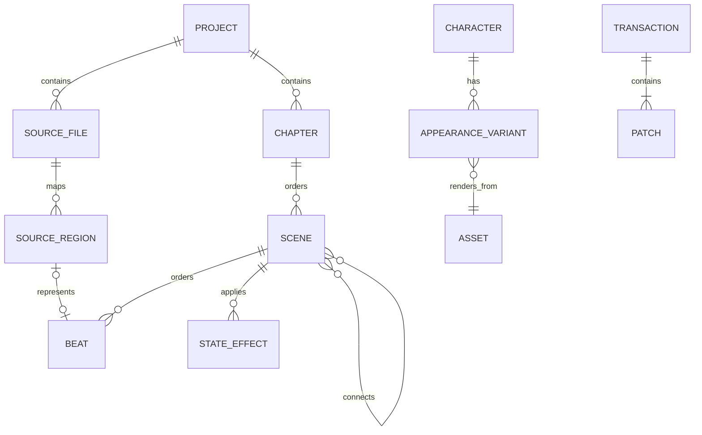

# Data model

## Authority and identity

The selected manual card/lore foundation has a concrete pre-editor
[reference-library v1 contract](REFERENCE_LIBRARY.md), with shared records,
revision selection, bounds and fixtures. It is not yet implemented or accepted.

Runnable truth lives in `.rpy` files. Editor metadata references source; it never
silently replaces it. Every supported visual object receives a stable editor UUID
mapped to a file revision/hash and source range. Human-authored Ren'Py identifiers
remain unchanged unless the user explicitly renames them through a reference-aware
transaction.

For Loomlight-created projects the authoring hierarchy is:

`Project → Chapter → Scene → Beat`

A Chapter is organisational. A Scene normally maps to one `.rpy` file and one primary
globally unique Ren'Py label; Branch edges connect scenes explicitly. Display names,
technical labels, filenames, and stable UUIDs are distinct identities so a cosmetic
rename does not create unnecessary source churn.

New technical names (Character variables, Appearance expression tokens and Variable
names) use lowercase ASCII letters, digits and underscores, start with a letter and
are at most 64 characters. Their inputs turn off OS capitalisation, correction and
spelling, and lowercase ASCII capitals and trim surrounding whitespace on blur and
submission. Ren'Py names suggested from asset filenames follow the same rule.
Display names, text values and imported filenames keep their case. Normalisation
never renames existing source symbols or imported assets.



## Source layer

| Entity | Essential fields |
| --- | --- |
| Source file | project-relative path, byte content/revision hash, encoding, parse status |
| Source region | stable ID, byte/line range, tokens/trivia, supported kind, parent region |
| Custom-code region | exact text/range, surrounding anchors, reason unsupported, warnings |
| Diagnostic | SDK/version, file/range, severity, code/category, raw excerpt, remediation |

The parser must retain comments, whitespace/trivia, statement order, identifiers,
embedded Python, screen language, ATL, translations, and unknown syntax. Source
ranges are invalidated and remapped after each accepted revision. Unsupported or
ambiguous source remains in place and must not be coerced into a visual beat model.

Compiled `.rpyc` files are generated derivatives rather than authoritative source. A
supported transaction that removes, moves, or renames an `.rpy` path must remove the
obsolete corresponding `.rpyc` at the old path so Ren'Py cannot continue executing an
orphaned compiled script.

## Project and narrative layer

| Entity | Essential fields |
| --- | --- |
| Project | ID, title, folder/path identity, resolution, pinned SDK, schema version, capabilities |
| Chapter | ID, display name, ordering, project-relative directory reference |
| Scene | ID, display name, technical label, source file/regions, ordered beats, partial-visual flag |
| Beat | ID, type, source mapping, payload, conditions/effects where supported |
| Edge | source/target Scene, kind, choice text, call/jump/return semantics |
| Asset | ID, project-relative path, media type, hash, usages, import provenance |
| Character | ID, technical variable, display name, dialogue colour, default appearance, definition range |
| Appearance variant | ID, character ID, attribute map, render mode, asset/render reference |
| Variable | ID/name, supported type/default, definition range, reads/writes, persistence/category |

Phase 1E implements the bounded visual Beat set: background/scene, show/hide Character,
change appearance, placement reference, dialogue, narration, arbitrary-list
unconditional Choice, Jump, Return/End, typed simple variable assignment, play/stop
music, play SFX, transition reference, and protected Custom Code. Supporting references
use stable Character, Appearance, Asset, Variable, and Scene UUIDs rather than
filenames. Later phases extend the same Beat/semantic model rather than replacing it.

A Choice owns ordered option bodies and can continue at the next Beat in its
containing body. A new option is empty; its source contains a sole verified `pass`
until a Beat replaces it. Jump and Return are explicit transfers inside an option.
Return returns to the caller, or to the main menu when there is no caller. A newly
created Scene still starts with Return. Structural commands refuse a new Scene
fallthrough, including when every guarded option can be unavailable.

The Choice payload contains option caption, optional condition and mapped option ID.
It has no destination field. A destination option has an ordinary Jump in its body.
The option ID is its header's Beat UUID; Choice identity is the menu header UUID.
Flat source-derived child Beats carry the existing group/branch owner. Option headers
reuse that branch mapping with `choiceOption: true`; they are not condition nodes.
`BodyRef::Branch` names an option body just as it names a condition branch. Headers,
children and shared following Beats have disjoint exact source ranges. No second
saved story document or action-list model exists.

Source-map schema 9 refines the earlier whole-menu mappings after verifying them
with their original recognizer. The menu header keeps its old ID and unknown fields;
provable existing physical records keep theirs. Opening and no-op editing never
rewrite `.rpy` bytes. Unprovable ownership refuses; unsupported option contents stay
protected Source. The reader and writer cap is 4,000,000 bytes, so the existing
500-Scene / 2,000-route fixture still fits after menus split into physical mappings.
Caption, guard, reorder and option-count edits carry each retained body's exact
bytes and mapped IDs. New options get new IDs. Then controls edit only the last
Jump/Return, or its absence for Continue. Source reconciliation refuses ambiguous
movement of children between duplicate-caption option headers.

Every recognized Beat mapping records a stable UUID, exact source revision, verified
byte range, exact range hash, and lexical context. The narrow mapper recognizes only
the supported canonical form. Unsupported/custom bytes stay in sequence as protected
regions; any operation that cannot prove source ownership or a safe boundary refuses.

## Characters and appearance

Character visuals are modeled as extensible appearance attributes, not as a filename
field on the Character. A typical future selection may be:

```text
outfit = university_uniform
pose = standing
expression = annoyed
```

Phase 1 exposes only `expression` in the normal UI; `outfit` and `pose` are implicit
`default` attributes. The schema must preserve an attribute map so later outfit, pose,
hairstyle, accessory, damage/state, or other dimensions can extend the model without a
migration from an expression-only architecture.

Phase 1 uses a static imported Asset as the render source. `render_mode` is designed to
admit later layered-image, animated, or other reviewed displayable strategies without
changing what a Scene beat references. Scene beats reference the appearance variant
(or an appearance selection), not a raw filename. Asset IDs remain stable if an asset
path is reorganised through a supported transaction.

Model-authored runnable Character create/update retains the author-visible raw
`displayName` and uses `source.literalDisplayName:true` in the existing extensible
SourceDefinition. This core-owned marker selects canonical literal encoding in the
statement: JSON string quoting plus doubled opening square/curly delimiters prevents
interpolation and text tags. Validation derives the exact statement from this marker,
name and colour. Ordinary subsequent Character updates preserve literal mode. Existing
unmarked manual definitions retain their prior canonical representation. Unknown
source/Character extensions, default Appearance and technical identifier survive.
The marker does not grant executable source authority to a response or renderer.

The Phase 1 Character surface exposes technical variable, display name, dialogue
colour, default appearance, and an `Appearances` list. Adding an appearance imports/
copies an image into the project and assigns an expression name; filename inference may
prefill the name but is never authoritative.

Appearance editing retains the Appearance, Asset and default-selection UUIDs.
`appearance.update` requires the expected expression and Asset SHA-256, with an
optional session-bound native selection authority for image replacement. A rename
patches only the expression token in recognized Show/Change Appearance statements,
retaining formatting, line endings, Beat IDs and other source bytes. Dirty, stale or
protected Scene mappings refuse the rename. Character/Variable technical identifiers
remain immutable; this operation does not introduce general identifier renaming.

Replacement images use a unique lowercase `game/images/ll_<uuid>.<extension>` path
and a verified explicit image declaration. Image, declaration, authoring metadata
and any affected Scene/source-map patches commit together. Original selected files
and previously imported project files remain intact, preserving custom references;
there is no automatic obsolete-file deletion. Old image names/declarations remain
available as aliases. Asset metadata may retain `appearanceAliases`, mapping a former
image discovery name to its exact Loomlight-generated declaration. Renaming back may
reuse that declaration for the same Asset only when its canonical literal form and
single exact source owner still match. An externally changed declaration, duplicate
owner or another Asset with that name refuses; unknown historical declarations are
not silently adopted. This metadata records ownership for a transactional edit;
`.rpy` remains authoritative for runnable content. Previously selected images and
unsupported/custom source references remain intact.

Phase 1D persists these identities in `.renpy-editor/authoring.json` schema version 1.
Each Character stores a UUID, immutable creation-time lowercase technical identifier,
display name, `#rrggbb` dialogue colour, optional default Appearance UUID, and exact
source statement/revision mapping. Runnable source is conventional:

```renpy
define alice = Character("Alice", color="#aabbcc")
```

The full document is schema-, size-, relationship-, identifier-, path-, discovery-,
hash-, and source-map-validated before every accepted write. Unknown fields survive
round trips but cannot supply executable source. Missing `authoring.json` is initialized
only for the exact pristine Phase 1C scaffold; once authoring evidence exists, loss of
the file is a non-destructive metadata error rather than permission to reset UUIDs.

Each Appearance stores UUID, Character UUID, label, extensible string attributes,
`staticImportedAsset` render mode, and Asset UUID. Phase 1D records explicit
`expression` with implicit `outfit = default` and `pose = default`. The first imported
Appearance becomes default. Raw filenames are never entity identity.

## Assets

Phase 1 imports assets by copying them into the project so a Loomlight-created project
is portable and self-contained. Assets use project-relative paths and stable IDs;
external absolute references are not a Phase 1 authoring feature. Loomlight's Assets
surface is independent of the physical directory name and follows conventional Ren'Py
locations: visual image assets under `game/images/`, audio under `game/audio/`, and
standard GUI resources under `game/gui/`. Duplicate/missing checks are required, while
advanced tagging, conversion, optimisation, search, and bulk management remain later
work.

A future supported organizational layout may be (this is not the Phase 1D import
layout):

```text
game/images/characters/alice/alice neutral.png
game/images/characters/alice/alice happy.png
game/images/characters/alice/alice annoyed.png
```

The path is organisation, not identity. Exact import naming/collision rules must be
reviewed against Ren'Py automatic image/audio discovery so the resulting names are
predictable and unambiguous.

Phase 1D Asset metadata stores UUID, kind (`background`, `characterAppearance`,
`music`, `sfx`), display name, project-relative path, normalized discovery name,
SHA-256, byte count, and availability. Supported images are PNG/JPEG/WebP; supported
audio is OGG/MP3/WAV/FLAC. SVG and other active/complex formats are excluded.

Imports use flat deterministic names because subdirectories do not create independent
Ren'Py namespaces. Character images use `<character> <expression>.<ext>` and discover
as `<character> <expression>`; backgrounds use `bg <name>.<ext>` and discover as
`bg <name>`. Audio shares one automatic namespace but deliberately separates kinds as
`music_<name>` and `sfx_<name>`. Case-folded paths, discovery names across extensions,
subdirectories, image `@` oversampling suffixes, and hashes produce distinct typed
collision/duplicate diagnostics. The pinned 8.5.3 scanner automatically discovers
FLAC alongside WAV/MP2/MP3/OGG/Opus; Loomlight's import subset remains
WAV/MP3/OGG/FLAC.

### UI-image role

L06 adds `uiImage` to the Asset kind enum without changing
existing IDs or the authoring metadata schema version. Its imports use
`game/images/ui <name>.<extension>` and the automatic discovery name `ui <name>`.
PNG/JPEG and static WebP keep the passive presentation bounds of 16 MiB and
8192 pixels per natural dimension. UI-image import, file creation and metadata
are one bounded shared-history transaction. Natural dimensions are stored as
`naturalWidth` and `naturalHeight` metadata. Legacy import paths retain their
separate streaming behavior.

Owned screen insertion and image changes take a stable Asset UUID plus its
expected SHA-256. Core resolves the contained literal source path and refuses
missing, changed or invalid references with `UI_IMAGE_MISSING`, `UI_IMAGE_CHANGED`
or `INVALID_UI_IMAGE`. The source stores `add "images/..."` with pixel `xsize`
and `ysize`; changing the asset, dimensions, parent and supported numeric layout
is one minimal transaction. `asset.reviewUiImage` reads the current contained bytes
without changing metadata. Apply can include the reviewed `replacementSha256`;
its new hash, byte count and natural dimensions share that source transaction.
Undo restores both the prior reference metadata and source. External image bytes
remain external. Unchanged source plus accepted replacement metadata still counts
as a changed transaction; `screens.compose.changed` reports that distinction.
Typed `imageSamples` and `imageAddition` canvas inputs verify the same Asset
handle/hash without writes. Passive previews and the image-only desktop picker
execute no project expressions. Browser image decoding completes before import or
Apply. Width/height drafts use whole pixels; aspect preservation derives from the
natural ratio and rounds the derived dimension to the nearest whole pixel.
Comments, neighboring source, node identity and no-op history remain protected.
The image byte-limit diagnostic is `UI_IMAGE_TOO_LARGE` and names the 16 MiB bound.
Passive previews share a 32 MiB cache budget. The mounted selected thumbnail and
staged import retain their preview priority; picker previews remain evictable.
Late picker responses cannot clear the selected thumbnail or revive a disposed
workspace. Selection changes release the previous mounted preview's priority.

[Ticket #40](https://github.com/Caldwell-41/Renpy-editor/issues/40) owns delivery and
acceptance. [UI-image evidence](tasks/evidence/ui-image.md) distinguishes service
checks, approved design, controller proof and SDK/native qualification.

### Project font role and text properties

L05 adds the `font` Asset role. Typed TTF and CFF OTF imports use
`game/fonts/<technical-name>.<extension>`, a separate font discovery namespace,
and a 16 MiB byte bound. Font admission parses sfnt tables and requires a usable
character map and glyph outlines. Collections and webfonts are outside this subset.
Font file creation and metadata share one history transaction.

`asset.chooseFont` returns a native selection authority. `asset.previewFont` reads
that authority without consuming it; `asset.presentFont` takes an Asset UUID and
expected SHA-256. Both return bounded bytes for passive FontFace decoding. No
renderer-supplied path or CSS URL enters this protocol. Core rechecks contained
bytes and reports `FONT_MISSING`, `FONT_CHANGED`, `INVALID_FONT` or
`FONT_TOO_LARGE` without discarding the authoring draft.

`screens.compose` command `formatText` accepts optional typed content, font handle,
size, color, alignment, bold and italic, plus supported numeric layout. Omission
keeps a property; null restores its inherited default. Size is a whole pixel from
1 through 512; colors use #RGB, #RGBA, #RRGGBB or #RRGGBBAA; alignment is finite
from 0 through 1. Textbutton source uses the corresponding `text_` properties.
Core patches exact literal tokens or inserts/removes the smallest property range.
Unresolved expressions stay visible and read-only while supported siblings remain
editable. An unchanged explicit font is revalidated before any typography write.
Typography and layout share one history entry; no-op, source revisions, comments
and neighboring custom source retain the existing protections. Canvas `textStyles`
uses the same typed values and changes no project source.

New or changed text literals are limited to 8,192 UTF-8 bytes. Existing-text and
addition controls check that byte bound on field completion and submission, retain
invalid input and focus the affected field. An unchanged source literal above the
bound does not block typography-only edits, because its text is not submitted.

[Ticket #39](https://github.com/Caldwell-41/Renpy-editor/issues/39) owns acceptance.
[Project font evidence](tasks/evidence/project-fonts.md) records the tested limits.

## Shared screen styles

`screens.list.styles` indexes supported ordinary `style name is text`, `frame`,
`window` or `button` definitions and explicit screen-element references. A button
style names both its `style` and `text_style`; a text-only button style can retain
its existing `text_style` reference. Built-in style names, ambiguous definitions,
unsupported inheritance, untracked style expressions and dynamic references remain
in Source. The index uses the existing bounded source inventory and lexical parser.

`formatText.style` contains `scope` (`shared`, `local` or `create`), `name` and
`expectedRevision`. The revision binds all captured `.rpy` bytes and source-map
ownership. Shared Apply patches the definition and optional selected reference;
local Apply copies the definition with effective appearance values and changes only
its selected use. A text-only style on a button owns only applicable text properties;
normal and state background/border properties stay on the selected element. Assigning
a text-only style preserves that decoration and removes a superseded button-style
reference. Shared text edits and local decoration edits still share one transaction.
Creating or changing a reference and accepting local text/layout
share one transaction/history entry. Unchanged commands add none. The core refuses
a changed definition/use inventory, dirty source, incompatible style or affected
property overridden at a use. All failures retain the inspector draft.

Element re-lookups after a Style patch remain inside the captured owning screen;
matching marker text in an unowned screen grants no write authority. A local copy
starts from the chosen definition and overlays only source-local properties and
explicit draft edits, rather than inherited values from a previous definition.
Unrelated unsupported UI files do not block ordinary composition refresh.

The bounded Style index reports its analysis limit without rejecting ordinary
owned-screen operations. Archives and orphan bytecode make shared review
unavailable and participate in its revision. The shared bounded inclusion graph
accounts for resolved owned components and projects their Style uses into affected
parent screens. Unmarked, dynamic, unresolved, cyclic or over-limit inclusions
refuse shared edits because their affected screens cannot be fully accounted for.
These refusals retain drafts and explain the missing shared-review capability.
Read-only inspection and canvas planning accept contained game `.rpy` paths for
indexed affected-use previews; owned mutations retain their stricter path rules.

`formatText.values.appearance` extends the existing property owner with background
colors, borders and supported state overrides. A border is `{color, width}` with a
hex color and whole width 1 through 32. Source stores it as a recognized `foreground`
Frame/Composite expression with fixed-size Solids and a two-pixel transparent centre.
Normal properties have no prefix. Button overrides use `hover_`, `selected_` and
`insensitive_`; the UI calls the latter Disabled. State controls expose text color,
background and border. Other state properties remain in Source. Text content and
numeric layout are always local. Typed font handles and unchanged-font validation
continue through the existing font owner.

The inspector keeps one draft owner and one affected-use dialog. It binds reviewed
values and use revisions, preserves section/scroll/focus/selection across review,
and displays the source-derived element/screen counts. The same draft records which
appearance fields the user edited, so changing a pending Style replaces untouched
defaults without turning the previous Style's values into shared edits. Local button
decoration stays outside text-only shared previews. Source reconciliation,
Undo/Redo and reopen reconstruct definitions and references from authoritative bytes.
[Ticket #43](https://github.com/Caldwell-41/Renpy-editor/issues/43) owns acceptance;
[shared-look evidence](tasks/evidence/shared-look.md) owns candidate-specific proof.

## Variables and state

Visual variables support `bool`, `int`, `decimal` and `string` definitions and literal
assignment. Variable creation and default edits commit source plus authoring metadata
in one entry through the existing shared session history. Semantic no-ops and refused
edits add no entry. Undo/Redo restores both files and their actual revisions; project
reopen retains accepted values and starts a new empty history. Existing types stay fixed after creation. Decimal defaults and values use
finite binary64 JSON numbers, with the exact JSON string `"-0.0"` for negative
zero. This applies to defaults, literal assignments, inspected arithmetic results
and canvas samples. Core also accepts a signed numeric zero and returns the string
form; other decimal strings are refused. Positive zero remains a JSON number.
Condition decimal atoms and arithmetic operands remain source strings. Integer
values retain exact signed i64 strings. Story
also supports bounded numeric formulas. Set variable keeps
`variableId` and `value`; arithmetic uses `{operation, operand}` in `value`.
Operations are `assign`, `add`, `subtract`, `multiply`, `divide`, `floorDivide` and
`remainder`. The operand is source text containing numeric literals, declared numeric
variables, signs, parentheses and `+`, `-`, `*`, `/`, `//`, `%` with Python precedence.
Ordinary division always infers decimal; floor/remainder keep integer type only with
integer operands. Integer targets refuse decimal results. For a decimal target,
commands emit an integer-result assignment as `(<formula>) + 0.0`, so Ren'Py stores
a float too. This source expression uses the same bounded parser. Bool/string literal
assignments retain their existing contract. Functions, powers, attribute/index access and Python execution
remain unsupported.

`scene.validateAssignment` accepts the same revision-bound Set variable formula
command as `scene.apply` and checks the same admission without committing source or
history. Its typed response reports target/input, supported/refused state, inferred
result type, reads/writes, field diagnostics, unknown reasons, variable choices with
definition revisions, numeric capabilities and project/map/authoring/Scene revisions.
`capabilities.decimalTransport` is `"finiteFloat64OrNegativeZero"`.
Draft values are constant-folded only; variable-dependent current state remains
explicitly unobserved. The [#94 evidence](tasks/evidence/arithmetic-94.md) records exact
transport fixtures. No renderer parser is required.

`scene.list` exposes the authoring revision and declared variable choices.
Arithmetic mutations require `expectedAuthoringRevision` plus the existing project,
source-map, Scene source and explicit-body assertions. Pending Scene or variable
Source drafts refuse; stale dependencies cannot authorize a write. Assignment
inspection reports the core-inferred result type, read IDs with names/types, target
write IDs, field diagnostics and a known value or explicit unknown reason. It uses
preceding supported local assignments only. Defaults never establish current Story
state. Unsupported control flow, nested ownership and Custom Code invalidate that
knowledge. Zero divisors and out-of-range literals, intermediate values or results
have explicit diagnostics. Negative floor/remainder match Python, including a zero
remainder for i64 minimum modulo -1. The renderer consumes core results.

Compound and general supported explicit assignments inspect/edit through the same
Story owner, including supported nested bodies. Existing self Add/Subtract literal
payloads retain their representation. Semantic no-ops preserve bytes/history;
qualified edits replace only operand/expression and necessary operator tokens,
retaining source style, spacing, comments and IDs. Source-map schema 8 is unchanged.
An exact-byte/range match permits an old Custom Code formula mapping to retain its
ID without rewriting metadata on open. Existing schema migration can refine it.
Invalid formulas remain protected and expose assignment diagnostics. The
[#94 contract and fixtures](tasks/evidence/arithmetic-94.md) own current shapes,
qualification and target limits; [#93 evidence](tasks/evidence/arithmetic-93.md)
retains integer-formula qualification and [#92 evidence](tasks/evidence/arithmetic-92.md)
retains the preceding simple-adjustment and both-target proof.

Screens Set variable actions use the same `{operation, operand}` value and shared
core admission. `screens.compose` keeps the existing `actions` command and
`expectedAuthoringRevision` / target-review assertions. Optional `validateOnly:true`
accepts that command and complete `addImageButton` creation drafts. Other command
variants remain refused. It runs the same preparation, including appearances, layout,
actions, asset replacement metadata and original dependency reviews, without committing
source, metadata or history. The response keeps the current `document`, `changed:false` and empty
`documents`; `actionValidation` contains the proposed inspection with a candidate
revision. A new imagebutton also has a temporary proposed node ID. Neither that ID
nor the candidate revision authorizes a later write or selects an accepted node.
Apply revalidates the complete original creation command and commits it once. Ordinary commits
omit `actionValidation`. Invalid input uses the existing field-specific arithmetic
transport errors. A Screens arithmetic refusal also carries an optional zero-based
`error.actionIndex` identifying the failing action in the submitted ordered list.
Its code and message stay unchanged. Inspection of another row must not assign that
error to the inspected field; Apply reveals and focuses the identified row.
Dirty/stale dependencies remain ordinary refusals.

`screens.inspect` and returned composition documents expose `actionVariables`
(full typed definitions with IDs and revisions) and `actionCapabilities` (the shared
numeric grammar/limits). Button `actionAssignments` aligns with the ordered action
list; formulas carry shared inferred types, read/write IDs, readable operands and
explicit unknown diagnostics. Other actions have null entries. Defaults do not
establish current click-time operands. `actionProtectionReason` explains protected
actions. Screen effects add `readVariables` and retain conservative possible writes,
including formula-definition revisions in dependencies.

A numeric action is generated as `Function(<owned helper>.assign, target, type,
operation, operand, lambda: <checked typed expression>)`. The lambda reads store
operands only when that action runs. The fixed versioned helper declaration is
appended once to its screen's source, in the same transaction and history entry;
its name derives from the stable screen UUID. One shared core parser/type checker
and tree-to-source adapter own both button kinds. Runtime uses generated Python
operators and checks each node for numeric type, signed i64 bounds and finite
results. Decimal targets promote the final value to float. Errors raise explicitly;
the helper returns None on success so later actions and Finish retain their order.
Inspection recognizes only the exact generated call and helper template. Imported
expression-valued `SetVariable` calls retain captured screen-evaluation timing and
stay protected rather than being converted. The inert canvas recognizes the exact
owned helper declaration as data-only initialization; it never loads or runs it.
[The #95 evidence](tasks/evidence/arithmetic-95.md) owns exact payloads, runtime
qualification and remaining target limits.

Phase 1D Variables store UUID, immutable lowercase technical name, supported type,
typed default value, and exact source mapping. Source uses ordinary mutable state:

```renpy
default door_open = False
default score = -2
default greeting = "Hello"
```

Strings remain data rather than expression text and escape quotes, backslashes,
Unicode, newlines, and controls deterministically. Character and Variable names share
one symbol table and reject Python keywords, underscore-reserved names, known
Ren'Py/Loomlight names, and statically visible top-level `define`/`default` collisions
in both canonical definition files.

Planned Phase 2 Character cards are editor-only records with stable IDs, optional
links to runnable Characters, descriptive/personality/voice/background/relationship
fields, provenance, applicability, approval state and revision. They may be manually
authored or LLM-proposed; approving a card does not modify the runnable definition.
The lorebook groups editable entries with titles/categories/tags and references.
Approved current cards/entries are included only through the reviewed context manifest.
Changes invalidate affected prepared sends/proposals; unresolved links are retained.
Planned storage is versioned `.renpy-editor/references.json`, one record/revision
service with separate card/lore collections. Scope is project-wide, selected Scenes or
an explicit finite route, with written knowledge/spoiler notes. Approved text remains
while a replacement is reviewed unless its own citations are stale; rejection preserves
it. Exact field/bound/migration fixtures precede the 2B.1 editor. Project prompt overrides/
style notes live in `.renpy-editor/ai.json`, with full text and baseline version/digest.
Machine-local `ai-profiles.json` owns endpoints, model defaults and project bindings;
keys use the OS store or explicit backend-memory-only session mode. See
[ADR 0011](adr/0011-ai-settings-secrets-and-reference-storage.md) and the
[Phase 2 brief](tasks/active/phase-2-initial-llm-assistance.md).

The implemented Studio slice uses strict device records with a store revision, up to
32 profiles and 128 owned cleanup references, bounded to 128 KiB. Profiles retain opaque
UUIDs, monotonic revisions, label/canonical endpoint/exact model, private-HTTP opt-in,
unverified capacity/token defaults, disabled state and optional credential ID/origin/
revision/service. Missing service remains legacy `app.loomlight.desktop.ai.v1`, omitted
on serialization; explicit `app.loomlight` retains its owned native namespace. Unknown
services are rejected. Service values never choose a backend or form a file path.

Optional profile `thinking` is a boolean; absent means on and remains omitted until
explicit Save. New profiles use context32768 and maximum response16384; existing
saved response limits remain unchanged. The effective mode maps to `enable_thinking`
for synthetic response-format tests and all assistance actions. Preflight digest
generation2 expires earlier off-only evidence and saved-mode changes expire prepared
requests. Native-only connection drafts are in-memory state, not project/profile
records: opaque ID/revision, bound origin/token, zeroizing key and bounded discovered
model IDs. Connect writes nothing. Completed Save publishes settings and the verified
owned key reference together through the existing staged cleanup protocol.

Missing credential `storage` means native and remains omitted: old schema-v1 records
preserve their serialized form/digest, including cleanup. Explicit temporary Mac file
storage uses `{kind:"developmentFile",generationId:<UUID-v4>}` on active and cleanup
references. First file staging upgrades to schema 2, with `developmentGenerations`
(maximum 64 unique UUID-v4 values, including abandoned/recovery stages) and optional
`activeDevelopmentGeneration`. Every file reference and active selection must be owned
in that list. Ownership precedes filesystem creation; active selection is published
with the verified credential switch. No independent pointer or automatic migration.
Older apps must refuse v2/unknown fields without resetting data; no downgrade support.
Newer/malformed/over-limit data remains unchanged and newer schemas have an explicit
incompatibility message. Windows keeps native routing and v1 serialization; this shared
schema support does not alone qualify Windows native credentials. The Windows adapter
stores generic OS credentials at `<service>/provider/<profile UUID>/<credential UUID>`
with local-machine persistence. UserName is fixed `app.loomlight.desktop/Studio/v1`;
Comment is `Loomlight Studio v1:` plus SHA-256 of the UTF-8 JSON array `[profileId,ownedCredential]`
using canonical shared serialization, binding origin, revision, service and storage.
New Windows entries retain the legacy service; both fixed services remain addressable.
Occupied targets are not overwritten; mismatched ownership/type/persistence refuses
read/delete. The blob holds 1–2560 printable non-space ASCII bytes. Larger shared-valid
keys fail explicitly with retained native input; shared 4096-byte validation is unchanged.
No blob/read-secret IPC. Mac file references and generation/cleanup ownership stay
unchanged; replacement does not migrate/delete them and can report cleanup pending.

Temporary files under `credentials-dev/generations/<generation>/` use owner-only
0700 directories and 0600 files. `master.key` is 38 bytes: `LLKEY`, version byte 1 and
32 random unencrypted key bytes. `records/<credential>.sealed` is `LLREC`, version byte
1, a fresh 24-byte nonce, 1–4096 encrypted bytes and a 16-byte authentication tag
(47–4142 bytes total). Associated data is the unambiguous JSON array
`[1,generationId,profileId,credentialId,credentialRevision,canonicalOrigin]`.
Unknown versions, malformed sizes, links/non-regular entries and unsafe ownership/modes
are refused. Auth failure never supplies partial plaintext. Only explicit save/recovery
creates a generation; a missing key for an existing generation is never regenerated.
Save flushes a new key before dependent records, verifies decryption before switching,
and retains unreadable recovery generations rather than sweeping or promising erasure.

No API-key value is a profile/project record or renderer payload. Native/deferred cleanup
retains the original namespace and ownership after replacement or profile removal;
healthy retired file records can be deleted only after unpublishing, while unreadable
records remain owned. A full-record digest binds mutations to their saved snapshot.
Native discovery evidence stays in memory and is invalidated by configuration/credential
changes or restart. Project bindings, session/generic modes and reference/prompt schemas
remain planned. Coherent device backup/restore requires profiles, generation metadata,
master keys and ciphertext; possession of those files permits decryption. App replacement
is intended to retain compatible user data, while app-data deletion/cleaners, lost disks
and clean OS installation do not preserve credentials automatically.

Phase 2 lore has subject/category/text, entity links, explicit applicability,
citations/provenance and `proposed`, `approved`, `superseded` or `rejected` revisions.
Contradictory alternatives remain visible without automatic selection. Structured
story-stage/game-day/time validity, computed knowledge and external import/export are
later work, not Phase 2 storage requirements.

Future state snapshots record provenance and whether they are reachable, saved-route,
or manual/synthetic. They contain variable values, prior decisions, day/time, known
facts, and source revisions. Contradictions are displayed rather than normalized away.
Initial variable categories may include relationship, story flag, route state,
day/time, inventory, preference, and persistent unlock.

## Extensible staging and media references

Phase 1 does not create disposable special cases for basic VN staging:

- character placement references a transform/placement definition; the initial UI
  exposes Left, Centre, and Right presets;
- visual changes may reference transitions; the initial selector exposes a very small
  set such as None, Dissolve, and Fade;
- audio beats use typed action/channel/asset references sufficient for play/stop music
  and play SFX while leaving room for custom channels, ambience, voice, volume/pan,
  fades, and Timeline synchronization.

The UI subset may be narrow; the stored semantic model must remain extensible.

Planned 3C extension: static placement stores source-backed position/anchor/scale,
independent of editor viewport zoom. Animated Appearances reuse stable Asset IDs for
qualified native video or explicit ordered image-frame/duration references, with typed
loop/end behavior and supplied-mask dependencies. Logical dimensions exclude any
side-mask portion. Container/codec/timing metadata must be verified and versioned; the
existing Phase 1 allowlist is not silently expanded. Preserve accepted media bytes;
there is no conversion or extracted-frame cache as a new source of truth. Dependencies
share existing import/history/recovery and source mapping. The
[3C media contract](tasks/reference/phase-3c-timeline.md#selected-staging-native-media-and-idle-playback)
owns format qualification and acceptance; this describes a future schema, not current
implemented metadata or browser decoder support.

## Transaction model

Every manual, visual, source, and later LLM edit becomes a transaction:

| Field | Purpose |
| --- | --- |
| ID and origin | Audit and undo grouping (`visual`, `source`, `LLM`, `external`) |
| Base revisions | Detect stale or conflicting writes |
| Semantic operations | Explain intent and support future partial acceptance |
| Exact patches | Apply minimal byte/range changes and show file diffs |
| Validation result | Parser and optional SDK diagnostics before acceptance |
| Recovery state | Journal status, commit outcome, undo/redo relationship |

Short-lived edit buffers may group a natural typing burst into one transaction; they
are not a second authoritative document. Accepted transactions persist automatically
through the same source/file coordinator used by explicit `Ctrl/Cmd+S` flush.
Persistence state is surfaced to the user as Saved/Saving/Pending validation/Conflict/
Recovery required. External revisions stop stale undo/redo and writes rather than being
silently overwritten.

Phase 1B makes the transaction envelope a non-empty vector of project-relative
mutations. Each replacement carries exact expected bytes, SHA-256, platform file
identity, an extensible mutation kind, and proposed bytes. Alternating checksummed
journal slots record per-mutation staged/commit/exchange/verification progress.
Journal version 2 stores only relative evidence names; stage, accepted, and displaced
bytes remain separate artifacts inside the anchored transaction recovery directory.
`prepared` is safely abandonable only when evidence absence is proved, while a pre-
mutation `rejected` record is terminal and does not poison later flush. Phase 1E adds
source create/move/delete and minimal Beat patches to this envelope. Committed history
stores the actual returned before/after revisions; an inverse is submitted only when
the live revisions match the recorded boundary. After an accepted inverse or redo,
new replacement identities propagate only to the nearest entry touching each path
across a matching full revision and exact-byte transition. This keeps consecutive
history coherent without crossing an external replacement, including identical-content
replacements. Interleaved paths, compound changes and branches share this same stack. Phase 1F adds bounded session-local
Source buffers: accepted base bytes/revision, optional UTF-8 draft, editor selection,
and retained external bytes for conflict. Drafts are not authoritative and do not
survive restart. Accepted source and any reconciled source-map companion share one
transaction/history action; multi-draft Save All is one mutation vector after complete
preflight. History remains session-local and starts empty after reopen. See
[TRANSACTIONS.md](TRANSACTIONS.md).

## Project lifecycle metadata

`.renpy-editor/` uses explicit schema versions and project-relative forward-slash
paths. Phase 1 metadata includes enough project identity, SDK/resolution configuration,
source mappings/stable IDs, recovery state, and workspace convenience state to close
and reopen the project safely. Last-open Scene/beat (if still valid), active centre
tab, panel collapse/split state, and preview zoom may be stored as editor convenience
without becoming game truth.

Migrations are deterministic, previewable, reversible when practical, and backed up
transactionally. Unknown fields are preserved. Metadata corruption cannot trigger
rewriting of authoritative `.rpy` source. Deleting `.renpy-editor/` must not stop the
game from running, but Phase 1 does not reconstruct missing metadata as a substitute
for the deferred arbitrary-project importer.

Phase 1C introduced schema version 1 for `project.json` and `source-map.json` with one
Chapter and one Scene. Phase 1E transactionally migrates valid projects to version 2,
preserving project/Chapter/Scene UUIDs and unknown fields. Version 2 stores ordered
Chapters, ordered Scenes with exactly one Chapter owner, globally unique primary
technical labels, unique safe relative source paths, explicit entry Scene, and
last-open Chapter/Scene selection. Reopen validates every relationship and source
mapping. Move/delete selects the nearest deterministic surviving Scene; at least one
Chapter and one Scene remain, and the entry Scene cannot be deleted. Display rename
changes neither labels, source paths, nor UUIDs.

Source-map v3 adds optional `conditionalBranch` and child `owner` fields to those
disjoint ordered ranges. A protected header Beat identifies a branch and carries a
separate group UUID, bool Variable UUID and `otherwise` flag. A direct dialogue child
addresses its group/branch UUIDs; the enclosing Scene revision and exact range/hash
remain write authority. Migration from v2 reuses every exact-byte Beat UUID, including
previously opaque children, and preserves unknown fields without writing `.rpy`.
Project remains v2; authoring remains v1. [ADR 0012](adr/0012-bounded-nested-dialogue-ownership.md)
records the qualified bounded foundation. Phase 3A extends that historical boundary
with source-map v4 under [ADR 0014](adr/0014-typed-conditions-and-recursive-source-ownership.md).
Branch headers now carry an ordinal and a typed supported condition or explicit unknown
diagnostic; the legacy simple-bool Variable UUID is optional. Headers and ordinary
children can identify an immediate containing branch, enabling recursive ownership
without overlapping source ranges. Old-map validation precedes richer recognition;
unchanged range/hash UUIDs and extras survive metadata-only migration. Exact source
verification remains mandatory, and newer schemas are refused.

The condition model supports bool/int/decimal/string values, numeric ordering and
equality across integer/decimal operands, same-type bool/string equality, and bounded
boolean combinations. Mixed comparisons retain exact integer precision; they do not
round the integer to binary64 before comparison. Integers remain canonical signed
64-bit decimal strings across JSON. Unknown/missing/type-invalid expressions remain
unknown, never false or evidence of unreachable branches. The core projection does
not execute Python or infer a route from default values. The first local slice supplied
the model; later Story controls use the same authority and pass scoped CI4 qualification.

The subsequent 3A.2 candidate advances source maps to v5 for supported Call statements
and guarded menus; [ADR 0015](adr/0015-guarded-choices-and-stable-call-continuations.md)
owns its reviewed contract and early both-target qualification. Older maps use their version's recognizer before
refinement. Exact tiled menu merges retain the header identity and preserve removed
records in non-authoritative `refinedChildMappings` extras. Every old record must be
accounted for; split ranges, reserved-key collisions and output exceeding the unchanged
1,000,000-byte reader cap refused without writes at that checkpoint. Schema 9 above
extends the bounded reader for disjoint option mappings. Source bytes are not migrated.

`Call` carries a target Scene UUID and stable `returnLabel`; insertion generates the
label, and target edits preserve it. Choice options may carry the shared `Condition`.
An all-guarded menu can continue when no option is available, so authoring cannot
assume every Choice is terminal. Early renderer support presents Calls and guarded
Choices read-only with revision-bound Source navigation. The narrow reviewed renderer
now provides Call and supported guarded Choice editors alongside full typed condition,
branch and subtree controls. CI4 qualifies the selected full frontend/core and SDK
save/edit/load-return behavior; Phase3A acceptance remains pending.

Structural commands use explicit root/branch bodies, immediate sibling Beat/condition
anchors and captured ownership/revisions under [ADR 0016](adr/0016-explicit-body-story-authoring.md).
SceneBeat may derive `structuralPlaceholder: true` for a sole exact branch pass. This
flag is not stored in source-map metadata, does not authorize a patch, and does not make
Custom Code generally editable. Empty-body replacement and all structural mutations
re-prove source ownership. Schema remains v5; IDs/extras are retained through qualified
moves and reindentation, with ambiguous or unsupported promotion refused.

Source-map v6 adds `ownedScreens` for explicitly created custom screens. Each entry
stores distinct screen/root UUIDs, its source name, `game/ui/<name>.rpy` path and
preserved extension fields. Migration from older supported maps preserves Scene
mappings, UUIDs, extras and all `.rpy` bytes. Existing screens are never adopted or
relocated on open. Newer unsupported schemas refuse before writing.

Blank creation writes `# loomlight-screen: <screen UUID>` followed by the ordinary
parameterless screen declaration and `pass`. One shared transaction creates the
file and adds its source-map entry; one shared Undo/Redo reverses/restores both.
Creation checks static screen names throughout `game`, case-insensitive file/name
collisions, the captured project/map/inventory revisions and dirty Source buffers,
including a destination deleted externally while its draft remains open. Public
portable names exclude Ren'Py double-underscore private names, its internal `_m1_`
namespace and Windows device names.
An empty directory may remain after a rejected file transaction; source and metadata
remain unchanged. Metadata size and relationship validation precede acceptance.
Creation reserves inventory capacity for the new file and any missing parent
directory before writing, including the aggregate script-byte limit. Its returned
catalog is prepared from the captured inventory and proposed map before commit;
a later inventory read failure cannot turn a committed creation into a refusal.
The static-name scan skips recognized Python block bodies while retaining Ren'Py
declarations nested in `init` blocks.

Owned root resolution requires the original path/name, one adjacent matching marker,
one supported declaration and an unambiguous static namespace. Source body edits and
offset shifts retain the UUIDs. Rename, deletion, missing/duplicated markers,
ambiguous declarations or malformed source produce an explicit unresolved reference.
The catalog supplies the resolved file revision. The UI requires that same revision
and declaration in its separately inspected document, retaining an unresolved UUID
when source changes between reads instead of falling back to another declaration.
Restoring the original declaration/marker resolves the reference without rewriting
source. Explicit screen rename/delete commands remain separate work.

Ordinary elements created through `screens.compose` carry a canonical UUID in an
inline `# loomlight-element: <UUID>` comment on their qualified statement header.
The marker belongs to the source and survives literal edits, sibling moves,
transactional Undo/Redo and reopen. It is active only inside an explicitly owned,
resolved screen. Unmarked Source-authored elements are not adopted on inspection;
duplicate element UUIDs lose structural-edit authority rather than retargeting an edit.
This element-marker contract began in source-map v6.

Source-map v7 extends each owned screen with `kind` (`panel` or `component`);
an omitted kind reads as panel. Parameterless components use the same owned-screen
registry, source markers and path rules. `componentUses` binds each use-node UUID
to its containing owner UUID and component UUID. Only exact marked `use name`
statements qualify. Parameters, expressions and transclusion stay opaque. Resolution
requires the recorded IDs, original source name and qualified owner markers;
renaming or deleting source never retargets a use by name.
Panel self-Hide and focus qualifications are local to that Panel. Extraction refuses
a subtree containing those contextual statements; ordinary edits and reorders inside
the original Panel remain qualified. Keep Close outside reusable content groups.

Transient `ScreenRevisions` capture source, source-map, inventory and effect hashes.
Component writes require that capture, a complete bounded inclusion graph and clean
Source buffers for transitive users. Composition and geometry share this admission
owner. Style indexing uses the same graph rather than maintaining a second graph.
Effect summaries hash relevant dependencies and report unknown for unsupported or
custom behavior. A known inclusion alone does not make an unknown child passive.
Except for the direct known-variable binding below, text interpolation and
unqualified text tags keep effects unknown without changing or filtering source.

Source-map v8 adds an explicit `dialog` owned-screen kind and reserves `callScreen`
Beat mappings with the same stable `screenTarget` binding. Earlier maps retain
their recognition rules and migrate through the existing transaction owner without
rewriting scripts. Dialogs and Call mappings are invalid in pre-v8 metadata.
Exact local `Return()` actions and game-menu dismissal qualify only for an owned
dialog, with `modal True`; panel Hide qualification remains unchanged. Effect
summaries expose `finishesInteraction` separately from `hiddenScreens`, bind action
and source dependencies into their revisions, and retain unknown effects for
unsupported actions or captured return values. Component extraction refuses a
subtree containing contextual dismissal statements from either screen kind.
The resolved target exposes `blocking`, derived once from a single exact root
`modal True` declaration. Missing, false, calculated or duplicate modality makes
an owned dialog nonblocking and its effects unknown. Authored Call admission uses
this captured result rather than reparsing source in Story. Exact standalone
`action Null()` is inert and remains editable and extractable for every owned
screen kind. It is separate from the contextual modality, focus, Return and Hide
spans that cannot move into a reusable component.

L11 extends the existing composition transaction with `actions` and `variableText`.
An action list has at most eight typed entries. Assignments refer to existing
variable IDs and compatible bool/int/string literals; frontend integers use canonical
decimal strings to preserve signed 64-bit precision. Show/Hide refer to qualified
owned nonmodal Panels. Finish is available only for a blocking Dialog and must be
last. Resolved targets expose `canShowHide` from the same Panel qualifier used by
the action writer. Panel kind and `blocking: false` alone do not establish this
capability; unknown effects do not necessarily remove it. This describes accepted
source eligibility, and writes still revalidate revisions and clean dependencies.
Custom actions remain in Source. The draft captures the authoring metadata
and verified variable-source revision, plus every distinct target's screen revisions.
Missing references, incompatible values and changed/dirty dependencies refuse the
write. Semantic no-ops preserve existing source trivia and create no history entry.

The existing `formatText` transaction also accepts optional `interaction` containing
`expectedAuthoringRevision`, `expectedTargetRevisions` and optional `actions`.
Omitted actions preserve the current action statement; an empty list writes Null.
Text, typography, Style companions, layout and actions stage through the existing
owners and commit together with one history entry. Action spans resolve against
the staged source after text/property edits. Original authoring and distinct target
revisions are checked again before acceptance, including no-ops. A failed review
leaves all source and companion files unchanged.

Variable text combines literal text with known `[technical_name!q]` placeholders,
including repeated references, Unicode and newlines. One bounded parser owns
inspection, text-write admission, effects and canvas resolution. `variableText`
accepts either a direct `{variableId}` binding or `binding:null` with a template in
`text`. `formatText.values.text` uses the same template owner with captured
interaction authoring context. Existing plain Text writes cannot bypass source-only
admission. Unsupported expressions, missing variables and active static tags remain
source-only. Escaped `[[` and `{{` retain their Ren'Py literal semantics.

Text inspection exposes `variableBindings`: an empty list for supported literal-only
Text, deduplicated stable-ID bindings in first-reference order for a supported
template, and null for unsupported text or non-Text nodes. This replaces scalar
`variableBinding`. Every referenced variable contributes its definition revision
to effects and freshness.

Core resolves typed defaults or explicit editor-only samples once per variable
into literal text with Ren'Py's quote conversion, keeping helper substitution
disabled. A sample captures the variable definition's source revision. Integer
samples use canonical signed-64 decimal strings, decimal samples use finite JSON
numbers or `"-0.0"`, booleans use real JSON booleans and strings remain literal. Decimal resolved
text follows Python float spelling, including signed zero and scientific notation. Brackets in sample values stay literal, and braces
cannot introduce text tags. Samples never alter source or runtime state.

Canvas button state is an explicit editor sample: normal, hover, selected,
selected-hover, disabled or selected-disabled. It is never inferred by evaluating
actions or variable values. The helper applies Ren'Py's matching style prefix to
text buttons, image buttons and bars. A typed bar also renders literal `hover_`,
`selected_` and `insensitive_` `left_bar`, `right_bar` and `thumb` colors; bar
edits change only the unprefixed colors and keep these statements as Source. Ren'Py
resets a bar's `insensitive_` prefix to idle while its range is positive, so a
qualified bar shows its normal appearance in the disabled samples. The inspector's
appearance prefix follows the sample; both combined samples open `selected_`, which
Ren'Py ranks above `hover_` and `insensitive_`.

Text and textbutton labels share the `[name!q]` template grammar for canvas samples.
Bound-text writes remain Text-only. Unquoted `[name]` interpolation, non-literal bar
state colors and custom control expressions remain source-only. Unresolved mappings
make the canvas unavailable and return explicit plan limits.

`ScreenEffects` adds known `assignedVariables` and `shownScreens` IDs alongside
`hiddenScreens` and `finishesInteraction`. These describe possible qualified button
effects, not observed execution or reconstructed runtime values. The shared action
grammar supplies their spans and revisions. Effects include variable/binding,
authoring, target identity, component and source dependencies; a changed definition
invalidates the captured effect revision even when screen source is unchanged.
Show/Hide summaries also include the target's component and action dependencies
and retain uncertainty from custom target behavior. Action-reference cycles are
visited once; recursive component inclusion remains unknown.

Pending Story screen placement is client-only Scene/body/Position context. Valid
placement choices are retained before navigation and survive a Screens round trip
without a Beat, source write or history entry. Incomplete placement recovery owns
its own unsubmitted input until a valid choice is retained. Beat type, target and
content edits, and refused Add operations, keep their separate draft guards.
Explicit Cancel/Escape restores the placement captured when the Beat form opened;
accepted insertion updates the retained context to its accepted source revision.

Owned screen inspection exposes nullable per-button `actions`: an empty list for
qualified inert Null or the typed ordered sequence. Unowned, duplicate-ID and
custom-action nodes expose no action-edit authority. Component Null inspection is
passive, but all component action writes remain refused. This replaces the legacy
`dismissal` inspection and composition command. Both `actions` and `formatText`
interaction use the same action admission and source writer. The UI never infers
authority from a label or screen kind; acceptance revalidates source and context.

L12/L13 extend the same composition transaction with `addBar`/`bar` and
`addImageButton`/`imageButton`. Additions capture `parentId`; edits retain the
existing parent and capture `nodeId`. Width/height are positive displayed pixel
sizes. Optional numeric layout belongs to the existing layout owner and cannot
compete with those dimensions. Each combined edit commits once or retains the
whole draft on refusal. Generic geometry paths refuse image-button dimension
changes so state-image scaling cannot diverge from the displayed size.

Bar bindings refer to an existing integer variable ID with canonical decimal
`minimum`/`maximum` strings. Endpoints and their positive difference must fit the
exact integer domain through 9007199254740991. The captured
`expectedAuthoringRevision` guards writes and provisional bar canvas samples.
Qualified source uses bounded `VariableValue` with integer step and forced steps.
Supported literal bar colors are nullable `leftBar`, `rightBar` and `thumb`.
Inspection exposes nullable `barBinding` and `barAppearance`; unsupported binding
expressions remain Source-only. Binding/variable revisions and possible variable
assignment contribute to conservative effects. Bar authoring and extraction of a
contextual bar into a Component refuse; same-screen reorder remains available.

Image-button appearances have six total states: required `normal`, plus optional
`hover`, `selected`, `selectedHover`, `disabled` and `selectedDisabled`. Each typed
reference captures asset ID and expected SHA256, with an optional acknowledged
replacement hash. Inspection exposes nullable `imageButtonAppearances`. Explicit
state source uses only the bounded literal `Transform(path, xysize=(width, height))`
grammar, alongside the same dimensions on the control. Plain paths or custom
expressions do not acquire typed size-edit authority. The required `interaction`
uses the existing typed action owner. Edits may preserve actions with null;
additions require an explicit typed list, including an empty list for Null.
Known typed references remain inspectable when their files are changed or missing;
media admission still refuses rendering or Apply until the reference is resolved,
and conservative effects remain unknown. Component image-button edits preserve
read-only actions; a new passive Component button may use the empty action list,
while effectful lists remain forbidden.

Clearing a bar color or image-button state property deletes its statement. An inline
comment stays on its own line at the same indent. `pass` replaces the statement only
when the block would otherwise be empty. Numeric layout keeps its own removal rule.

For a control picker's own UI-image import, `asset.import` may receive the captured
`expectedAuthoringRevision`. A successful response includes the transaction-derived
`authoringRevisionChange` with `before` and `after`. This transition projects only
the accepted asset metadata and retains captured variable-file revisions. Only the
initiating draft and a workspace document still on the same base may advance.
Unrelated changes and Refresh Source do not rebase a retained draft. The receipt
is response data, not persisted authoring metadata. Reviewed replacement Apply
prepares its accepted document projection before committing; a later failed disk
refresh cannot change a committed operation into a refusal.

Canvas drafts use `barSamples`/`barAddition` and
`imageButtonSamples`/`imageButtonAddition`. Existing controls identify `nodeStart`;
additions identify `parentStart`. Numeric layout for the sole prospective addition
uses one plus the selected accepted screen's maximum node span end. Samples never
write source or runtime variables. The six-state canvas enum shares the control
contract. A control draft preserves unrelated accepted style properties and replaces
only its owned control/numeric fields; clearing an override removes the old value.
The native fallback is hover/disabled/selected to normal, selected-hover to
hover then normal, and selected-disabled to disabled then normal. No fallback
passes through selected-idle for selected-hover. Helper data contains validated
assets and values, with no executable binding or action expressions.

`screens.create` accepts an optional `kind`, defaulting to panel. A dialog Help
starter shares the panel content builder and emits `modal True`, game-menu Return
and a focused Close button with Return. A blank dialog contains modality, game-menu
Return and `pass`, with no invented content. Both reuse the same accepted
source/map transaction and history. Component creation remains restricted to the
existing component operations. [#45](https://github.com/Caldwell-41/Renpy-editor/issues/45)
owns Story Call and normal-play acceptance, which remain pending.

Schema v7 also recognizes bounded `show screen name` and `hide screen name` Story
Beats. Their mapping stores `screenTarget` with stable screen UUID and source name;
well-formed missing targets retain unresolved intent. Read-derived payload revisions
and `screenEffects` are never persisted as permanent write authority. Explicit
authoring requires a current resolved Panel target. Source edits preserve the old
binding when a name changes, including to another known panel, and protect that
Beat until the intent can be resolved. Bare names with inline comments and trailing
whitespace retain their exact bytes; target edits patch only keyword/name tokens.
Multiple renamed statements retain their IDs when the Beat structure and matched
anchors still agree. Ambiguous replacements remain Custom Code rather than acquiring
new targets by name. This applies to known and missing replacement names.
Unsupported parameters and dynamic forms remain Custom Code.

Older maps are validated with their own recognition rules before v7 refinement.
Exact source ranges retain UUIDs and extension fields without rewriting `.rpy`.
Existing opaque Beats are not adopted merely because the owned catalog changes.
Show/Hide remain conservative boundaries for existing Continue and flow analysis;
this recognition does not add AI operations or general screen-effect execution.

Help starter creation uses the same single source/map transaction as blank creation.
Its title, explanation, typed UI-image and Close button are ordinary marked nodes.
The content-only group contains title, explanation and image; Close remains its
sibling under the outer column so extraction cannot capture panel-local dismissal.
Exact Panel self-Hide game-menu/Close actions, `modal False` and `default_focus True`
are qualified for ordinary edits and subtree moves. Unsupported actions, duplicate
properties and other target names stay protected. These contracts do not imply SDK,
normal-play, UI or native acceptance; tickets #41/#44 own those remaining gates.

Composition requests capture screen UUID and exact file revision. Add supports
fixed/frame/vbox and literal text/textbutton nodes; a frame accepts one child.
Text edits replace only a qualified literal token. Reorder moves an exact ordinary
subtree within its parent and refuses protected crossings, an unterminated moved
statement or insertion after an unterminated destination. Removal refuses the
screen root, protected nodes and containing groups.
It deletes the qualified subtree range, preserving surrounding source, and inserts
`pass` only when the remaining parent body would otherwise be empty. One accepted
change uses one existing source transaction/history entry; no-op commands add none.
Parsing, source ranges and returned revision all use the same captured byte buffer.
An interleaved standalone comment outdented to the subtree header or beyond has
ambiguous ownership and blocks removal and reorder. Comments within the subtree's
body retain ordinary subtree behavior.

Protected structural statements appear as read-only hierarchy rows with derived
`source-<SHA-256>` identities. These identify the current inspected region; they do
not grant ownership or the durable UUID guarantees of ordinary owned elements.
After removal the UI selects next sibling, otherwise previous sibling, otherwise
parent. An unmarked sibling uses its source offset in the accepted revision as a
selection key. Device preferences restore that key only against the same source
revision on reopen; this grants no editing authority and is not a durable identity.
Its shared-history integration restores the removed target on Undo and the
fallback on Redo. Other history preserves a surviving selection. Device preferences
optionally remember screen/element selection by project UUID; history itself remains
session-local. Text/addition drafts retain their original source revision. If Source
removes their target, the UI keeps the text available for copying or explicit discard.
Accepted source-changing geometry saves refresh composition controls against the
returned document, preserving focus, expanded sections and scroll. New edits use
that revision; existing drafts retain their captured revision.
No-op geometry saves return the same ownership-annotated document, preserving root
and element identities and protected rows without changing source or history.
Explicit Design entry focuses the text editor. The removal notice's specific Undo
action expires after a later source-changing Screens save or Source reload,
including return from another workspace. No-op saves retain the action.

### Numeric screen layout

`screens.inspect` returns typed `numericLayout` values and field-specific refusal
reasons for fixed, frame, window, vbox, hbox, grid, viewport, text, textbutton and
literal image children. `blocked` includes the accepted parent's placement rules;
`sourceBlocked` retains the element and Source restrictions before those rules.
Image drafts combine `sourceBlocked` with their selected parent's rules for both
the inspector and retained canvas drafts. Changing parent never clears a
Source-only restriction. The L04 extension and its qualification state belong to
[#42](https://github.com/Caldwell-41/Renpy-editor/issues/42).
`screens.setLayout` captures file revision, screen name, node byte offset and a map
of changed properties. Each value has `unit` (`pixels`, `relative`, or grid-only
`count`) and a finite
number. Null removes an explicit property. Pixel coordinates are integers; relative
coordinates are floats in Source, including `0` versus `0.0`. Values are bounded to
absolute 16384. Dimensions require positive integers; other non-coordinate values
require nonnegative integers. Relative dimensions remain Source-only.

| Fields | Covered children | Meaning and constraints |
| --- | --- | --- |
| Position and anchor | All ten types | Integer pixels or a float fraction of the parent/element. Vbox controls vertical placement, hbox controls horizontal placement, and grid controls both axes. Those child coordinate edits refuse; a parent link preserves the child's draft. |
| Width and height | All ten types | Integer pixel layout requests. Text keeps natural glyph bounds and wraps within its available space; children can enlarge groups. A viewport's dimensions define its clipped opening. |
| Minimum/maximum width and height | Fixed, frame, window, vbox, hbox, grid, viewport, textbutton; maximum only on text | Integer pixel bounds. Minimum cannot exceed maximum. Explicit size and its separate bounds cannot overlap. Image bounds remain Source-only and prevent helper rendering. |
| Side padding | Frame, window | Integer pixel insets. Existing button padding remains renderable but is not editable here. |
| Child spacing | Vbox, hbox, grid | Integer pixel spacing between children or grid cells. |
| Grid columns and rows | Grid | Positive integer header arguments, 1-64 per axis. Their product cannot be smaller than the direct-child count. Neither argument can be removed. |
| Alignment presets | Types with editable placement | Set position and anchor together to relative 0.0, 0.5 or 1.0. Parent restrictions still apply. |

The literal reader resolves `pos`, `anchor`, `align`, `xalign`/`yalign`, `xysize`,
`minimum`/`maximum`, `padding`, `xpadding`/`ypadding` into canonical fields. It patches
only changed numeric tokens when an alias can still represent the result. Otherwise
it splits the affected alias into canonical statements while retaining its comment.
Unchanged parent-controlled values in a fully literal alias can be retained during
that split; source ambiguity still prevents splitting and controlled-field edits
still refuse.
Removing an entire property statement leaves `pass` so an empty block stays valid.
Duplicate setters, expressions, malformed tuples, nested property blocks, unsupported
body indentation, overlapping size rules and other placement transforms stay
Source-only. The renderer reuses the
same numeric parser and validation for revision-bound drafts. It never evaluates
source expressions or runs neighboring actions.

One Apply uses the shared source transaction and history. No-op adds no entry.
Numeric drafts retain their original source revision across refresh and conflicts.
Invalid raw spelling remains a draft even when numeric conversion equals the saved
value; valid equivalent spelling can remain a no-op. For grids with unknown cell
count, unrelated layout changes do not inherit the count-edit capacity refusal.
After an accepted numeric save, unchanged drafts for other durable element UUIDs can
rebase onto that returned revision. Unmarked nodes use kind, literal and source offset
as a temporary key, without claiming durable identity. Missing targets expose a
read-only retained draft with explicit discard. Source remains authoritative.
[Numeric layout evidence](tasks/evidence/numeric-layout.md) owns the qualified SDK
cases and the limits of geometry and native proof.

### Nested containers and viewport limits

Composition adds window, hbox, grid and viewport through the same owned-element
requests, UUIDs and transaction/history owner as fixed/frame/vbox. Frame, window
and viewport accept one explicit direct child; use a group for multiple children.
Empty containers are permitted. Grids start as `grid 2 2:` with
`allow_underfull True`; source order fills rows left to right. Empty cells remain
empty. Adding beyond capacity refuses. Grid argument edits patch only the changed
header tokens, together with the current element's other layout fields in one Apply.
Dynamic headers and values outside the authoring range remain Source-only.
Opaque direct children make grid counts Source-only because their cell count is
unknown. Grids without explicit `allow_underfull True` keep count changes and
child Add/removal in Source. Safe unrelated layout edits remain available. The
inspector's `allowsEmptyCells` metadata reports that policy without evaluating it.
Equivalent whitespace in the scalar policy is accepted; duplicate or malformed
policies remain protected.

L04 viewports show stationary top-left clipping. Wheel/drag/key scrolling,
scrollbars, adjustment bindings, initial offsets, child_size and alternate grid
ordering remain Source-only and prevent an inaccurate canvas render. Increasing
viewport height reveals more content; the enclosing window's height remains editable.
The helper intersects descendant hit regions with every enclosing viewport and
omits fully clipped regions. Hierarchy and Source can still select those elements.

The Source modal reads the real source buffer without changing the canvas layout.
It excludes unapplied Screens drafts. A clean, revision-matched buffer permits
statement selection; dirty or changed buffers require Source reconciliation.
Edit in Source opens the existing Source editor and keeps its conflict rules.
Closing the modal retains screen drafts. No read or selection executes project code.

Scene source-map entries contain the exact file revision and ordered Beat mappings.
Migration is a recoverable source-map/project-metadata transaction; corrupt or missing
metadata does not authorize reconstruction from `.rpy` files. IDs are UUIDs and paths
are relative forward-slash paths. Unknown fields are preserved on schema round trips.
Machine-local absolute
paths exist only in the application-local versioned Recent Projects store. That store
is one atomically replaced JSON object: an interrupted pre-commit update retains the
previous complete schema version, while a committed replacement is verified before
the lifecycle operation reports success. Stale sibling temporaries are not data-model
inputs and are never broadly deleted during an unrelated update.

## Phase 1E media presentation

Asset import support is broader than preview presentation. `media.present` accepts
only a stable Asset UUID and a purpose (`thumbnail`, `imagePreview`, or
`audioAudition`); paths are resolved from current validated metadata in core. The
snapshot must match the recorded regular-file identity, byte count, and SHA-256 through
an anchored read. Presentation is capped at 16 MiB. PNG/JPEG dimensions must be between
1 and 8192 pixels on each axis; OGG/WAV/FLAC/MP3 are accepted for explicit audio
audition. WebP may remain a valid imported asset but is not rendered by this passive
Phase 1E presentation boundary.

The response contains passive bytes, MIME type, content hash/cache key, and image
dimensions where applicable. Renderer caches are memory-only and content keyed; stale
view/session generations are cancelled, object URLs are revoked on invalidation, and
all media is disposed when the active project/session changes.

Staged import uses `asset.previewImport` with only the current session and opaque
selection authority ID. The authority remains project bound, retains the selected
file handle and is not consumed by preview. Identity, byte count and SHA-256 must
still match; PNG/JPEG and static WebP use the same 16 MiB/8192-pixel limits. The response has the
existing passive media shape, with the selection ID in `assetId` until an Asset
exists. No renderer path/URL is accepted. Staged object URLs are capped at 32 MiB,
released on removal, successful import, discard and disposal; late receipts cannot
reattach removed previews. Audio staging shows metadata without autoplay.

## Corrective Phase 1D value and asset contracts

New background and character-appearance filenames use lowercase space-separated
Ren'Py image names (for example `bg cafe.png` and `alice happy.png`), because
underscores remain part of a Ren'Py image token. WAV/MP3/OGG/FLAC audio uses identifier
filenames and the pinned scanner's automatic audio namespace; FLAC does not require a
compatibility declaration merely because of its format. Physical inventory derives
status from current path, size, SHA-256, normalized-name ownership, and any required
exact top-level declaration. Legacy underscored images keep their paths and stable
UUIDs and become compatible only through verified explicit transactional declarations.

Phase 1 integer values cross renderer IPC as canonical signed decimal strings. The
core rejects whitespace, `+`, leading zeroes, `-0`, fractions, exponent/hex forms, and
values outside signed 64-bit range; strings remain a distinct typed value.
Raw string values are limited to 10,000 UTF-8 bytes, complete generated statements to
64 KiB, and the serialized authoring document to 1 MiB, so every accepted value remains
reloadable after escaping.

## Shared flow projection (1G.1)

`flow.list` returns a core-derived observation of accepted source, never a second
runnable graph. Nodes reference existing Scene IDs/labels. Choice/Jump routes and
Return terminals carry their originating Scene, proven Beat ID where available,
exact source range and revision. Choice identity includes the source revision and
option ordinal/range so duplicate captions do not collapse; mapped Jump/Return IDs
retain their proven Beat identity. Unknown ranges never select a nearby Beat.

Destinations distinguish a uniquely resolved mapped Scene, proven absent static label,
unresolved/custom destination (with Source navigation only when proven), and terminal
Return. A bounded project-wide lexical inventory must be complete before absence or
uniqueness is claimed. Unsupported conditional/dynamic source remains opaque; proven canonical
options after an unknown destination are retained with an explicit incomplete boundary.
Additional labels remain unmapped, not invented Scenes. The unique accepted `start`
label's canonical unconditional jump establishes the entry badge; custom/missing/
ambiguous entry does not fall back to metadata or tree ordering.

The 3A.2 candidate adds supported branch guards and option conditions, Call edges with
stable return labels, and exact body continuations. A body location carries Scene ID,
optional Beat ID/owner and optional revision-bound Source range. Missing continuations,
ambiguous return labels and possible recursive Call routes remain partial/unknown.
These fields do not evaluate availability or establish reachability. Dynamic and
otherwise unsupported forms retain their existing opaque boundary.

Under the selected [ADR 0010](adr/0010-local-project-safety-and-observed-flow.md)
contract, observation identity describes source bytes, inventory and metadata actually
used by that graph. Dirty Source buffers are excluded. Retain consumed dependencies,
including relevant authoring/media presence and inventory; app edits invalidate
affected inputs and disk Refresh rebuilds from current reads. The cache is session
scoped and disposable. A graph revision never certifies that disk is still identical.

Carry observation/check status separately from partial source recognition, persistence
and execution state. Record the last completed disk check and subsequent accepted
app-edit generation so the UI can distinguish checked content from later saved edits.
No persistence schema migration or graph-owned write authority is required.

Navigation checks current target/range independently; commands retain exact current
Scene/Source transaction preconditions. Limits remain 16 MiB/file, 32 MiB aggregate,
2,048 source files, 500 Scenes and 2,000 edges with existing traversal guards.
Keep at most four readers, bounded buffers and session cancellation; no file-handle
cache between requests. One disk acquisition is sufficient for observed display;
no immutable filesystem snapshot or mandatory second hash pass is promised.

`FlowWorkspace.observation` carries `status` (`checked`, `savedEdits`, or
`incomplete`), `checkedAt` (UTC epoch milliseconds of the last completed scan, or
null), and `fromCache`. `fromCache` requests a background disk check when opening a
previous view; it is not write authority. Partial custom syntax is distinct from a
failed scan. The renderer keeps the last usable model with visible failure status.
The graph hash includes consumed authoring/media state as well as source and metadata.


## Runtime diagnostic projection (1G.2b)

A runtime diagnostic carries origin (`compile`, `lint`, `runtime`), severity, bounded
message, optional proven project-relative path and one-based line, optional column,
source content revision, operation/session identity and freshness. Column stays absent
when the pinned format does not establish it. Core retains the launch file identities;
`runtime.resolveDiagnostic` accepts only operation ID and diagnostic ordinal, never
renderer-supplied paths or ranges. It verifies identity and revision and returns a
revision-qualified Source byte range. BOM, CRLF and Unicode conversion remains in the
existing Source controller. Failed/unknown freshness is distinct from process outcome.

The projection is limited to 256 records and at most 4 KiB per message; raw output
retains the existing 2 MiB limit with 32 KiB pages. Known pinned SDK compile/traceback
and lint locations are recognised; all other text remains bounded fallback output.
No diagnostic is independent document truth or authority to mutate/open arbitrary files.

A diagnostic location button rechecks the current operation, source identity and
revision through the core, then uses the existing Source navigation path. Dirty,
deleted, replaced or stale files never select a nearby Beat. Locations outside the
approved game `.rpy` Source scope are not navigable. Static Source/Branches findings
stay separate from SDK validation, and an empty diagnostic list never turns a process
failure into success.

## Project assistance prose and prepared context

The 2026-10-15 [reference redesign amendment](REFERENCE_LIBRARY.md#walkthrough-redesign-contract--2026-10-15)
defines schema1's optional projectContext world/tone snapshots, stable game/card
association commands and non-destructive card restore. Legacy lore and unknown values
remain stored. [Shared context assembly](PROMPTS_CONTEXT.md#shared-project-world-and-tone--2026-10-15)
defines default known-field inclusion, explicit omission, budgeting and preserved legacy
style notes excluded from the wire. These locally implemented changes remain under the
redesign task's qualification gates; earlier native acceptance is not transferred.

[PROMPTS_CONTEXT](PROMPTS_CONTEXT.md) owns `.renpy-editor/ai.json` v1 project prompt
overrides, separate style notes, baseline version/digest, bounds and shared history.
The selected one-Beat preview records exact approved reference revisions and bounded
source/metadata read sets without storing payloads or mutating runnable source.

Generated Character card and lorebook entry revisions use the existing native references schema v1 and
three-revision bound. Accept writes `status:"proposed"`, `reviewedAt:null` and a
core-owned record/revision ID; `approvedRevisionId` is unchanged. Approval/rejection
requires the exact current proposed revision and library revision (`reviewCard` or
`reviewLore`). Approval updates
status/timestamp, supersedes the prior approval and moves `approvedRevisionId` in one
undoable metadata transaction; rejection leaves that pointer/text intact. Generated
provenance is inferred and records model plus reviewed request/prompt digests, without
persisting raw requests/replies. Optional core-owned `supportingReadSet` maps actual
sent story/definition source paths to existing full revision tokens; stale source
identity/bytes block approval and ordinary reference inclusion. Generated replacements
replace that snapshot while retaining unknown extension fields. Explicit manual Save
of a generated proposed revision is refused until review; subsequent authored manual
replacement clears generated support bindings. Descriptive prose remains unescaped
metadata and all runnable source stays byte-exact. Lore revisions preserve authored
applicability and knowledge annotations; generated fields cannot approve or change
scope. Matching citation updates retain extension values; unresolved/unselected
citations persist. Stale supporting reference dependencies propagate through explicit
citations and prevent approval/inclusion even when the cited approved ID is unchanged.
