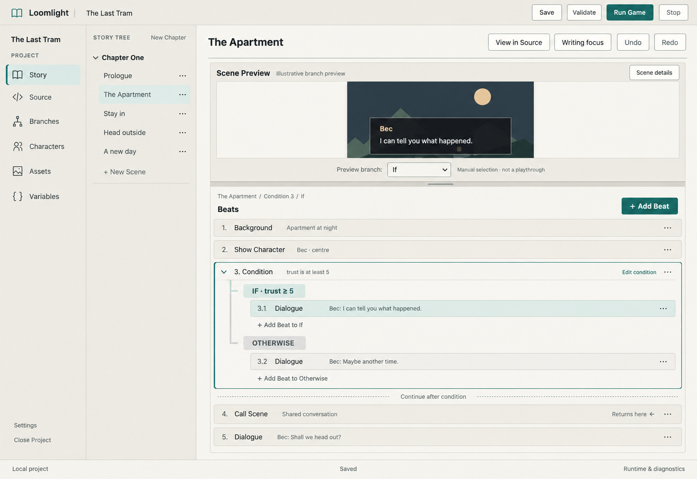

# Phase 3 — Initial WYSIWYG release

## Design section continuity and final experience review, 2026-10-22

State `review_ready`. The user reports Design sections collapsing after Reuse this
look and font-picker actions, and requests a final Experience First pass with a
concrete change report. Reproduce the issue and repair shared form continuity,
including deliberate closed sections, draft retention, keyboard focus and picker
return. Review the existing select/edit/preview loop without adding new features.

Continue on the chosen Mac and branch `codex/phase3b-screen-designer`, clean entry
`cc92795`. Allow one focused diagnosis/implementation cycle, one combined lab cycle
and one in-scope repair cycle if needed, with a three-cycle cumulative limit. Current
use is continuity local2/3. Earlier allowances stay closed. This remains a local
browser mockup; no native, SDK, CI, package, publication or approval work is selected.
The affected controls and existing journeys pass, both sizes/themes received visual
review, and docs record the final result and changes. Final use is continuity
local2/3; the unused repair cycle is closed. Next is user review.

The ordinary browser receipt `final-ux-diagnostic-01.json` reproduces Reuse this look
open=true becoming false after Give this element its own look. Font selection also
returns focus to the page body. `renderInspector` replaces all sections and assigns
default open values on every rebuild. Preserve the diagnostic under
`.toolchains/phase3b/`. Apply one shared correction rather than exceptions for each
button; retain the earlier depth and preview-control behavior.

Local1 passes TypeScript and all 60 rendering cases, then verifies open/closed
sections, both reuse actions, scroll continuity and font choose/cancel/Escape with
focus return in Screen notebook. It stops on an assertion that Position units has
focus after Playwright `selectOption`; that helper does not focus the menu.
`continuity-select-focus-01.json` records SUMMARY focus before/after the unfocused
selection, then `field:coordinates` after explicit focus and another change. The
check now establishes keyboard focus before requiring its restoration. No product
correction follows this harness issue. Preserve the failed
`continuity-focused-01/` report and sibling log. The shared repair snapshots actual
section state per screen/element/editing step before rebuilding and restores stable
control focus and panel scroll. Picker close resolves its original launcher after
rebuilds; a removed control falls back to its section heading. The earlier special
case for Depth is removed in favor of this shared behavior. Local2 is the combined
check; local3 remains available for an in-scope repair if needed.

Local2 passes TypeScript, approval/source checks, all 508 rendering cases and 20
interaction groups on Chromium 155.0.8059.86, without browser errors. The new
continuity journey passes in all three layouts. It checks both reuse actions,
explicitly closed sections, scroll/focus retention, font choose/cancel/Escape,
position changes, Apply/Cancel, selection return, image-picker focus, action removal
and compact Design. Existing list, canvas, depth, Undo/Redo and story journeys pass.

Experience First review concentrates on uninterrupted editing. Design and Connect
remember sections per selected element and editing step. Rebuilds keep scroll and
keyboard focus; pickers return focus to the launcher, and removed controls return
focus to their section heading. The shared repair replaces the earlier Depth-only
exception. Parent review covers the compact reuse/font-picker captures, wide Design
and compact Depth. All 12 final matrix captures match the previously reviewed
reorder local4 set byte for byte, retaining both themes at 1100×720 and 560×640.
Preserve report, 12 matrix images, ten interaction images and comparison receipt under
`.toolchains/phase3b/continuity-combined-02/`, with the sibling log and both diagnostic
receipts. Validation passes for 794 repository files and whitespace. No repair or
verification remains pending. Work stays local and all approvals remain null.

The verified candidate is local commit
`5973550de64a634491f74839bdd5799635fc023c`, tree
`cc0712f91a24d24f1df6df0a498febf393806e0f`. With source files clean,
`npm run design:source` returns fingerprint
`70d9beebc45e4783f9f17d374edf9983e03a079e68ca06d475fecec55c06a028`.
Later documentation receipts preserve this candidate identity. No publication occurred.

## Element list reordering and opening Design, 2026-10-21

State `review_ready`. The user requests click-and-drag ordering under Choose →
Elements, double-click to open Design, and a clearer name for Front & back.
Single click selects in the list; double-click or Enter opens Design. Dragging
reorders within the current parent, matching the existing order buttons. Groups
keep their children. The user's follow-up places these controls inside Position &
size as Depth, with a plain explanation of overlapping items and immediate Undo.
Remove the separate Front & back section. Preserve tooltips, drafts, protected
samples, Escape and Undo/Redo.

Continue on the chosen Mac and branch `codex/phase3b-screen-designer`, clean entry
`ee595f6`. Allow one focused cycle, one combined lab cycle and up to two in-scope
repair cycles if needed, with a four-cycle cumulative limit. Earlier allowances
remain closed. This is fictional browser behavior only; keep work local and all
three approvals null. No native, SDK, package, CI or publication work is selected.
Real pointer drags, single/double-click behavior, cancellation, group order,
Undo/Redo and draft guards pass, with visual review in both sizes/themes and updated
canonical notes. Final use is reorder local4/4. No repair or verification remains
pending. Next is user review of Screen builder.

Local1 passes TypeScript and all60 rendering cases, then the complete new list
journey in Screen notebook. Canvas focus passes selection, double-click, depth
location and a real reorder before the check expects Choose's `compose` step.
That drawer deliberately opens over the current `layout` step. The test now records
the step before dragging and requires it to remain unchanged, across all variants.
No product correction follows this harness assumption. Preserve the failed
`.toolchains/phase3b/reorder-focused-01/` report and sibling log. Local2 verifies the
corrected assertion, then local3 is the combined check; local4 remains for repair.

Local2 passes all60 rendering cases, all three new list journeys, held-pointer
insertion-marker/Escape, dirty-draft refusal, group ordering, template protection,
compact drag/depth and all earlier movement/resize checks. The older notebook
journey then looks for Bring forward after selecting a different element without
opening its new Position & size location. The check now opens that section before
using depth controls. This is a navigation-contract update. Repeated depth changes
also keep the section open, with a new assertion. Preserve failed
`reorder-focused-02/` report/captures and sibling log. Local3 verifies the coherent
candidate through the combined check, including the relocated controls. Depth now
sits after horizontal/vertical position; Choose avoids repeating its directions.

Local3 passes TypeScript, approval/source checks, all508 rendering cases and20
interaction groups, including all new list behavior and earlier journeys. Preserve
`reorder-combined-03/` report/captures and sibling log. Static review then identifies
selection mutation before a refused Alt-arrow reorder. The ordinary browser probe
`reorder-keyboard-diagnostic-03.json` confirms the visible selection stays Dialogue
window after refusal, but opening Design changes it to Dialogue (what). The keyboard
handler now passes the focused ID to the shared reorder operation; only an accepted
move changes selection. A protected-template regression checks the visible form
after opening Design. Local4 is final combined verification of this scoped repair.

Local4 passes TypeScript, approval/source checks, all508 rendering cases and20
interaction groups on Chromium155.0.8059.86, without browser errors. It covers all
three complete Screens journeys, list dragging, single/double-click, Enter, depth
location/repeated changes, cancellation, Undo/Redo, no-op/invalid-parent drops,
dirty-draft protection, nested group ordering and the blocked-keyboard regression.
Parent visual review covers both themes at1100×720 and560×640. All12 final matrix
captures plus held-pointer/drop-marker and compact Depth captures match the reviewed
local3 set byte for byte. Preserve report, 12 matrix images, eight interaction
images and review receipt under `.toolchains/phase3b/reorder-combined-04/`, with the
sibling log. Earlier failures and the keyboard diagnostic remain retained. Validation
passes for793 repository files and whitespace. All work stays local; no design
approval or app integration is implied.

The verified candidate is local commit
`b5292b1e7fbd11c0ac8c23b796ce5fb9d2c3f727`, tree
`f2d327c97a488a7041548ed02a9970d7868b5aa6`. With source files clean,
`npm run design:source` returns fingerprint
`d0eda81a4cda53a5294ebff2c83e4274392999b15caea7b3d8185fe06f5dbd76`.
Later documentation receipts preserve this candidate identity. No publication occurred.

## Screen builder copy and direct manipulation — 2026-10-21

State `review_ready`. The user prefers Screen builder and requested first-use copy
with unslop, clear preview-value/story-test explanations, help for complex controls,
and the selected element name with smaller type text in Connect. They also requested
visible element resizing and Screen notebook's nested selection under Choose,
including hover tooltips and small type icons. These browser refinements are complete;
all three current drafts remain available and their approval entries remain null.

Chosen host Mac, branch `codex/phase3b-screen-designer`, clean entry `7bf9d1f`.
Experience First, unslop and writing-for-agents guide this outcome. The original
five local cycles expanded to seven for the added resizing request. Final use is
copy local6/7; the unused repair cycle is closed. Prior refresh5/6, refinement4/4
and early11/11 stay closed. Work is local-only; no native, SDK, CI, package, live
model or publication allowance is renewed. Next is user review of Screen builder.

Choose now reuses the notebook's nested list in group/sibling order, with type icons,
actual parent depth and pointer/focus help. Keyboard browsing follows that order.
Connect names the selection and shows its type in smaller text. Change preview
values explains example variables and button appearance; Test opening and closing
explains the example dialogue. Button appearance affects buttons only. Font/image
pickers and action controls use specific labels and descriptions. The
[comparison notes](../../design/design-lab-screens/README.md) own current controls,
research and simulation limits.

Local1 reproduces the drag report. Help title stays at328,214 with an automatic-group
notice, while Help frame moves from280,180 to352,212. The vbox starter parent blocks
individual movement; review also finds a selection-only pointer-down guard. The
starter now uses a free layout group matching its manual positions, and the first
press starts a drag without replacing the pressed canvas node. Groups translate
their descendants. Automatic placement still blocks individual movement with clear
directions, while handles allow resizing. Preserve
`.toolchains/phase3b/copy-drag-diagnostic-01.json`.

Local2 passes 60 rendered cases, then stops on a group-delta assertion. The local3
receipt `copy-group-diagnostic-03.json` shows top25%/38.0556% becoming
30.5556%/43.6111%. Both move40 game pixels; serialized percentages differ by0.0001%.
The assertion now compares snapped game-pixel deltas. No product correction follows
this harness finding. Local3 then exposes blocked Undo: a previously inspected
child's unchanged draft keeps its old position after group movement. The commit
boundary now prunes only drafts still equal to current source before mutation;
actual edits stay retained. A shared-look propagation regression covers the same
cache assumption. Preserve failed `copy-focused-02*` and `copy-focused-03*` reports
and logs. The user's "Approved" authorizes continuing the repair within this outcome.

Local4 passes TypeScript, approvals, 508 rendering cases, 13 earlier page groups and
movement/Shift-resize/cancel/group/Undo in all three Screens layouts. It stops when
the preview-values test clicks the disclosure's center and hits its help button.
`copy-summary-diagnostic-05.json` records that target and the closed disclosure.
The test now clicks the label area; help clicks keep their intended behavior.
Preserve incomplete `copy-combined-04*` evidence. This is not a combined pass.

Local5 passes 60 rendered cases and movement, Shift resize, eight visible handles,
opposite-edge resizing, keyboard resizing, Escape, group movement and Undo in all
three layouts. It then finds that changing Button appearance closes its controls.
`copy-values-diagnostic-05.json` records open=true becoming false in the same Connect
step. Rebuilding now snapshots live disclosure state before replacing the DOM,
rather than trusting asynchronous toggle events. Entering Connect opens the story
test once; a deliberate close persists through updates. Preserve the failed
`copy-focused-05/` report and sibling log.

Local6 passes TypeScript, approval/source checks, all 508 rendering cases and 20
interaction groups on Chromium155.0.8059.86, with no browser errors. Its Screens
checks cover all three journeys, the nested list/order/icons, hover and focus help,
Connect identity/copy, first-press dragging, group translation, resize handles,
keyboard resizing, image proportions with fractional positions/centered anchors,
Escape, Undo, shared-look propagation and preview-control state. Parent visual
review covers all 12 matrix captures in both themes at1100×720 and560×640, plus
Choose tooltips and Connect editing states. Preserve report, 12 matrix images,
six editing images and review receipt under `.toolchains/phase3b/copy-combined-06/`,
with its sibling command log. Validation passes for 792 repository files and
whitespace checks. Browser samples remain fictional and reset on reload.

The verified candidate is local commit
`989153326381002b5db02b30c9e235a79e1002f6`, tree
`436cb087914755c41f237506b8a654cdf0d6ae01`. With source files clean,
`npm run design:source` returns fingerprint
`9ec7efc3d784f8bb4ad9cb68232f0d333d12d0baa8ec53ec5f6e9a366b858975`.
Later documentation receipts preserve this identity. No publication is claimed.

## Screens research and three-candidate refresh — 2026-10-21

State `review_ready`. The user requests element tooltips, retaining the revised
Screen notebook, removing the old workbench/canvas/original notebook, and two new
mockups informed by a research subagent's inspection of comparable apps. Apply
Experience First and unslop to all three; use writing-for-agents for records. This
supersedes the earlier instruction to retain the first three runnable candidates.
Their source and evidence remain recoverable in Git, with no approval implied.

Continue on the chosen Mac and branch `codex/phase3b-screen-designer`, clean entry
`1b14b44`. The parent owns implementation. One explicitly requested research agent
inspects official sources and UI images, then recommends concrete patterns. Keep
the selected notebook's structure and existing editing behavior; make both new
alternatives structurally distinct. Explain every element type on hover/focus and
beside the add control. Keep large previews, ordering, resize/focus controls,
draft retention, protected samples and memory-only actions.

Allow up to four focused implementation/verification cycles, one combined Design
Lab cycle and one in-scope repair/verification cycle if the combined check finds a
new issue. Final use is refresh local5/6. Verification is complete; the unused repair
cycle is closed. This new UI outcome renews no native, SDK, package, CI or live model
allowance. Prior local4/4 and local11/11 stay closed.
Publication remains local-only; the earlier rejected push has no fresh approval.

Complete when only the retained notebook and two new alternatives are selectable,
their element help works with pointer and keyboard, the notes identify the research
behind each design choice, both themes/sizes receive visual review, and focused/combined lab
checks pass. All approval entries remain null until explicit version selection.

Local1 passes TypeScript, approval checks, all 60 Screens rendering cases and three
complete journeys. The user-requested research agent visually inspected official
Penpot, Unity UI Builder and Godot images. Visual review selected narrower screen
controls for the new alternatives, a visible Add entry and less prominent removal
in Canvas focus, and content items before groups in Screen builder's chooser. The
notebook keeps its layout. Preserve the first report, representative captures and
log under `.toolchains/phase3b/refresh-focused-01*`.
Local2 also passes all 60 cases and three journeys. Visual/static review selected
two final refinements: compact alternatives fit their initial stage to the visible
workspace; keyboard browsing follows the chooser's displayed content-first order.
The focused journey now checks both and retains editing-panel captures. Preserve
local2's evidence under `.toolchains/phase3b/refresh-focused-02*`.
Local3 passes all 60 cases and three journeys, including initial compact game
visibility and displayed-order keyboard browsing. Editing-state captures selected
smaller task-card copy, removal of duplicate selection headings and visible
disclosure arrows. Canvas focus now names its open-state toggle Hide editor.
Preserve local3's report and editing captures under
`.toolchains/phase3b/refresh-focused-03*`. Local4 verifies these final presentation
changes before combined qualification.
Local4 passes TypeScript, 60 rendering cases and all three complete journeys. Parent
visual review covers both themes/sizes and the new editing states. No failure has
occurred in the four refresh cycles. Preserve all final focused images and report
under `.toolchains/phase3b/refresh-focused-04/` with its sibling command log. Local5
is the combined Design Lab check. No source or design-note edits during that run.
Local5 passes TypeScript, approval/source checks, all 508 rendering cases and 20
check groups on Chromium 155.0.8059.86, with no browser errors. It includes all
three Screens journeys, all other lab pages, shared navigation/draft guards,
approval/HMR behavior, native/network refusal, sample reset, invalid selections and
production build exclusion. All 12 final Screens captures match the visually
reviewed local4 images byte for byte. Retain report, 12 matrix captures, two editing
captures and the comparison receipt under `.toolchains/phase3b/refresh-combined-05/`,
with its sibling log. No failed refresh cycle or repair remains pending. The
[comparison notes](../../design/design-lab-screens/README.md) own the observed research,
design choices, current controls and simulation limits. Next is user comparison of
the three drafts. No app promotion, native, SDK, CI or publication occurred.
Closure validation passes for 790 repository files, plus whitespace checks.

The tested refresh source is local commit
`47418fe809588eaca12531977d065da22296de39`, tree
`96cd3a24c3dbf029a15712dba01e0c6c25582a80`. `npm run design:source` returns fingerprint
`a075c7b85b177dfde3cdeb5460087b120ac902ef9fec2067b6d4a8a079c32f55`.
Later documentation receipts preserve this candidate identity. All current approvals
remain null; no publication is claimed.

## Screen notebook refinement — 2026-10-21

State `review_ready`. The user prefers Screen notebook and requests plain directions,
help tooltips, clear front/back ordering, a preview workspace that can be resized
by dragging its border, and a larger default preview. This selects a browser-only
refinement on the existing branch. Preserve the first three runnable candidates;
add a revised notebook draft. "Best so far" records a preference, not approval of
the revised design or authorization to promote it into the app.

Use unslop for interface copy and writing-for-agents for these records. Continue on
the chosen Mac host. Allow one initial focused verification cycle, up to two focused
repair cycles if needed, then one combined lab cycle, with documentation closure.
Final use is refinement local4/4. No repair or verification remains pending. This
new outcome does not renew the completed
early source proof's local11/11, native, SDK, CI or independent-review allowances.
The earlier task records branch publication authorization. The latest push remains
local-only pending the explicit approval described below.

The resize handles change the editor's available preview area. Game dimensions
remain a separate control. Front/back controls reorder elements within their parent
group, and a group's children move together in the preview. A selection outline
must not lift the selected element above its assigned order. Explain automatic
vertical/horizontal/grid layout separately. Screen-level Ren'Py `zorder` is distinct
from child order. Keep all demo changes in browser memory.

Complete when the revised notebook uses clear copy, keyboard-accessible help,
pointer/keyboard resizing and cancellation, a visibly larger game view, correct
overlap ordering and undo, retained drafts, and passing focused/combined checks at
both registered sizes/themes. Record controls and approximation limits in the
comparison notes. Keep approval null until the user selects the revised version.

Refinement local1 passes TypeScript, approval checks, 80 rendering cases, all three
original journeys, and the revised help/resize/focus/draft checks. It stops when
the overlap test tries to fill a collapsed position group after reparenting. The
test now reopens the group after that real inspector rebuild. Visual review also
found that the default preview height exceeded its visible container. Default and
focused heights now use the available workspace height. Preserve the first report,
captures and command log under `.toolchains/phase3b/notebook-focused-01*`.
Local2 also passes overlap targeting, selection paint order, group movement and
undo. It stops when the action test uses the element list hidden by Buttons &
story. That test now selects Close in the visible canvas, matching the available
user control. Wide and compact captures show the complete game view. Preserve
local2's report, captures and log under `.toolchains/phase3b/notebook-focused-02*`.
Local3 passes all 80 Screens rendering cases and all four complete interaction
journeys, including the original layouts. Preserve its report, captures and command
log under `.toolchains/phase3b/notebook-focused-03*`. No further focused cycle is
selected. Local4 passes TypeScript, approval/source checks, all 528 lab rendering
cases and 20 check groups on Chromium 155.0.8059.86, with no browser errors. Both
themes and registered sizes pass. The revised journey covers help, pointer/keyboard
border resizing, Escape, draft retention, focus mode, overlap targeting, selection
paint order, group movement, Undo, protected screens and story behavior. Final
report and revised captures are ignored under
`.toolchains/phase3b/notebook-combined-04/`. Parent visual review checked both themes
and sizes. The [comparison notes](../../design/design-lab-screens/README.md) own
controls and approximation limits. Next is user review of `guided-v2`; all four
approvals remain null. No native, SDK, package or CI operation was performed.

Refinement review candidate is `41e08b1aa97d5912e4fdb859e621fa9ac2cd424b`, tree
`16d84534641a839281b6ff04c05c81e3aa8259af`. `npm run design:source` reports fingerprint
`a526070b74990b01c7dabea07a0b861646562b533ab6e9e5ef2b486c67cd11cc`.
This pins the tested browser source; later documentation receipts do not replace it.
Closure repository validation passes for 788 files, plus whitespace checks.

Publication remains local-only. Automatic approval review rejected the combined
receipt commit/push command before execution because it could not confirm explicit
user authorization for this payload and the `origin` destination. The bounded local
receipt commit succeeded separately. Publishing these changes to
`origin/codex/phase3b-screen-designer` needs fresh explicit user approval. This does
not reopen verification or change the review-ready browser result.

## Phase 3B planning entry — 2026-10-21

The user requested a branch from the current Phase 3A Story logic work, a read of
the 3B brief and a grilling interview before implementation. Local branch
`codex/phase3b-screen-designer` starts at `571e76c0eed9775a9280f7d070c0167b56c60d9f`
on `codex/phase3a-story-logic`; the working tree was clean at entry. The interview
concluded with the user's "Yes approved" to the final delivery recommendations.
The agreement below authorizes the early implementation outcome. No earlier
milestone acceptance is implied.

### Selected early outcome and cumulative allowance

State `review_ready`. On 2026-10-21 the user approved two further local cycles and
required review with the linked Fix Root Causes skill. Local10 covers focused
reproduction, diagnosis, repair and Screens verification; local11 covers combined
lab verification and documentation closure. Both the source/runtime proof and
prototype comparison checks now pass. The next action is user layout selection. Use
the current Mac development host; obtain affected Windows
x64/macOS ARM64 proof through focused CI. Deliver one nested-screen source/runtime
proof, then a three-layout Screens prototype ready for user selection. The parent
owns source/runtime integration, the designated prototype agent must use the
prototype skill, and a separate agent independently reviews the source/runtime
change. Live workspace implementation follows explicit design selection.

The user authorized committing and pushing `codex/phase3b-screen-designer` for
selected checks and recovery. Maximum cumulative use is now eleven local verification
batches, including the one-batch and two-cycle extensions, four local Ren'Py preview launches,
two focused CI dispatches including
retries, one independent review and one follow-up review of fixes. The execution
ledger owns cumulative use. Preparation and focused repairs share those limits;
failed/cancelled attempts remain charged. Reassess after two
unsuccessful corrections of the same hypothesis. Installer packaging and live model
requests are outside this outcome. Preserve the protected native draft and existing
Phase 2/3A recovery. No earlier allowance is renewed.

The early proof must inspect a nested custom screen, patch one supported property
through the existing transaction boundary, preserve an opaque neighbor byte for
byte, survive reopen/undo/conflict handling and demonstrate actual pinned-SDK
rendering. Record approximations and distinguish this slice from full 3B support.
Only after that proof does the prototype agent implement the Design Lab comparison.

### Early execution ledger

Current use is local11/11, preview4/4, CI1/2,
review1/1 and follow-up1/1 complete. CI1's terminal audit below passes the early
source/runtime gate. Local10 confirms the root causes and passes focused Screens
verification; local11 passes combined lab verification. No repair or CI is pending.
No SDK, native, package, CI or independent-review allowance was renewed.

- Local1 compiled the new source service and ran three cases. Two passed; the third
  stopped on a harness assertion expecting `SOURCE_DRAFT_DIRTY` instead of the
  existing `DIRTY_SOURCE` response. Corrected the expectation; no product change
  was needed for that failure.
- Local2 passed all three dispatch/parser cases and SDK version/compile/lint. Its
  preview attempt failed before game start because the driver used
  `screenproof.layout` instead of the pinned SDK's `screenproof::layout` testcase
  selector. Retain ignored `source-local-02` logs and partial result.
- Local3 corrected that selector and reused the unchanged passing core cases.
  SDK version/compile/lint passed. The sandboxed runtime could not access displays;
  its Hiservices XPC/display initialization failure supplies no rendering proof.
- Local4 ran outside the sandbox. All three core cases, four rejecting harness
  cases and SDK version/compile/lint passed. Native execution reached the story,
  while the driver incorrectly waited for a generated main menu in the minimal
  fixture. The frontend check separately caught the new operations missing from
  its expected list and a default Python 3.9 interpreter without `tomllib`.
- Local5 corrected the minimal fixture's initial/continuation screens, retained
  the produced core executable and selected the available Python 3.12 runtime.
  The frontend check passes all211 cases. Core3/3, harness4/4 and SDK version/
  compile/lint passed. Native execution activated Help and verified the opaque
  sentinel, then failed an unsupported `.style.xsize` attribute read. Removed that
  redundant driver assertion; the decisive `renpy.render(...).get_size()` equality,
  screenshot, unchanged-source and exactly-one-continuation checks remain required.
  No successful geometry, screenshot or continuation result is claimed locally.
- The independent review found duplicate-declaration whitespace and missing
  protected-property spans, incomplete compiled-input reuse hashes and an absent
  artifact privacy gate. The follow-up confirms those four fixes. It also identified
  the wrong runtime start assumption and missing retained test binaries on failure;
  the parent corrected those driver/evidence paths. Toolchain/source/test-executable
  identity, named results, durations, retained executables and existing privacy
  scanning now form the proposed CI evidence. Final driver fixes have parent review,
  not an additional independent review beyond the selected allowance.
- Local6 passes all five corrected zero-SDK evidence cases, including executable
  retention on failure, repository links/privacy/whitespace and the retained local
  artifact scan. Native preview remains4/4; do not run another local preview.
- The prototype agent read the required prototype UI workflow and lab rules before
  implementation. Retain all ignored
  `source-local-02` through `source-local-05` reports/logs, including failures.
- Local7 passes TypeScript, approval/source checks, repository validation of 785
  files and whitespace checks. The scoped browser attempt reached zero cases because
  the old port 5174 server had ended. Its failed report remains under
  `.toolchains/design-lab/pages/screens/batch7-server-unavailable-report.json`.
  The already planned combined checker supplied its own server and completed all
  508 rendering cases and 13 earlier interaction groups. It then failed to import
  the Screens check because its registration used the wrong relative path. This is
  a lab check-registration defect, not a passing Screens interaction result.
  The parent preserved the report and 12 Screens captures under
  `.toolchains/phase3b/prototype-batch-07/`. Visual review found an overlapping lower
  dock in Canvas desk, cropped Fit previews and clipped fixture instructions.
  Those issues selected the sole remaining local8 repair/verification cycle.
- Local8 again passes TypeScript, approval/source checks and all 508 rendering
  cases. The 13 earlier interaction groups pass. Screens' Workbench journey reaches
  compact new-screen creation, then times out at `check.mjs:111` looking for the
  exact accessible name `Next prototype layout`. The Screens group and later shared
  integration/build-isolation groups did not complete. This is not a combined pass.
  The report and 12 final Screens captures remain under
  `.toolchains/phase3b/prototype-batch-08/`; the command log remains alongside it.
  The parent inspected all 12 captures. Fit shows the game rectangle and Canvas
  desk's dock no longer overlaps status. Compact layouts retain scrolling.
  The first Workbench geometry assertions passed before the later timeout; no full
  Canvas desk or notebook interaction result is claimed.
  Static review identifies CSS-generated arrow text as a possible accessible-name
  mismatch. Explicit switcher button labels were added after this run. That narrow
  correction has parent review but no new browser evidence. All eight selected
  local batches are consumed; no additional browser probe or retry was run.
  Closure documentation validation passes for 785 repository files, with privacy,
  link and whitespace checks. Those metadata checks do not qualify the label fix.
- The user replied "Approved" to one additional browser verification batch after
  local8. Local9 again passes TypeScript, approval/source checks, all 508 rendering
  cases and the 13 earlier interaction groups. Screens stops at `check.mjs:82`
  because its first action-row `innerText()` is empty, rather than the expected
  typed assignment. The check does not record the active variant, so no individual
  layout's completed journey is inferred from this failure. The remaining Screens
  and shared integration/build-isolation groups are incomplete. No combined pass
  is claimed.
  Preserve `.toolchains/phase3b/prototype-batch-09/` and its sibling command log.
  The incident index has no matching content-visibility entry. Static review finds
  that the notebook inspector uses `content-visibility: auto`; adding an action
  rebuilds that inspector, after which the test reads row text without scrolling
  it into view. This is the current harness-visibility hypothesis, not a confirmed
  diagnosis. The focused check now scrolls each asserted row into view, waits for
  nonempty rendered text and includes the variant in those assertion messages.
  Assignment and finish-order expectations remain unchanged. This correction has
  no new browser evidence, and no product rendering/action code changed.
  All 12 retained Screens captures have identical SHA256 values to the visually
  reviewed local8 captures, so that appearance review is reused. Closure repository
  validation passes for 785 files, plus whitespace checks. This is metadata proof,
  not a passing browser check of the latest correction.
- The user approved two more cycles and invoked the linked Fix Root Causes skill.
  Local10 begins with a focused reproduction using the original unscrolled read.
  It reproduces the failure in the guided layout: the correct Set/Finish DOM text
  exists, its disclosure is open, `contentVisibility` is `auto`, and effective
  visibility is false. Workbench and Canvas journeys complete in that diagnostic
  before the guided failure. This establishes a legitimate offscreen render state,
  not missing action data. Scrolling before reading fixes the harness's first wrong
  assumption. Review found the same pattern in the protected-action notice; both
  now require visible, nonempty rendered text before unchanged assertions.
  The same reproduction measures the switcher with and without explicit labels:
  exact-name count is one with labels and zero without, because CSS arrows become
  part of the original accessible names. Labels correct the semantic names at the
  controls. Per-layout start/pass messages and failure DOM/visibility context now
  expose this evidence without another diagnostic patch. Retain ignored
  `.toolchains/phase3b/prototype-batch-10/reproduction.json` and its script/log.
  The first documentation update command used the app directory with root-relative
  paths and failed before changing files; it was corrected before browser work.
  No product or browser result is attributed to that metadata command.
  The corrected focused check passes all 60 rendering cases and complete Workbench,
  Canvas desk and Screen notebook journeys, with no browser errors. It verifies
  visible typed actions and the protected notice, all three switcher transitions,
  draft retention, geometry, source conflict, template protection and Help flow.
  Retain `focused-report.json`, `focused.log` and 12 captures beside the reproduction.

  The root-cause review also checked the earlier prototype corrections. The check
  path now resolves from the runner's lab directory; the same focused run loads it.
  Canvas desk's former minimum rows exceeded its available height, while width-only
  Fit cropped taller previews. Zero-minimum rows and a width/height-aware Fit fix
  those layout decisions. Geometry checks and retained before/after captures cover
  their corrected results. Existing source/runtime fixes retain independent review
  and the audited both-target CI proof; no native/SDK rerun is selected. No generic
  retry, swallowed failure, weakened action assertion or product-state guard was
  added to hide the browser failures.
- Local11 passes TypeScript, approval/source validation, all 508 rendering cases
  and 20 check groups on Chromium 155.0.8059.86. All three Screens journeys pass
  again. Shared navigation/draft cancellation, gallery links, approval/history/HMR,
  native refusal, read-only serving/network CSP, sample reset/invalid selections
  and production-build exclusion all complete. The report has no browser errors.
  Retain `.toolchains/phase3b/prototype-batch-11/report.json`, its 12 Screens captures
  and the sibling command log. Every final capture has the same SHA256 as its
  reviewed local8 counterpart; the parent also rechecked representative final
  wide/compact light/dark captures. Original failures remain preserved separately.
  This completes the selected early source proof and prototype comparison outcome
  for review. It does not approve a layout or implement the full live designer.
  Closure validation passes for 785 repository files, with link/privacy and
  whitespace checks. CURRENT/HANDOVER remain within their workflow review targets.

### First focused CI run and manual continuation

Published implementation candidate `0ef174877cbe5ae3fd883afb92940de68916b04a`, tree
`521a550ef7d82ecf970a0527a1bab368062bad63`, on
`origin/codex/phase3b-screen-designer`. The authorized first push started
[run39555526201](https://github.com/Caldwell-41/Renpy-editor/actions/runs/39555526201),
workflow 391374211 / `Phase 3B early screen source proof`, event `push`, attempt 1,
ordinal 1. Created 2026-10-21T06:27:36Z; last observed updated 06:27:40Z, `in_progress`.
Mac job 119074294342 and Windows job 119074294589 were both `in_progress` at recording.
At that wait checkpoint, terminal results and artifact audit were pending. The workflow runs only
focused source/evidence/SDK checks, retains test executables and scans before upload.

Wait record `7fcb8d6` published that pending state and ended active polling. The
terminal audit below supersedes its continuation instructions. Earlier full-app
drafts and protected native recovery remain intact.

### CI1 terminal audit and prototype continuation

On 2026-10-21 the user requested the recorded CI audit and continuation, and required
the grilling decisions to remain documented using writing-for-agents. CI1 is
terminal `success`, updated 2026-10-21T06:30:42Z, at the exact candidate/tree above.
Both selected jobs and every required step pass, including privacy and retention.
The parent downloaded both ZIPs and job logs, validated archive entries and digests,
and audited retained results rather than treating the workflow badge as evidence.

| Evidence | Windows x64 | macOS ARM64 |
| --- | --- | --- |
| Artifact ID | 12325227254 | 12325167262 |
| ZIP bytes | 8,125,111 | 10,526,748 |
| ZIP SHA256 | `4d75bd92b6d5683aea432f9cc494c015309563183831ed72d1c98b47ad7a86df` | `8b70126c56e170aa5631cb0e2aa77915303c51c2a59c1c13c80a0c2d8a396442` |
| Retained test executable SHA256 | `efa713957cc319c6e911c7ffffb47fb8f073fee49956305496c5caf9a61fc8cc` | `60138eb6ebdce4b7b9d294d4ace46621e18b3cb3ad16b6a02e015bfee4d2277a` |
| Source inputs matching Git checkout filters | 335/335 | 335/335 |
| Named core / evidence / runtime cases | 3/5/1 passed | 3/5/1 passed |

The retained binaries have the expected PE AMD64 and Mach-O ARM64 headers. Both use
Rust/Cargo 1.90.0; wrapper Python is 3.12.10 on Windows and 3.15.0 on Mac. Each host's
five command records report exit 0, bounded output, positive duration, reaped process
and no timeout. Raw logs confirm the named cases and privacy scan of all 10 files.

The SDK renders the accepted frame at 720×360 in a 1280×720 virtual game, shows the
unchanged opaque sentinel and continues exactly once after Close. Accepted source
hashes and all other bytes remain unchanged; cleanup completes. Captures on both
hosts are 922×518 window pixels. The parent inspected their Help text, image and
Close control. Capture size reflects the scaled window, not the virtual game size.
The first audit's extra 1280×720 screenshot-size assumption was corrected to preserve
that distinction; no product or CI result changed.

This passes the selected early source/runtime risk proof. It does not qualify full
Screens editing, persistent ownership, Story screen Beats, Escape/focus behavior,
second-aspect rendering or whole Phase 3B. Phase 2/3A human acceptance remains pending.
Retained raw evidence and `audit.json` are ignored under `.toolchains/phase3b/ci1/`;
hosted artifacts expire 2026-10-28 at 06:29:53Z (Windows) / 06:29:51Z (Mac).

The parent resumed the designated prototype agent with the consolidated design
section below. It must use the prototype skill's UI branch and writing-for-agents
for notes. Batch 7 covered initial targeted and integrated lab checks; batch 8 used
the sole repair cycle. The parent owns task/status/ADR records
and publication; the agent owns the new lab screen, required lab glue, draft approval
record and comparison notes. Native/product operations remain outside the prototype.

### Screens prototype candidate and verification boundary

The designated agent used the prototype skill's UI branch in the existing Design
Lab. [Comparison notes](../../design/design-lab-screens/README.md) own the layouts,
review journeys, simulated controls and implementation limits. Each candidate has
the same fictional Help panel/dialog and protected-template inventory.

| Candidate | Structure | Local preview |
| --- | --- | --- |
| Layout workbench | Hierarchy, canvas and inspector beside one another | [Workbench](http://127.0.0.1:5174/?screen=screens&variant=workbench) |
| Canvas desk | Player view above a hierarchy/property dock | [Canvas](http://127.0.0.1:5174/?screen=screens&variant=canvas) |
| Screen notebook | Compose/Arrange/Connect notebook beside the player view | [Notebook](http://127.0.0.1:5174/?screen=screens&variant=guided) |

The local9 code candidate is `8e2aacb5a6d4ecc22003685e63c8d2b756dcb442`, tree
`6492d40e241a54a1f6c72ffd4ba4b46e0c8f1f0d`, published before that run.
Its `design:source` fingerprint is
`058e6b09bf687c4fe0ba7651b405692117f6d47f943d4ab70541fa1feb45846e`.

The earlier prepared candidate is `db9abbe411cf3369927407864c8371d330cb7099`, tree
`51b5eb660ff5135a01e357af7b31b46246f3272c`, published and verified on the remote branch.
Its `design:source` fingerprint is
`56c9e3c8688e96aa73bb111a2ffeb7b733b1fd48b16da55552fcce3d73c3dfb7`.
It includes the action-row check correction before root-cause reproduction and the
protected-notice fix. Neither earlier candidate records a passing verification.
The final reviewed candidate is `94824c80c57bba9eb3aaf1a4a6ec2658bd3149c3`, tree
`d369a03fa5c7dffcffd57f3b33a94e4a2ec4b53c`, published and verified on the remote
branch. Its `design:source` fingerprint is
`90eb707f5582770f797f1efb23a49c21c6c3227d0a8b5481687288599bb333e0`.
This preserves the code that passed local10/11 and the three unapproved candidates.
Documentation-only successors preserve that distinction and the earlier SDK candidate.

The floating switcher uses `?variant=` and protects edited samples before reset.
Local10/11 pass the focused and combined checks after root-cause reproduction.
All three approval entries remain null. The prototype is `review_ready` for layout
selection. Its required browser interaction/integration checks pass.
Source/runtime support remains limited to the earlier qualified proof; browser
imports, source edits, sharing, Story controls and previews use memory only.

Local9 consumed the first extension. The user then approved one focused Screens
cycle and one combined lab cycle, with documentation validation, and required the
[Fix Root Causes skill](https://github.com/cursor/plugins/blob/101b274dd991f694e1f7024be2157e5f3adf07de/pstack/skills/principle-fix-root-causes/SKILL.md).
The parent read that exact revision, reproduced both original failures with actual
accessible names, variant, DOM text, disclosure and visibility facts, then verified
the corrections. Assertions and product behavior remain intact. Focused journeys
preceded the full matrix. All eleven local cycles are consumed; no further check
is selected. No new SDK, Ren'Py launch, native app, package or CI operation occurred
in these extensions. Design selection and recorded approval still precede live
Screens implementation.

### Agreed 3B design from the grilling session

The user approved all 22 recommendations on 2026-10-21. This section owns the product
decisions from questions 1 through 18. The selected outcome and allowance above own
the host, team, limits and publication decisions from questions 19 through 22. Implementation and proof
remain separate from these design approvals.

#### First journey and full 3B scope

Build separate Help panel and Help dialog examples, each with a title, explanatory
text, image and dismissal button. The panel remains visible while dialogue continues;
the dialog blocks underlying game interaction. Connect them through the selected
Show/Hide/Call screen Beats. New screen offers blank and matching Help starters;
starter controls are ordinary editable nodes.

The first authoring set contains fixed/frame/vbox, text, images and text buttons.
The remaining release inventory includes window/hbox/grid, image buttons, bars,
viewports, shared styles and reusable components. Full 3B also includes supported
editing of generated dialogue, choice, main-menu/navigation, preferences and
save/load screens. Their required controls and game behavior stay protected;
supported decoration, layout and style changes explain their limits beside controls.
The first source proof and Help slice do not complete 3B.

Use one adaptable layout per screen at the project's game resolution. Relative
positions, anchors and container rules handle the second qualified aspect ratio.
Separate resolution layouts and breakpoint authoring remain beyond 3B.

#### Editing and interaction behavior

Keep hierarchy and canvas selection synchronized. Provide keyboard and numeric
editing alongside pointer gestures. Inspector changes remain a draft until Apply;
Cancel restores saved values. One Apply and each completed drag create one undo
entry. Invalid fields and source conflicts retain the draft.

Each custom screen has an explicit panel or blocking type. Panels dismiss with Hide;
blocking screens finish with Finish interaction. Both default to Close and Escape
dismissal; clicking outside leaves them open. Qualify keyboard focus and dismissal
in Ren'Py. These runtime dismissal rules are distinct from Escape cancelling an
editor gesture.

Canvas controls remain inert. Authors can set sample variable values and select
normal/hover/selected/disabled appearances. Mark active sample data and keep it
separate from game source and runtime values.

#### Properties, assets, reuse and actions

| Area | Agreed editable properties |
| --- | --- |
| Layout | Position, anchors, alignment, width/height, size limits, padding and spacing |
| Text | Content, font, size, color, alignment, bold and italic |
| Images | Asset, displayed size and aspect preservation |
| Appearance | Background, border and applicable normal/hover/selected/disabled states |

Qualify each property's Ren'Py mapping before claiming support. Other properties
remain editable in Source. Add typed project-owned font and UI-image assets and
pickers. Start font qualification with TTF/OTF; retain existing supported image
formats. Shared style/component edits update all uses, list affected screens before
Apply and offer an independent copy. Initial reusable components have no parameters.

Text can display existing variables. Bars bind to existing integer variables with
explicit limits. Buttons can assign literal values to existing bool/int/string
variables and perform short, visibly ordered action sequences. An action that
finishes interaction must be last. More complex dynamic logic and arbitrary Python
actions remain in Source.

#### Prototype handoff and completion

After the source/runtime audit passes, the assigned agent reads the installed
prototype skill and follows its UI branch in the existing Design Lab. Produce one
Screens prototype with three structurally different layouts, using the same agreed
capabilities and fictional content. Preserve the hierarchy/canvas/inspector behavior
across variants and keep all sample changes in browser memory.

The comparison is ready when all three variants render at the selected sizes and
themes, their stated editing journeys work, existing lab checks pass, and review
notes identify simulations and limits. Present shareable variant URLs and retain
the candidates. Explicit user layout selection and the lab's recorded approval
precede live workspace implementation.

## Restarted combined Phase 2 / 3A guided walkthrough — 2026-10-16

User requests restarting the guided walkthrough from the beginning after reviewing
additional work and ensuring an up-to-date build. This selects walkthrough preparation
and a matching signed Mac build; it supersedes the completed redesign/amendment's
no-local-build restriction for this new walkthrough only. No implementation repairs,
new CI matrix, live Studio sends/management, merge or release are selected.

Entry: clean `codex/phase3a-story-logic` at `95b5cfd`; application inputs match the
qualified `7551a9c` candidate (successors are documentation only). Reuse the final
redesign/model-settings both-host automated audit and qualified Phase 3A SDK evidence.
Prepare one additional signed Mac package using the unchanged approved identity and
names in a fresh ignored directory. Preserve the old build and original session;
this adds one build to historical build1/1, without renewing closed qualification
budgets. Existing walkthrough launches1/3 leaves two starts available; reserve a
start only after the old session is safely resolved. No automatic retry after failure.

Read-only process inspection confirms original PID8877 still runs the old verified
package. Its unsaved Mara draft remains protected. The production single-instance
plugin uses one bundle-ID socket, so a separate profile cannot permit simultaneous
instances. Do not bypass that gate, close/save/discard/navigate the old session or
attempt a losing launch. Complete package preparation before asking the user how
to resolve the old draft and switch. Fresh disposable project/profile state will use
the existing ordinary-UI fixture; ordinary saved credentials remain separate.

Read-only native UI observation now shows Story in Writing focus with an open Add
Condition form (All of: flag is True and literal True), plus a Saved source badge.
This differs from the earlier Mara-card observation: do not assume Mara's draft is
gone, or that Saved means all form input is committed. No UI action was performed.

Revised guided order, one short question at a time:

1. Settings: local profiles, endpoint/model/key copy, single context and response
   limits, configurable model-load defaults, explicit Read/Apply and connection test.
2. Characters: unified Writing/Game setup, game-first and planning-first association,
   writing topics, relationships/starting knowledge, list collapse and draft actions.
3. Retained card versions and explicit transactional restore, Undo/Redo.
4. Project-wide Lorebook: world/starting situation, tone/style, Save/Discard and the
   visible per-request context omission with separate character voice.
5. AI Assist: target/task/references, exact request inspection, rewrite/Continue/Draft/
   generated card/lore review, selected acceptance versus saving and recovery. Actual
   generation or server management requires a separately selected live step.
6. Phase 3A: typed conditions, ordered branches, guarded choices, Call/Return,
   nested insert/move/collapse, manual preview limits, Source/Branches coherence,
   history/reopen and ordinary external-edit draft protection.
7. Compact/light/dark readability and separate explicit Phase2/Phase3A decisions.

Preferences, demonstrated defects and explicit acceptance are distinct. This Mac
walkthrough does not claim Windows human proof or whole-phase acceptance. Private
paths, receipts and recovery metadata remain ignored.

**Preparation completed; guided Step1 is open.** The additional signed package build
passed (one attempt, no retry). Executable SHA256
`5c12f271a58a8fcd72e52e1ca0d20c9ad51d1d3460b685ab3a1bf76534d199ec`;
installer SHA256
`367721545177238f6899337fe4096fcd135963a008487db50835e52507ceca32`.
Strict bundle signature, approved certificate-bound identity, copied bundle, actual
read-only mounted installer contents and Mach-O ARM64 architecture passed. All
captured application input hashes remained unchanged through packaging. No signing,
credential or notarization policy changed. This matching package includes the completed
Characters/Lorebook redesign and configurable model-load settings; the old package
did not. Existing automated evidence is reused, with no new qualification test claims.

After the explicit switching question, user said **“i have closed the old app”**.
Process inspection confirmed no Loomlight process, so no agent Save/Discard/close was
performed. Fresh launch2/3 then started PID18966 at the exact verified new executable.
Native UI observed the new example in Recent Projects, opened it and navigated through
Settings → AI providers. Current screen is the unsaved New Studio profile at the top
of Connection, with the new local-profile wording and default loopback endpoint.
Fresh source/reference baseline (42 files) and launch/path receipts are ignored in
the new session directory. Ordinary saved profile/key and original fixture were not
reused. No network/test/discovery/management/generation action was performed.

**Cumulative walkthrough usage:** two package attempts/two passes (old1 plus new1),
editor launches2/3; one reopen remains. No phase approval yet. Task/status changes
are local-only; no commit/push/merge/release.

**Step1 feedback:** user says “Yes that looks clear, lets move on” about Connection
labels/help. Recorded as clear; no requested change or whole-phase acceptance. Moved
by scrolling to Model ID/API Key for Step2. Native observation shows user-edited
unsaved profile input; preserve it without saving/reloading or contacting Studio.
Next review response defaults and model-loading controls after this section.

**Step2 feedback — connection workflow change requested:** user rejects the need to
save before entering a key or discovering models: “Name -> IP -> API key, connect,
choose model -> save”. Agreed follow-up direction: Profile name → Endpoint/address →
API Key → Connect → choose model → Save profile. Connect should authenticate and
retrieve available models from the entered draft connection; it should not require
an already saved profile or model selection. Save then persists the completed profile.
Connect is distinct from a model-specific generation/response-format test and does
not implicitly load a model, generate text or apply model-load overrides. Preserve
native-only credential entry/storage; the UI need not expose key bytes. Cancellation
and failed connection should retain entered draft details without silently replacing
an existing saved profile. Existing key-before-save/unsaved-target management guards
need deliberate redesign, not a cosmetic reordering or bypass. Source inspection
confirms credential/discovery controls currently depend on a clean saved selection.
This is a requested functional/UX follow-up, not implemented or accepted behavior.
No app input, saved profile/key, service or product source changed during this feedback.

**Step2 confirmation — UI rearrangement agreed:** user explicitly says “Yes, record
that change, the ui will need to be rearraged”. Reorder the setup UI to match
Profile name → Endpoint/address (with its applicable private-HTTP option) → API Key →
Connect → Model selection → Save profile. Move API Key before model selection and
place Connect after the connection/key inputs; make model selection the next visible
step after successful connection. Keep connection status/errors with Connect and
preserve entered details on failure. Save completes local profile setup after model
selection. Preserve existing themes, native credential protection and draft safety.
This approves the workflow/layout direction for later implementation; no product
rearrangement, credential entry, connection or additional build is performed now.
The consolidated walkthrough decision index records this newer direction, superseding
conflicting earlier model-before-key/save-first presentation.

**Step3 opened:** user requests moving to Response defaults and Model loading.
Scrolled only; unsaved connection input remains intact. Native UI shows context32768,
maximum response8192, parallel1, GPU memory Manual and memory fitting Off. Read/Apply
remain disabled for the unsaved profile. No preference, profile/key, server setting
or model state changed; feedback on these sections is pending.

**User-requested pause and implementation transfer — 2026-10-16:** walkthrough is
paused at Step3 before feedback on Response defaults/Model loading. User explicitly
authorises messaging [Design Universal Norm Output Test](codex://threads/01a1421f-2ca7-76d2-a786-fa13948014ae)
and asks that agent to implement the agreed connection layout/workflow alongside its
LLM changes. Brief successfully sent with the approved sequence, draft Connect/key
lifecycle, native secret protection, retained drafts/saved profiles, stale-result
invalidation, no implicit model/generation action and relevant focused test coverage.
The receiving chat is already implementing thinking on and new-profile maximum
response16384, so it owns integration and subsequent live status updates. Historical
budgets remain separate; this transfer does not grant a fresh live/CI/build allowance.

Preserve the open walkthrough and its unsaved connection input; pausing does not
authorise Save/Discard/Reload/close or reuse for the recipient's test. No further
walkthrough UI action or technical check is selected here. Current package remains
the verified earlier candidate; it cannot establish the new thinking/default or
connection-flow changes. On resume, check the implementation owner's result and
matching build availability, then continue Step3 with updated behavior identified.
Connection copy was clear; the setup sequence/layout change is approved direction;
response/model-loading feedback and both whole-phase decisions remain pending.
Walkthrough documentation/session records remain local-only, sharing the checkout
with the receiving agent's ongoing source changes; do not discard or stage its work.

## Approved implementation handoff — 2026-10-15

User requests a new Sol6.1/xhigh coordinator chat, Sol6.1/high implementation/testing
subagents, independently scoped/auditable slices, coordinator review and CI only after
review approval. User also requires a thin production-action harness, explicit readiness,
no sleeps/timeout inflation/bypasses/weakened assertions, a CI logic audit before running,
and a bounded Unsloth generation allowance. The
[proposed implementation task](walkthrough-redesign-implementation.md) owns the refined
plan, dependencies, deliverables and budgets. User approved it and requested starting
the new Sol6.1/xhigh chat. Approval is recorded before dispatch; the preparing chat has
performed no implementation/live/CI operation. The new coordinator owns execution.
Existing package/draft and walkthrough allowances remain untouched.

## Lorebook refinements agreed — 2026-10-15

User agrees all four suggested refinements to the simple project-wide two-field design:
**World & starting situation** includes lasting rules/opening circumstances; global
Lorebook notes are shared context for project AI writing, disclosed in request preview
with per-request omission; overall tone remains distinct from character-card voice;
text areas grow with content while the page body scrolls and Save/Discard stays fixed.
No categories/tags/extra panels. Existing theme tokens remain authoritative. The
[agreed Lorebook design](../../design/lorebook-workspace-2026-10-15/README.md#agreed-refinements--2026-10-15)
supersedes screenshot v2's former World at the start label; no new image is necessary.
Saving sends nothing; preview/context and explicit Send remain separate. This new
shared-context behavior requires future implementation/budgeting and preserves existing
approved references, source freshness, entries and private state. No application/source/
reference save, migration, build/launch or Studio operation. Character design remains
approved. Next: remaining AI/Phase3A walkthrough; no whole-phase acceptance inferred.

## Lorebook palette correction — 2026-10-15

User rejects the blue/purple mockup colour scheme and requires the existing app palette.
Verified actual theme overrides in app/src/ui-refresh.css and approved Paper/Teal image;
delivered [corrected preview](../../design/lorebook-workspace-2026-10-15/global-world-tone-v2.png)
using1targeted built-in ImageGen edit. Dark neutral text, grey helpers/borders, warm
surfaces and muted teal match the existing light-theme direction. Actual shared tokens
also govern earlier B layouts; generated blue colouring is superseded. Original PNG/
prompts retained. Owner visual review and PNG/hash checks pass; bitmap rendering is not
pixel-exact CSS proof. Lorebook calls2, total design16; no additional agent. No code,
native navigation, source/reference edit, build/launch, provider or credential operation.
Current card draft preserved. Lorebook layout/workflow approval remains pending.

## Lorebook redesign proposal — 2026-10-15

User dislikes the Lorebook layout and asks for a global world-state/tone page using
ImageGen. Delivered [project-wide Lorebook proposal](../../design/lorebook-workspace-2026-10-15/README.md):
one shared document per project with World at the start and Tone & writing style,
below-field helpers, approved B frame, no entry-list/sidebar clutter and fixed Save/
Discard/history presentation. These scope assumptions and the mockup await approval.
Existing multi-entry data, explicit AI selection and prompt style settings remain;
no migration, default context injection, restore implementation or data deletion is
selected. Global-context preview/budgeting and tone precedence require later design.
One built-in edit, owner visual review and PNG integrity/hash checks complete; prior
character calls14, Lorebook1, cumulative15; no extra agent. Preserve character design
approval, unsaved Mara draft, build1/1 and launches1/3. No native navigation, app/source/
reference/profile/credential change, Studio request or phase sign-off. Next: user
approval/refinement of the Lorebook page.

## Current walkthrough design record — 2026-10-15

User requests all feedback recorded and UI consistent with agreed B, with new mockups
for approval where needed. The [consolidated decision index](../../design/character-workspace-2026-10-15/walkthrough-decisions.md)
owns the current settings copy/placement/defaults, Studio loading follow-up, unified
Characters model, stable/collapsible B frame, approved relationship wording, starting-
only guided knowledge, linked-lore/applicability deferrals, Source notes UI removal
and surfaced prior-version restore. Earlier conflicting recommendations/images are
historical; existing data, approval/freshness safeguards and unsaved draft remain intact.
Two [updated approval previews](../../design/character-workspace-2026-10-15/walkthrough-decisions.md#updated-approval-previews)
were delivered using3built-in ImageGen edits (one targeted panel-icon correction),
cumulative14calls, agents2. Owner visual review and PNG integrity/hash checks pass;
static views are not native interaction/restore qualification. User explicitly approved
both final knowledge/history views and their updated copy on2026-10-15. No source edits, build, launch,
Studio call, credential operation, phase sign-off or remote publication. Preserve
build1/1 and launches1/3; Mara last observed with unsaved reference changes. User
agrees to omit generic Related story items controls, preserving saved links. This
closes the **character-card design review — COMPLETE, approved on2026-10-15**.
Implementation/testing and whole-phase acceptance remain pending. No new mockup is
needed: approved final views already omit that control. Next: Lorebook, followed by
remaining AI and Phase3A walkthrough. Full chronology and
unique technical/recovery evidence below remain preserved. CURRENT was compacted to its overview role; HANDOVER retains slightly
more than the suggested length to preserve exact qualification/recovery and publication
limits. No historical failure evidence was removed.

## Combined Phase 2 / 3A Mac approval walkthrough — 2026-10-14

User selected: “Yes, prepare the signed Mac build and up to three launches, then guide
me through Phase 2 and 3a one step at a time for my approval.” This supersedes the
prior feedback pause only for this combined walkthrough. State: `in_progress`;
Phase 2 and Phase 3A acceptance remain pending and require separate explicit decisions.
Candidate is branch `codex/phase3a-story-logic`, source60ec1da (docs-only successor of
qualified49dba1f); it includes the entire Phase 2 branch591b04a.

Fresh allowance: **one signed Mac package build, up to three native editor launches**.
No transfer/reset of implementation qualification counts. Preserve the approved
certificate, names, storage and ordinary saved profile/key. Use a disposable public
example and isolated application state; no live/paid sends, model discovery, credential
setup, merge/release, Windows build or automatic follow-up fixes selected. Reuse valid
both-host automated/SDK evidence. Mac human feedback does not claim Windows human proof.

Preparation: pinned local Node24.19.0/npm11.9.0/Rust1.90.0; approved signing identity
is visible outside the filesystem sandbox. No certificate import/trust/ACL change.
Build output and machine-specific evidence remain ignored. Sequence: verify package
identity/installer/source candidate; launch1; guide Settings, references, Assist/review,
then conditions/choices/calls/Source/Branches/history; reserve remaining launches for
reopening. Explain each visible screen, ask one short question at a time, and record
preferences, demonstrated defects and explicit acceptance separately.

**Preparation result:** one signed Mac ARM64 build passed; installer contents and
copied bundle passed strict signature, approved certificate and certificate-bound
identifier verification. Product files are unchanged from source60ec1da. Executable
SHA256 `6c30b9797427db07552c961c0c5410590494168ed1b7bd86a7d29fcc8c47e698`;
installerSHA256 `d7eaa3ccf10a98054edfffd6021024f60b682c7106030c6a639df505f4fdc7bf`.
Existing local self-signed identity reused without trust/ACL changes; no notarization
claimed. Pinned renderer build and native compilation completed. Earlier CI proof is
reused; no qualification suite/SDK was rerun. Ignored approval-walkthrough evidence
retains identity receipt, build/launch logs, candidate, public fixture hashes and PID.

Launch1 was observed at the exact verified output executable. Existing `phase2-studio`
isolated ordinary-UI mode created the public source-foundation/references example;
no profile/key/network request was created. It remains open in Settings → AI providers.
The new-profile/credential-not-configured state belongs to the isolated walkthrough,
not the user's ordinary saved profile. The older installed app was not replaced.

**Usage:** build1/1 passed, editor launches1/3. **Human results:** Step1 Connection feedback recorded; no acceptance yet.
- User prefers local-profile wording for “Saved on this computer. Saving does not
  connect.” Proposed follow-up: “Profiles are saved only on this computer.”
- User did not understand “Not checked for this saved configuration.” Inspection
  confirms this is the setup-test/structured-proposal compatibility state, shown
  even for the unsaved new-profile screen. Wording/placement issue: it does not name
  the test and refers to a saved configuration that does not exist. Proposed follow-up:
  hide it for a new profile; show “Setup not tested yet” beside Test setup under
  Setup readiness for a saved untested profile. User explicitly approved this wording
  and placement; record as an agreed follow-up, not implemented behavior.
- User supplies Model ID help: “Enter an exact model ID, or choose one after you
  Refresh models.” Record as a copy preference, retaining the Refresh models label.
No product code changes, rebuild, launch, setup test or network operation performed
for this feedback. Step1 wording/placement decision is recorded; user requested moving on.
Step2 remains open at Settings → AI providers, scrolled to key/response controls.
- User requests renaming “Saved key” to “API Key”; recorded as an agreed follow-up.
- User requests clearer budget/response text and larger default lengths. Refined copy:
  “Total context budget” / “Total token budget for the request and response, including
  a safety margin.” “Maximum response length” / “Maximum number of tokens to generate.
  Reaching this limit may cut the response short.” Truncated proposals remain refused.
- User accepted the refined response copy and new-profile defaults: context32768
  and response8192. Recorded for implementation follow-up; current build unchanged.
  These values were used in the prior successful owner live recheck; this is evidence
  of that configured model, not universal capacity or cause of the earlier failed send.
  Current new-profile values are context4096/response1024/ceiling8192. Follow-up must
  resolve the capacity setting consistently and preserve smaller-capacity admission,
  setup invalidation and existing saved profiles; no automatic capacity verification
  or discovery is implied. No product or profile change during walkthrough.
- User requests removing the generic key-reuse/native-entry/nonrevocation paragraph
  and replacing it with a concise macOS storage notice. Refined copy: “macOS: API keys
  are encrypted and stored on this computer. Software running under your user account
  may be able to decrypt them.” Present once in API Key instead of duplicating the
  long Mac notice. This is wording only; actual storage/security policy and native
  confirmation disclosure remain unchanged. No credential operation performed.
Step3 Advanced settings remains visible. User questions the relevance of configured
capacity, asks whether context can be set while loading Studio's model, and finds
multiple total-context limits confusing. Local inspection: capacity is a manually
reported server ceiling; budget is Loomlight's per-request total including reserved
output/margin. Budget must not exceed ceiling. Loomlight currently lists models and
sends requests; no explicit model-loading integration exists.
Read-only current official-source research confirms Studio supports choosing context
at model load (official API guide and current LoadRequest/inference route). This does
not establish compatibility with the user's installed Studio version or authorize a
model load/reload. Sources: https://unsloth.ai/docs/basics/api and
https://github.com/unslothai/unsloth/blob/main/studio/backend/models/inference.py .
User explicitly selects a recorded follow-up: one Context length setting plus
separate Maximum response length; connect/refresh/select a model, and on generation
load that model with the chosen context if it is not loaded, wait ready, then generate.
Detected actual capacity replaces the second editable limit. Defaults remain32768/8192.
The [Phase2 functional follow-up](phase-2-initial-llm-assistance.md#walkthrough-follow-up--studio-model-loading-and-one-context-setting--2026-10-14)
owns the requested flow, unverified inventory/loading/version seams and later acceptance.
This is `not_started` follow-up, not an implementation selection or live-load permission.
No code, profile, provider or model operation performed. User confirms Temperature
and Top-p explanations are clear; record no requested change to these controls.
User requests moving Allow private-network HTTP beside the Endpoint textbox and
showing it when a non-HTTPS address is entered. Record the repeated message once as
an agreed UI follow-up: conditionally show beside Endpoint for nonempty non-HTTPS
input, hide for HTTPS. Loopback HTTP still does not require opt-in; keep that clear.
Visibility does not enable the option, send a request or weaken existing address
validation. No source/profile change.
User finds “Setup readiness” odd and requests a refined explanation. Record the
requested follow-up with refined heading “Connection test”, button “Test connection”
and help: “Send a small test request to check whether Unsloth Studio can return the
response format Loomlight needs. No project content is sent.” This changes wording,
not the test's payload, readiness checks or explicit-send requirement. User explicitly
approves this heading, button and explanation as a recorded follow-up.
The user cannot inspect “Synthetic setup test request” because no profile is saved.
Record that preview as **unreviewed / unavailable in this unsaved-profile state**;
do not infer clarity or approval. No profile was saved and no test was run merely
to obtain feedback. User requests moving on. Model list and profile maintenance is
expanded and visible; explain Refresh models (Studio model-list request), Retry
(retry saved-profile read after failure), Reload saved profiles (reread local profiles)
and Remove profile (remove saved connection). No button activated.
User requests moving Refresh models directly below Model ID, expresses confusion
about Retry versus Reload saved profiles, and requests a separate red Danger Zone
with a confirmation dialog for Remove profile (inspired by GitHub, not copied).
Record placement/destructive-action treatment as agreed follow-up. Confirmation must
name the selected profile and local saved-key impact, provide Cancel and an explicit
red Remove profile action; cancellation performs no mutation. Static inspection finds
current removal dispatches directly without a deletion confirmation. No actual removal
was attempted during this unsaved-profile walkthrough.
Static inspection of Retry/Reload confirms both read local profiles; Retry preserves
selected profile when it still exists, whereas Reload currently selects the first
saved profile. User explicitly accepts one Reload profiles control preserving
selection, with Retry loading profiles shown only after a read failure; record as
agreed follow-up, preserving the unsaved-input guard and busy-state protection.
Settings wording/layout review is complete for currently inspectable controls; the
synthetic request preview remains unreviewed and all requested changes remain unimplemented.
User requests moving on. Closed Settings without discarding a dirty draft and opened
Characters → Character cards. Existing public Mara card is selected, Saved, and marked
Approved by the fixture. No card text or approval was changed. On2026-10-15 the user
questions their separation and asks for a refined associated-character/card workflow,
including creating a Ren'Py character from a card. Code inspection confirms existing
optional linking is hidden under Story links & knowledge notes; no create-from-card
flow is established. Recorded the [linked workspace direction](phase-2-initial-llm-assistance.md#walkthrough-follow-up--linked-character-workspace--2026-10-15)
in the Phase2 task: one list, Game setup and Character card sections, an empty card
section for each game character, Planning only cards with Create game character or
Link existing character, and clear In game state. User explicitly accepts this design
direction, then reports layout shift between cards and inconsistent placement of New
character / New character card. Recorded stable workspace geometry and one consistent
creation-action position in the owning follow-up. Cross-card shift remains user-reported,
not independently reproduced with the one-card fixture. No product/source/reference
changes, native relaunch or network operation performed. User requests continuation.
Current Mara card has **unsaved reference changes**, observed on2026-10-15. Preserve
that live draft; no automatic Save, Discard, Reload, navigation away or app close.
The user has expanded writing/link sections while exploring. Next: review Appearance
notes, Background and Motivations labels/grouping one step at a time, then Voice &
relationships. Fields remain unmodified by the agent; no new launch or send.
**Character design exploration selected — 2026-10-15:** the user is generally unhappy
with the card view and requests2–3 different layout/style mockups, one online research
subagent and ImageGen. The user adds that importance is unclear, relationships are
cluttered and Story links & knowledge notes is unclear. This selects design exploration
only, replacing the current field-by-field feedback step until a direction is chosen.
One explicitly authorized research-only agent reviewed five official product/help
sources (Novelcrafter, Scrivener, World Anvil, Campfire, Milanote); no login, repository
mutation or further delegation. Owner uses the imagegen skill and built-in tool for
three distinct new concept screenshots: writing notebook, focused section editor,
visual overview. Three initial generations selected; no app build, launch, technical
qualification or live Studio operation. Existing build1/1 and launches1/3 unchanged.
Prompts and source research are saved under docs/design/character-workspace-2026-10-15/.
All concepts preserve the accepted linked-character model, fixed New character/save
positions and current draft. Essentials lead; relationship editing is disclosed on
request; unclear link/knowledge grouping is split into plain authoring topics.
**Delivered:** three1586×992 concepts saved in the [design comparison](../../design/character-workspace-2026-10-15/README.md),
with final images, exact prompts, research links and hashed manifest. Built-in ImageGen
used three initial generations plus one targeted C refinement (restore Writing/Game
setup, remove Edit-unlock actions, reduce game-status emphasis and fix creation anchor).
Owner visually reviewed the three outputs; this is self-review, not independent UI
qualification. A favors prose hierarchy; B favors one topic at a time; C favors a
visual overview. Portraits/type choices are illustrative, not new accepted features.
User selects **B** as preferred on2026-10-15 and requests refinement: help beneath
card text boxes explaining what to write for AI use; collapsible character sidebar;
more room for the actual card. Design refinement only, no implementation/new build.
Owner prepares expanded-list and collapsed/focused B states: remove permanent right
inspector, replace inner topic sidebar with a horizontal topic strip/dropdown, keep
one compact collapsible character list, preserve identity/save/creation anchors and
make the editor dominant. Add concise persistent per-field help and one accurate
explicit-inclusion note; do not promise automatic AI use or tracked runtime knowledge.
**Delivered refined B:** two1586×992 expanded/focused screenshots in the existing
design comparison, exact prompts/helper-copy and updated hashes. Built-in ImageGen
used3calls for2final states (one targeted correction restored missing New character
in the expanded draft); cumulative design7calls, researcher1. Owner visually reviewed
both: width returned to editor, horizontal topics, no right inspector, visible below-
field help, explicit collapse/restore/focus controls and creation/save anchors. Earlier
images/prompts preserved. No new researcher. These static proposals do not prove
responsive switching, keyboard use or draft preservation and do not establish
implementation/human acceptance. Unsaved Mara draft untouched. Next: user review of
refined B width/help. User finds B better and directs Story's collapse/expand pattern.
Recorded shared panel-icon controls/placement, visible restore affordance, focus transfer
and remembered state; generated Hide/Show/Focus button styling is superseded for collapse.
No product edit, extra image generation, native relaunch or provider send. B interaction
refinement agreed; implementation and whole-phase acceptance remain unselected.
User asks what is next; resumed relationship review. Latest native observation shows
Mara **Saved**, superseding the earlier live dirty-state note; no agent Save/Discard/
Reload was performed and no cause of that state change is inferred. Opened Voice &
relationships and scrolled only. Current relationship is Not linked with existing
public fixture prose; no selector/text was changed. Explain relationship notes as
writing context when the card is included in a request. For B, propose compact named
rows, one entry opened at a time, character selection plus how Mara feels/acts toward
them; Add relationship remains explicit. User agrees that entry direction and requests
an ImageGen mockup. Delivered [Relationships concept](../../design/character-workspace-2026-10-15/README.md#relationships--refined-b)
using one built-in edit of the B focus image (cumulative8calls, researcher1). Owner
inspected readable summaries, one open editor, helper and creation/save anchors;
generated panel icons must still match Story in implementation. Exact prompt and PNG
hash retained. User finds the layout clear and approves **Relationship with** plus helper
**Choose who these notes are about.** Original image/prompt retained; approved copy recorded
in design/helper records. Moved to What they know: expanded current Story links & knowledge
notes and scrolled to Knowledge & spoiler notes; existing fixture text “Proposed:
recognises the passenger, but keeps this quiet.” observed, with Saved state. No field
edit, new image, native launch, Studio send or phase sign-off. Next: feedback on the
purpose, label and helper for What they know, then Linked lore separately.

**Knowledge-section design exploration — 2026-10-15:** user finds the entire section
messy and unclear, explicitly requests one subagent to rethink goals/AI workflow and
2–3 mockups fitting approved B. One read-only source/workflow reviewer separates manual
character knowledge, optional lore organisation, applicability, game setup and generic
links. Links do not automatically include target prose; scope is author guidance, not
runtime knowledge or an automatic spoiler gate. Delivered three built-in ImageGen edits:
A one note with optional disclosures, B guided questions with one saved note, C separate
notes/world-reference views. [Comparison and workflow review](../../design/character-workspace-2026-10-15/README.md#knowledge-workflow-alternatives)
retain exact prompts, PNG/hash checks and visual self-review limitations. Owner inspected
all3; no extra sidebar, broad editor/help and creation/save anchors retained. A's duplicate
chevrons are illustrative; shared Story controls remain required. Three calls, cumulative11;
research/workflow agents cumulative2. User selection pending; no implementation selected,
new image correction, native launch, project edit or Studio send. Existing approved B
frame/Relationship with wording remains valid.

User prefers knowledge option **B — Guided questions**, but asks whether the notes
describe the beginning world state. Temporal meaning is unresolved; the mockup does
not specify a story point. Current implementation stores manual prose and applicability,
not initial/runtime knowledge or automatic learning. Proposed for discussion: make
starting character knowledge explicit, with later scene-specific changes separately
identified; no such temporal capability or copy is approved/implemented yet.

Next: clarify temporal meaning before further design or walkthrough progression.

**Open temporal-workflow gap:** user asks how to record later discoveries and how AI
knows a character's knowledge at the current writing point. Source review confirms
current prompt assembly includes selected approved reference content and action-specific
story context, without a resolved per-character knowledge timeline. Today the author
must supply the relevant state in the request and review included reference text.
Starting knowledge alone is insufficient. Proposed for discussion only: author-reviewed
discoveries anchored before/after a Scene/Beat and conditional route/choice, assembled
into a current-point summary for request preview; ambiguity requires route selection
or clarification, with later/other-route discoveries excluded. No automatic execution,
source inference, new capability or implementation scope is approved by this proposal.

## Agreed scope — starting knowledge only

The user chooses knowledge option **B — Guided questions** and explicitly limits this
section to the character's knowledge when the story begins. Later discoveries, scene/
route-dependent knowledge and a resolved “what they know here” preview are deferred to
a future phase; no specific phase is assigned and they are not current acceptance gates.
Keep one prose field with guided questions about starting facts, unknowns and secrets.
Draft title: **Starting knowledge & secrets**. Draft helper: **Describe what this
character knows, doesn't know and keeps secret when the story begins.**
The draft copy reflects the agreed scope; no additional approval or implementation is
inferred. Existing notes must not be automatically reclassified or overwritten. Current
AI inclusion remains explicit; there is no new automatic timeline or runtime inference.
Original PNGs/prompts remain preserved; no image regeneration or product edit is selected.

Next: Related world notes / linked lore; no new build, launch, image or Studio send.

**Linked lore review:** user requests continuation. Reconnected to the already running
walkthrough app (no launch) and scrolled to Linked lore. Existing “The last tram” link
is checked; Mara remains Saved. No checkbox/text/selection changed. Current links
organise references and disclose dependencies; target prose is excluded unless selected
separately for an AI request. They do not establish character knowledge. Proposed B
label **Related world notes**, helper **Link Lorebook entries relevant to this character.
Choose them separately when preparing an AI request to include their text.** Copy and
purpose feedback pending; no user approval, provider operation or implementation inferred.

**Voice walkthrough decision — simplified linked lore:** user questions the relevance
of character-to-lore linking and agrees to leave it out of the lean character-card
setup for now. Defer its visible controls/workflow; revisit later if useful. This does
not remove the Lorebook, prohibit explicit lore selection for AI requests, or authorise
deleting existing saved links. B's related-world-note block and pending helper proposal
are superseded for the lean card design. Starting knowledge remains selected. No native
field changed, image regenerated, source edited or Studio request sent.
Next review: applicability (current Applies to), which is manual whole-project/Scene/
route guidance, not runtime knowledge. Owner proposes Whole project by default with
optional applicability tucked under More details; this proposal awaits feedback.

**Voice simplification decisions:** user agrees to omit Applies to from the character-
card design and defer route-specific variants. User explicitly requests removal of the
Source notes section from this simplified UI. Preserve existing stored scope/provenance/
citations and underlying approval/freshness protections; no destructive migration or
bypass is selected. Generic links remain an unreviewed separate concern.

**Version-history review:** user asks whether all previous card versions are needed
and questions the visible Earlier saved text section. Source inspection confirms the
reference document already retains at most3 revision snapshots per record, pruning to
prior approved/current plus the new revision on save; it is not unlimited history.
Recommendation: omit the visible version dump from the main editor while retaining
bounded revision storage, AI approval and ordinary transactional Undo/Redo. Retention-
policy changes and removal of recovery are not user-authorised. Display decision pending.
Latest native observation: Earlier saved text opened by user; card has Unsaved changes,
Applies to shows Whole project. The agent did not change/save/discard any field; preserve
this draft. No app launch or provider request. Previous Saved observation is superseded.

**Agreed history direction:** user prefers a surfaced history feature with an option
to roll back to the previous card version. This supersedes the owner's suggestion to
hide history. Proposed presentation: compact **Version history**, readable preview of
previous saved content and explicit **Restore this version** action. Current Earlier
saved text only displays revisions; restoration is a functional follow-up, not existing
behavior or an authorised live rollback. Restore should use the shared transactional
change layer, preserve the card's identity, respect current unsaved-draft guards and
approval/freshness checks, and create a new current revision rather than rewind IDs or
silently delete newer data. Ordinary Undo/Redo should apply. Keep existing bounded
snapshot retention; no unlimited archive or destructive pruning change is selected.
No app/source edit, native restore, save/discard, extra image or provider send performed.

No whole-phase acceptance is implied.
Preferences/defects/phase acceptance remain separate. Do not infer approval from
successful preparation or open screens. Keep this process/project for continuation;
reserve launches2–3 for deliberate reopen checks.

**Previous technical qualification selection — 2026-10-14 (preserved):** Phase3A Story logic is **ACTIVE — INCOMPLETE**.
The selected implementation/technical qualification is now **review_ready**: CI4
exact49dba1f passes both-host terminal artifact audit, all30 core/51 DOM/full ten-case
controller and six actual pinned-SDK outcomes including saved-callee/safe caller-edit/
later-load return. Portable renderer11 closes clipping with20 inspected captures.
Phase3A acceptance is not claimed; Phase2 stays **PAUSED — INCOMPLETE**, with no
resume, completion, acceptance or closure. No merge/release or new 3B/3C/3D/3F scope.
The user approved local/renderer caps14, two extra paired runs (cap5), clearly labelled
self-review and one independent review-only agent. Prior failures, worktrees and
allowances remain preserved; no further run is needed for the scoped passing outcome.
Default 3B/3C entry still requires accepted Phase2/3A. See the
[CI4 terminal audit](#ci4-terminal-audit-and-scoped-qualification--2026-10-14).

**Baseline and dependencies:** entry branch is `codex/provider-qualification`,
HEAD `591b04a`; implementation now uses dedicated `codex/phase3a-story-logic`, preserving
the Phase 2 branch, with four pre-existing local
pause/assessment documentation edits preserved. Phase 1 and bounded nested-source
foundations are accepted; the latter is both-target qualified through PR19. The first
safe rewrite is qualified. Section 19's overlap therefore permits remaining 3A without
Phase 2 final acceptance. 3A reuses source-map v3, exact-range preparation, transactions,
history, variables and observed flow. Shared changes must preserve the existing AI
allowlist or visibly refuse unsupported targets; no provider request is needed.

**Execution:** one implementation agent. The user explicitly allows one review-only
subagent for independent workflow review; no implementation delegation or additional
subagents. Reuse existing independent reviews; label self-review honestly. Earlier delegated execution and CI-polling
exceptions are superseded. CI follows WORKFLOW's manual same-thread waiting policy:
record dispatch, pause, audit on user resume. No polling loops or background watchers.
Reviewed pushes to `codex/phase3a-story-logic` remain authorized. No merge, release,
Phase 2 advancement, local SDK/native editor/package/credential/live operation.
The takeover does not renew allowances.

**Reviewable slices:**

1. 3A.1: typed condition grammar, exact values, diagnostics and nested source ownership;
   reuse accepted foundation and prove a nested transaction before broad UI work.
2. 3A.2: conditional choices, calls/stable return labels, block-aware continuation,
   observed graph and history; early actual pinned-SDK dispatch/runtime proof.
3. 3A.3: nested Story condition/choice/call controls, explicit keyboard moves,
   Branches navigation, shared diagnostics and retained drafts.
4. 3A.4: coherent-candidate Windows/macOS qualification of both routes, nested calls,
   save/return, source round trips, history, ordinary conflicts and reopen.

Section 3 owns the grammar, interaction contract and completion criteria. Each slice
requires owner review and any selected independent review before advancement. Missing
proof never becomes acceptance. Hard dependencies, exhausted cumulative allowances
and material scope decisions require a concrete escalation; routine checkpoints do not.
Initial 3A.1 allowance: six focused local check invocations, subsequently amended and
retained in the ledger; current core cumulative cap is 18 after the explicit resume
extension. Reassess after two unsuccessful corrections of one hypothesis. Renderer cumulative cap is14 and local validation cumulative cap is14, as explicitly
approved on2026-10-14. Usage is renderer11/14, local12/14, core16/18; all original
consumed rounds/failures remain accounted for. The user authorized two additional
paired runs, raising cumulative CI cap to5; usage4/5. Zero local SDK execution, package
builds/owner native starts/credentials/live calls. Independent review-only exception
is limited to the one authorized reviewer. No implementation delegation. Per batch/target:
one verified SDK install, one GUI generation, compile and lint, at most six runtime
cases (failures count). Early batch follows reviewed core condition/call work before
broad UI. No Phase 2 allowance is reused; extra required native capability or exhausted
limits remain a decision, never a waived gate.

**Owner:** this brief owns Phase 3 capability boundaries, acceptance and this execution
ledger. [ROADMAP](../../ROADMAP.md) owns overall sequence; [PRODUCT](../../PRODUCT.md)
retains the initial-release commitment. [WORKFLOW](../../WORKFLOW.md) governs delivery
and [Phase 2 section 19](phase-2-initial-llm-assistance.md#19-selected-shared-foundations-and-two-lane-delivery)
owns the shared team/sequence. The current user selection authorizes all 3A slices,
not other Phase 3 capabilities. Native video/animation without conversion remains the
future 3C direction; 3E/Git remains removed.

Implementation agents follow the accepted [UI/UX guidelines](../../UI.md#accepted-uiux-guidelines-for-implementation-agents),
including plain interface language, optional technical help, completion/submission
validation and shared control ownership. These guide future implementation; they do
not claim the current application already satisfies every interaction.

## 1. Outcome and first usable results

An author can build branching story logic, design supported game screens, time VN
staging/audio, inspect a supported starting state and run from it, then save
and reopen the game. Visual changes remain ordinary Ren'Py source, editable outside
Loomlight and runnable without editor metadata.

Phase 3 is substantially larger than Phase 2. Deliver reviewable capabilities along
the way; do not hide the first usable result behind completion of every workspace.
The selected delivery overlap above governs implementation; the table below names
capability completion boundaries rather than a strictly serial execution order.
No calendar estimate is committed before the source/SDK feasibility checks.

| Checkpoint | First usable result | Completion boundary |
| --- | --- | --- |
| 3A — Story logic | A variable changes which choice is available; a called Scene returns to its caller. | Supported conditions/calls agree across Story, Source, Branches and actual runtime. |
| 3B — Screen designer | Edit one supported screen using hierarchy, canvas and properties, then inspect it in Ren'Py. | Declared screen subset, reusable supported components, source reconciliation and accessible editing pass. |
| 3C — Staging, native animation and VN Timeline | Drag/resize a character; play a supplied native animation, including an idle loop during dialogue; animate transforms and schedule music/SFX. | Declared placement/media/timing/transform/channel subset survives Source edits, undo and reopen and matches native SDK output; no import conversion. |
| 3D — State and Run From Here | Inspect one explicit route's effective state and start at a supported point. | Provenance, unknown-state refusal, call-stack constraints and isolated launch behavior pass. |
| 3F — Release acceptance | Install on both supported targets and finish the integrated authoring workflow. | Agreed product coverage, distribution channel, applicable signing and release evidence are complete. |

**3E is removed.** Local Git and GitHub remain deferred optional work, outside this
phase and initial-release acceptance. Retain 3F's existing ID for traceability; it is
release qualification, not another creative feature. Existing project-creation Git init
is unchanged. Repository development commits are unrelated to this product deferral.

Each checkpoint may use internal implementation/review/test commits in the same chat.
WORKFLOW governs pauses and independent review; these rows do not mandate a chat per
commit or authorize the entire phase as one goal.

**At the end of Phase 3:** build a richer playable visual novel using supported
conditions/calls, editable game screens and timed staging/audio; inspect and launch
from a supported story state; save/reopen your work; and install a
qualified initial-release editor on Windows x64 and macOS ARM64. Unsupported Ren'Py
still remains editable as source, with visual limitations shown. Phase 3 builds on
Phase 2's cards, lorebook and reviewed generation rather than replacing them.

## 2. Dependencies and compatibility

- 3A establishes shared condition/call semantics before 3D uses them. Branches keeps
  its observed saved-state contract; it does not become a second source of truth or
  claim complete reachability analysis.
- 3B and 3C reuse accepted source mapping, transactions, assets and history. After
  accepted Phase 2/3A they may run in separate implementation lanes, with one owner
  assigning shared-file writers and integrating their source/runtime contracts.
  Story logic remains before Screens; runtime comparison uses one shared job service.
- 3D must account for supported visual/audio effects from 3C or explicitly refuse
  unsupported entry points. A successful jump is not proof of reconstructed state.
- [Optional Git](optional-local-git.md) has no dependency edge into Phase 3 or 3F.
- Phase 2 assistance stays on its accepted operation allowlist. New conditions,
  screens or Timeline syntax do not automatically become LLM-editable. Excluded
  regions and unknown effects remain visible in selected context.
- Phase 4 broader analysis and Phase 5 open-world state are not prerequisites for
  honest, bounded Phase 3 support. Do not infer day/time, character knowledge or
  arbitrary Python state merely because later UI designs mention them.

### Inspected implementation seams

The inspection baseline is this planning branch's inherited application tree at
`de2fdad`; active Phase 1 changes and future Phase 2 interfaces must be reconciled at
implementation entry. Proposed new module names below are design suggestions, not
existing APIs. Keep the current Rust core / TypeScript / Tauri stack.

| Existing code | Finding and implementation consequence |
| --- | --- |
| [scene.rs](../../../app/src-core/src/scene.rs), `BeatPayload`, `parse_scene`, `is_terminal_payload` | Current Beats are flat, menu recognition expects unconditional jump destinations, and Choice is terminal. Nested conditions, menu fallthrough and returning calls require a structural extension, not just new form fields. |
| [source.rs](../../../app/src-core/src/source.rs), [metadata.rs](../../../app/src-core/src/metadata.rs) | Source ranges currently identify Scene/Beat ownership; project schema remains v2; the bounded source foundation adds source-map v3 ownership under accepted ADR 0012 (both-target qualified and integrated through PR19). Extend typed nested/screen/transform locations and an explicit migration while preserving byte offsets versus editor positions. |
| [scene/flow.rs](../../../app/src-core/src/scene/flow.rs) | Extend this observed projection with condition/call/continuation information; do not build a separate graph store or reinterpret cached edges as write authority. |
| [scene-ui.ts](../../../app/src/scene-ui.ts), `deriveScenePreview` | Current preview is a scene-local TypeScript projection. Keep a lightweight renderer, but put new shared expression/state semantics in core rather than creating different truth in each workspace. |
| [transaction](../../../app/src-core/src/transaction), [dispatch.rs](../../../app/src-core/src/dispatch.rs) | Reuse revision checks, history/recovery, session ownership and cancellable background work. New screens/transforms use the same prepared-mutation path. |
| [lifecycle/runtime.rs](../../../app/src-core/src/lifecycle/runtime.rs), [renpy/runtime.rs](../../../app/src-core/src/renpy/runtime.rs), [runtime-preparation.ts](../../../app/src/runtime-preparation.ts) | Current runtime supports Run/Validate and deliberately disables developer/console/autoreload in controlled play. Preview/Run From Here need explicit typed runtime purposes, not a hidden weakening of normal Run. |

**Common implementation sequence:**

1. Add a bounded lexical/block layer over exact bytes, using existing lexical helpers
   where suitable. Track indentation, strings, comments and opaque child ranges; no
   regex script rewriting or project Python execution. Keep unsupported parents opaque
   when safe child boundaries cannot be established.
2. Extend source-derived typed models and mapping metadata with stable identity, node
   kind and parent/range information. Prove migration/no-op reopening of existing
   projects before any new surface writes; only metadata requires migration, not a
   rewrite of ordinary existing scripts. Reject unsupported newer schemas cleanly.
3. Expose narrow read/prepare/apply commands through the existing protocol. A gesture
   holds a temporary UI draft and commits one reviewed/revision-bound change on release
   or confirmation. Cancel/Escape, external edits or stale sessions retain input and
   write nothing. Structural edits cannot consume protected neighboring ranges.
4. Implement one real operation through renderer → dispatch → source preparation →
   transaction → reopen before building a whole workspace. The early shared source
   slice precedes expanded Phase 2 proposal planning; 2C.1 extends its preparation
   seams and later 3A/3B/3C controls reuse them. Preserve domain validation and the
   existing transaction layer rather than building a separate AI patching system.
5. Add a shared explicit preview job: frozen accepted inputs, reviewed executable
   trust, isolated scratch project/profile, typed result and original-source mapping.
   The proposed preview uses a separate Ren'Py window on both targets; native window
   embedding is not a prerequisite. No automatic execution on selection or editing.

Record a focused ADR for the nested mapping migration and the scratch preview/runtime
boundary at their implementing checkpoints. Confirm font asset discovery/import needs
for Screens before extending the existing media allowlist. Long preview/render/SDK
work releases authoring ownership; only snapshot/precondition/commit work holds it.

## 3. 3A — Richer Story logic

**Proposed first subset:** conditions over existing bool/int/string variables using
typed literal comparisons and bounded boolean combinations; conditional choice
availability and explicit conditional branches; Scene call/return with an explicit
return point. Preserve exact integer precision. Parameterized calls, arbitrary
expressions, dynamic labels, Python evaluation and unbounded recursion are outside
the first subset pending a separate decision.

First write down the expression grammar, type/error rules, nested-block ownership,
source mappings and call/return behavior. Check these against the pinned official SDK
before promising a source format. Design the editing UX with small examples before
implementation. All edits use minimal source patches and shared transaction/history.

**Completion checks:**

- A synthetic two-route story chooses the expected option for each tested variable
  value; boundary values and missing/type-mismatched definitions are diagnosed.
- A called Scene returns to the correct continuation, including a bounded nested-call
  example. Jump, call and return remain distinct in graph navigation and diagnostics.
- Story-to-Source and Source-to-Story edits agree; unsupported expressions, comments,
  formatting and custom blocks survive unchanged. Partial/unknown conditions are
  never silently treated as false or as unreachable paths.
- Undo/redo, external-edit conflict, failed acceptance and close/reopen preserve the
  accepted source and input. Tests assert branch/runtime outcomes, not just labels.

**Early risk proof:** exercise a real nested source edit and call/return through core
dispatch and the pinned SDK before building the full condition-editor UI.

### Story interaction design

**Proposed 2026-10-02, not yet accepted or implemented.** The user requested UI/UX
planning and a generated image based on the current UI. Keep Story as the familiar
writing surface: preview above an ordered Beat outline, existing scene tree, inline
forms and shared Save/history/status behavior. Add structure only when the author
adds logic. A simple dialogue scene should look and feel as it does today.

[Reference and generation provenance](../../design/phase-3-story/README.md).
This uses a saved actual UI screenshot, not live Phase 1 work. The image demonstrates
3A; the written interaction rules below take precedence over generated details.

**Example author journey:** select Add Beat → Condition, choose `trust`, “is at least”,
and `5`, then confirm once. Story inserts one expandable condition group. Add Bec's
“I can tell you what happened” dialogue to If and “Maybe another time” to Otherwise.
Continue below the group with Call Scene → Shared conversation, then another dialogue.
The group makes mutually exclusive content visible without requiring a graph editor.

| Author action | What the UI does |
| --- | --- |
| Read or collapse a condition | Label the group with its condition in plain language. Show If, ordered Else If branches, and Otherwise with indentation and a subtle nesting rail. Collapse to condition and branch/Beat counts; preserve selection and input. Outline numbers locate content, not execution order. |
| Create/edit a condition | Use typed variable/operator/value controls. Offer “All of” / “Any of” / “Not” for supported combinations, with an optional read-only source expression. Show missing variables and type errors beside the relevant field. Add Else If and Otherwise explicitly; keep branch order visible because the first matching branch wins. |
| Write inside a branch | Keep the ordinary inline Dialogue/Beat form. A breadcrumb identifies Scene / Condition / Branch. “Add Beat to If” names the insertion parent. Top-level Add Beat shows its exact insertion location before confirmation; it never guesses nesting from the selected row. Confirm new Beats once and return a collapsed saved row. |
| Reorder or move content | Up/down moves within the current body. “Move to…” selects an explicit parent branch and position, with a readable destination before apply. Provide keyboard equivalents. Moving a group moves its whole subtree; prevent moving it into itself. Dragging is optional, never the only path. One accepted move is one undo operation. |
| Continue after a condition | Show a non-editable “Continue after condition” structural separator at the parent indentation. Only branches that fall through reach it; show Jump/Return endings explicitly. If no Otherwise exists, a no-match path continues. Do not present the separator as a runnable Beat. |
| Add conditional choices | Keep the existing option editor, adding an optional “Available when…” condition and readable badge on each option. Explain where execution continues if no options are available. Distinguish unavailable, available and unknown with text; unknown is never silently disabled as false. |
| Call another Scene | A compact Call Beat names the target and says “Returns to next Beat”, with navigation to that continuation. Opening the target retains a back-to-caller breadcrumb; it does not expand or copy the target's contents inline. Keep Jump and Return visually and semantically distinct. Missing targets get an actionable diagnostic. |
| Inspect a branch preview | Offer a manual branch selector labelled “Illustrative branch preview” and “Manual selection · not a playthrough”. Keep the chosen branch separate from editing selection. Require a choice at ambiguous forks; never run both bodies in source order or infer actual state. Unsupported effects yield a partial/unknown preview. Evaluated route state arrives in 3D. |
| Cancel, collapse or navigate with a draft | Keep typed input and existing commit/cancel navigation protection. Collapsing a group with active input must not hide it silently: retain the editor or provide a visible draft marker and return action. Save status describes persisted source separately from unsubmitted form input. |
| Delete a group | Show the group's condition and contained Beat count. Explicitly distinguish deleting the entire group from unwrapping one selected branch; do not silently concatenate mutually exclusive bodies. Preserve the existing transaction/revision checks and undo. |

**Writing comfort and accessibility:** preserve Writing focus and the scene/branch
breadcrumb; do not add a mandatory right inspector for ordinary dialogue. Preview
resizes using the accepted accessible divider, without the redundant slider. On
narrow windows collapse the scene tree and wrap controls; cap visual indentation and
offer “Focus this branch” with an ancestor breadcrumb for deeper nesting. This changes
presentation, not stored nesting or scope. Provide labelled disclosure controls,
visible keyboard focus and text labels as well as color. Use existing light/dark theme
tokens and shared button sizing. Do not reduce dialogue text to fit more branches.

**Implementation connection:** 3A.1/3A.2 expose stable parent/branch identities and
continuation information. 3A.3 renders that outline and dispatches explicit insert,
move, unwrap and condition edits through the shared transaction layer. View state
(collapse, focus, manual preview route) must never rewrite source. Reconcile external
edits by stable identity; if a draft's owner changes or disappears, retain its text and
show a conflict rather than transferring it to another branch.

**UX proof within 3A.3/3A.4:** create the example above with mouse and keyboard; edit
both dialogues; add an Else If; move a Beat between bodies; collapse/reopen; cancel and
undo; reopen the project; then inspect an ordinary external edit while a child has a
draft. Verify actual source ownership and draft preservation, not only screen labels.
Check light/dark, laptop/wide layouts, Writing focus and deep nesting without horizontal
overflow. Validate both trust outcomes through deliberate normal Ren'Py execution;
manual editor preview alone cannot pass the runtime gate.

### Implementation plan

| Step | Concrete implementation | Proof before proceeding |
| --- | --- | --- |
| 3A.1 — Expressions and nested source | Introduce a typed expression tree in core: bool variable/literal, same-type equality/inequality, integer ordering, `not`, `and`, `or`, parentheses. No calls, attributes, indexing or evaluation of Python text. Add nested conditional blocks with ordered `if`/`elif`/`else` bodies to the source-derived Beat model. | Exact-byte no-op corpus, edits within one nested child, comments/Unicode/newlines, bounded depth/node counts, type errors and unknown expressions. Check SDK behavior for the emitted subset. |
| 3A.2 — Flow and persistence | Add conditions to choice options and a nonterminal Call Beat with a stable collision-checked `from` label. Preserve existing return labels on edits. Model possible continuation after a conditional menu; replace the blanket terminal-Choice rule with block-aware completion checks. Extend map migration, history and observed graph using the same model. | Old Phase 1 fixtures reopen unchanged; all-false menu continues as Ren'Py specifies; called Scene returns to the following Beat; nested calls and remove/undo retain correct destinations. |
| 3A.3 — Story controls | Add a variable/operator/value condition builder, nested branch rows, condition badges on options and a Call Scene picker. Support keyboard insert/move and explicit moving across block boundaries. Branches shows guarded/call/continuation edges with navigation to the exact source. | One edit through actual frontend/core dispatch, coherent Source/Story/Branches, cancellation and pending input retention, useful missing/type-mismatch diagnostics. |
| 3A.4 — Qualification | Run a small branching fixture through normal entry with multiple variable cases and two call sites, including save inside a called Scene and return after a safe surrounding edit. | Actual route/value/return assertions, no-op/minimal-patch regressions and both affected native targets. Stable `from` labels do not promise arbitrary save compatibility after script changes. |

Recommended first scope excludes parameterized/dynamic calls and while-loop authoring.
Already existing custom forms stay lossless. Add an explicit final Return/Jump where
the authored block requires one; never make an all-false conditional menu silently
fall into another Scene. A selected trace used in 3D will account for actual guarded
continuations; 3A's overview graph does not infer that every displayed path is reachable.

Ren'Py basis: [conditions](https://www.renpy.org/doc/html/conditional.html),
[conditional menus](https://www.renpy.org/doc/html/menus.html), and
[calls/return labels](https://www.renpy.org/doc/html/label.html#call-statement).

## 4. 3B — Supported screen designer

For implementation or prototype work, read the
[agreed grilling design](#agreed-3b-design-from-the-grilling-session) and
[selected early outcome](#selected-early-outcome-and-cumulative-allowance) first.
They own the selected inventory, author journeys, approval boundary and current
delivery scope. The contracts below remain the source/runtime requirements.

Use the canonical [UI direction](../../UI.md#screenui-designer): hierarchy plus a
constraint canvas, property editing and synchronized screen source. The selected
first author workflow creates Help panel/dialog examples with containers, text,
image and a button. The approved inventory includes explicit layout, styles,
bounded actions, bars, grids, viewports and reusable components. Each property and
action still requires qualified source and runtime behavior before implementation
can claim support.

Start with a disposable custom screen. Prove safe ownership and round-trip mapping
before enabling the agreed generated-screen adapters; do not rewrite the full
generated screen file. Arbitrary existing-project import,
dynamic screen Python, unrestricted actions and complete WYSIWYG fidelity are excluded.

**Selected Story connection (2026-10-07):** provide a small typed set of Story Beats
for owned custom screens: **Show screen**, **Hide screen** and **Call screen**. Show
leaves the screen displayed while the story continues; Hide removes it. Call waits
for the screen interaction to finish, then continues at the following Beat. A called
screen's supported **Finish interaction** button emits `Return()`; a shown panel uses
Hide for dismissal. Keep Call screen distinct from Call Scene and Story Return.

Start with explicitly owned, parameterless screens and no captured return values,
dynamic screen names or arbitrary action expressions. Core resolves stable screen IDs
to source names and emits ordinary `show screen`, `hide screen` and `call screen`
statements through the existing preparation/transaction path. Reconcile source edits,
missing references and screen renames/deletions without silently retargeting a Beat.
Runtime screen presence and possible action effects feed the conservative 3D contract;
an unresolved active screen interaction is not an eligible reconstructed starting point.
These operations do not expand Phase 2's AI allowlist.

**Completion checks:** create/edit/reorder supported nodes through canvas and keyboard
hierarchy; compare the selected layout and interaction states against real Ren'Py at
the chosen resolution and a second supported aspect. Reconcile a supported Source
edit; preserve an unsupported neighboring block and show partial coverage. Undo,
resize, external conflict and reopen must preserve the same source intent. Buttons
preview as inert controls in the editor; runtime actions require deliberate execution.

**Early risk proof:** round-trip one nested screen with an opaque neighboring region
and compare its actual SDK rendering before committing to the general canvas design.
Record supported properties and visible approximation limits alongside the result.

### Implementation plan

**Approved release inventory:** screen roots; fixed/frame/window/vbox/hbox/grid
containers; text, image/add, textbutton/imagebutton, bars and viewports; selected
layout/text/color properties; simple styles and `use` of an explicitly owned component.
Show/Hide/Return and typed variable-setting actions form the first action builder.
Game-menu actions are selected by template adapters, not arbitrary Python entry.

Screen adapters also expose a bounded effect summary for 3D: passive presentation,
qualified conventional interaction, or possible variable/presentation/control-flow
changes with affected IDs where known. Include relevant screen, component, action and
binding revisions. Unknown/custom actions remain unknown rather than being treated as
passive. This supplies conservative refusal; it does not add interaction recording or
general screen execution to the editor. Establish this contract with 3B.1–3B.3 before
3D consumes screen-dependent state.

| Step | Concrete implementation | Proof before proceeding |
| --- | --- | --- |
| 3B.1 — Screen source service | Add proposed core `screens` service with declaration inventory, typed nodes/properties, source spans and protected opaque children, using the shared block/mutation layer. New screens get a collision-checked owned file; existing screens are edited in place, not duplicated under a new definition. | One nested custom screen containing an unsupported neighbor round-trips and accepts a minimal property edit through the transaction layer. |
| 3B.2 — Canvas, tree and inspector | Add proposed `screen-ui.ts`: synchronized hierarchy and canvas selection, drag/resize/snapping plus numeric and keyboard editing, typed asset/style pickers, action builder and inert hover/selected samples. Store editor layout/selection metadata only; renderable properties remain in source. | Drag is one undo entry; Escape cancels; parent layout rules constrain child movement. Distinguish absolute pixel coordinates, relative coordinates and anchor values rather than coercing every drag into `xalign`/`yalign`. |
| 3B.2a — Story screen connection | Add typed Show/Hide/Call screen Beats with an owned-screen picker and exact source navigation. Expose Hide for shown panels and Finish interaction for called screens; qualify these contexts before offering the actions. Share references, history and effect summaries with the screen service. | Create and connect one custom screen in normal play: Show persists through dialogue, Hide removes it, Call waits and Finish continues at the following Beat exactly once. Verify source round trip, missing-reference refusal, cancel, undo/reopen and conservative 3D uncertainty; scratch preview alone is insufficient. |
| 3B.3 — Real game screen adapters | Add schema-aware adapters for the pinned generated `say`, `choice`, main-menu/navigation, preferences and save/load templates. Expose supported layout/style slots while preserving required parameters/IDs, action bindings and dynamic list/slot logic. Support reused components by explicit owned definitions. | Change dialogue box/name placement, choice styling and menu layout in a generated project; continue dialogue, choose a route, change a preference and save/load normally in the SDK. Unsupported template versions fall back to source. |
| 3B.4 — Preview and completion | Use the shared scratch preview job with synthetic `who`/`what`, menu choices and other template inputs. Compare supported layout/hit targets against actual Ren'Py, plus full-game screen integration. Offer an explicit rerun after edits. | Native fonts/scaling/focus at project resolution and a second aspect, accessible tree/property operations, Source edit/reconcile, undo and reopen. Record preview approximations; browser geometry alone cannot qualify native output. |

Candidate file conventions are `game/ui/<screen>.rpy` for new screens and a dedicated
owned style file, finalized against actual generated projects. Do not replace all of
`game/screens.rpy` or claim every arbitrary screen is editable. `say`/`choice` template
bindings are protected semantic slots; parameters are not editable runtime variables.
For save/load and other dynamic screens, the editor uses sample items, clearly marked.
Font import uses project-owned assets and typed core handles, not arbitrary CSS URLs.

The default canvas never runs screen Python or actions. Screens may be evaluated
repeatedly during Ren'Py prediction; real interaction belongs in explicit trusted
runtime preview. Complex loops, creator-defined displayables, dynamic style expressions,
custom Python actions and general import remain source/custom regions. New reusable
components initially have no arbitrary parameter expressions or transclusion authoring.

Ren'Py basis: [screen language](https://www.renpy.org/doc/html/screens.html),
[actions and values](https://www.renpy.org/doc/html/screen_actions.html), and
[GUI customization](https://www.renpy.org/doc/html/gui.html).

## 5. 3C — VN animation/audio Timeline

Selected early sequence: static character staging, PNG/ATL idle loops, native looping
video, prepared transparent video, and once-only end controls. Existing supported
transform/audio work uses those same Appearance/placement/source services. Timing is
tied explicitly to beat execution and relative event order. Authoring time, preview time and actual runtime time have
distinct meanings. Dialogue interactions can wait indefinitely; do not invent a fixed
duration for an entire interactive Scene.

The broader canonical track list is a design direction. Character drag/resize,
native pre-rendered playback and idle loops are now explicit completion requirements
below; remaining camera/effects/voice scope needs separate inventory. Full video
editing, import conversion, unrestricted ATL, arbitrary Python interpolation and
sample-accurate synchronization are excluded.

**Completion checks:** preview/play/scrub supported effects with disclosed limits;
change timing numerically and by keyboard; preserve source mappings and unsupported
ATL; undo/reopen; compare generated transforms and audio event order with the pinned
SDK. Define measurable duration/order tolerances from the supported behavior before
trusting the gate. Do not use an unexplained screenshot similarity threshold.

**Early risk proof:** one combined transform/audio sequence survives a source edit,
transaction and real runtime comparison before adding the full Timeline workspace.

### Selected staging, native media and idle playback

The user wants to drag/resize a character with matching game placement, play existing
pre-rendered animations and give a character an idle loop while dialogue waits. The
selected import boundary is **only formats natively supported by the pinned desktop
Ren'Py SDK; no conversion/transcoding in this release**. This makes those authoring
outcomes explicit 3C requirements; exact profiles must still be qualified before
implementation claims support.

- Select a visible character in Story Preview, drag it and resize with handles;
  expose position/anchor/scale numerically and by keyboard. Preserve aspect ratio by
  default. Static placement needs no keyframe or Timeline setup. Write ordinary
  Ren'Py transforms through the shared edit layer. Use project virtual coordinates,
  with viewport zoom separate from game scale; compare anchors, bounds and placement
  against actual SDK output. Apply the same staging to static and animated appearances.
- Import a qualified native video or an explicit ordered sequence of supported image
  assets with positive frame durations. Use it as an animated Character Appearance or
  background with Play once/Loop and a declared end state. The same media/appearance
  service supplies Story and Timeline; do not build a separate animation asset store.
- Assign an idle animation to an Appearance or reuse a supported looping transform.
  A nonblocking loop continues across dialogue waits until hidden or deliberately
  replaced. Advancing text must not re-show/restart the character on every Beat.
  Keep base placement/size separate from animation changes so dragging does not erase
  the idle. Unsupported overlapping property ownership is diagnosed rather than guessed.

**Initial format profile candidates:** WebM with VP8/VP9 video and, when audio is
present, qualified Opus/Vorbis; Ogg/OGV with Theora video and qualified Vorbis audio;
and timed PNG frame sequences emitted as supported ATL image animation. These are a
bounded subset of upstream formats, not a requirement to expose every Ren'Py decoder.
Publish the exact accepted container/video/audio combinations only after pinned-SDK
qualification on Windows x64 and macOS ARM64. File extensions alone are insufficient.
Broader native formats may be added only after that same bounded qualification.

Animated GIF import/playback is excluded; there is no GIF-to-frames/video conversion.
Likewise no automatic MP4/H.264/AAC conversion, frame extraction, mask generation,
re-encoding or video-editing pipeline. Reject unsupported input before writing project
assets and explain the supported export profiles. Reject unqualified single-file
animated-image formats rather than silently treating them as a still image. The existing
Phase 1 static-image/audio allowlist remains its own accepted subset.

Transparent movie sprites use an author-supplied Ren'Py-compatible mask representation;
the first qualified route is a prepared side-by-side mask, with an optional separate
mask route only if synchronization is proved. Do not infer that a video's alpha channel
is playable. Logical sprite dimensions/resize handles exclude the mask portion. Authors
can instead supply transparent PNG frames. Optional poster/end images are supplied
assets, not frames extracted by Loomlight. Multiple simultaneous movies need a qualified
frame-rate/capacity policy; reject incompatible combinations rather than claim fidelity.

Extend the shared asset/source contracts with verified media kind, container/codecs,
logical dimensions, frame-rate/timing information where available, stable asset IDs,
mask/frame dependencies and explicit playback settings. These describe source-backed
render definitions and imported bytes, not a second runnable truth. Preserve original
accepted bytes. Asset lifecycle, source reconciliation, undo and migration/reopen apply
to the whole dependency group. Validate contents and declared profiles without running
project scripts. Missing or unsupported media retains a diagnostic and cannot become a
successful imported/previewed asset merely because its filename has an allowed suffix.

Use the shared runtime preview for authoritative decoding/comparison. A browser unable
to play a qualified Ren'Py profile shows a supplied poster/partial status and an explicit
Preview in Ren'Py action; it never rejects or transcodes a valid game asset solely to
match WebView support. Selecting/importing media does not automatically start playback
or execute Ren'Py. Preview play/stop is explicit and releases its media on close/switch.
Idle loops need not have exact elapsed time reconstructable in 3D: normal playback is
separate from Run From Here, which retains unknown-timing refusal or clearly labelled
synthetic restart rules.

**3C completion proof:** drag/resize both a still and animated Appearance; compare
logical placement/scale with the compiled/running game at project resolution and a
second window size. Play a supplied native clip once and loop it; demonstrate a masked
sprite and transparent frame sequence over a background. Keep an idle running through
at least two dialogue waits, then change/hide it and verify playback stops. Exercise
click/skip/rollback/save-load, source edits, undo/reopen, rejected GIF/unsupported codec,
missing dependencies and mixed frame rates on both affected native targets. Define
timing/geometry tolerances from the early proof; no arbitrary exact video-seek promise.

Upstream basis: [movie formats and sprites](https://www.renpy.org/doc/html/movie.html),
[supported image formats](https://www.renpy.org/doc/html/displayables.html#images),
[ATL](https://www.renpy.org/doc/html/transforms.html) and
[transform properties](https://www.renpy.org/doc/html/transform_properties.html).
Online documentation reports 8.5.4. Tagged 8.5.3 source/doc inspection below confirms
relevant APIs; measured codec, mask and target qualification is still required.

### Agreed implementation order and source bindings

The user accepted the researched sequence below and requested it be recorded. This
orders the selected 3C capabilities within the existing two-lane delivery plan; it
starts no implementation. Keep static/frame/video appearances on one selection,
placement, source-patch and history path. No new animation runtime or converter.

| Order | Concrete implementation and author controls | Proof before expansion |
| --- | --- | --- |
| 1 — Static staging | Add Story selection/drag/resize plus numeric/keyboard position, anchor and scale. Emit source-backed placement transforms. Map viewport coordinates to the game's virtual coordinates; preserve intended pixel versus relative value types. | One still Appearance matches real SDK placement at project resolution and a second window size; a gesture is one undo, Escape writes nothing and reopen agrees. No Timeline/keyframes required. |
| 2 — PNG/ATL idles | Add an ordered frame list with positive durations or an explicit FPS default and per-frame durations. Emit an ATL image block with frame references/pauses and optional repeat. Add the supported looping-transform binding separately from outer placement. | A supplied transparent PNG sequence and supported transform idle continue across dialogue waits, stop/change correctly and survive source edits, undo/reopen. Consistent frame dimensions/subject placement are recommended; show mismatches rather than silently crop/rescale assets. |
| 3 — Native looping video | Add an animated Appearance/background backed by a typed Movie definition using the qualified native profile and native playback defaults. Expose Loop and explicit preview controls. First prove an opaque, silent clip; then qualify the declared embedded-audio profile and mixer behavior. | One accepted clip starts on Show and stops on Hide; moving/resizing it uses the same placement controls. Existing dialogue advances do not emit another Show. Video playback remains responsive and does not interfere with ordinary music/SFX. |
| 4 — Prepared transparent video | Add supplied side-mask binding and calculate logical width from the visible half. A separate supplied-mask route remains optional after its synchronization proof. No alpha extraction or mask generation. | A prepared masked clip displays correct transparency, anchor and dimensions over a background in native SDK output. Check simultaneous supported movie frame rates and supplied dependency validation. |
| 5 — Play-once/end state | Add explicit once-only Movie settings and an end-state choice: disappear, hold last frame, or supplied still. Define incompatible settings and fallback/first-frame behavior before exposing controls. | Each end state matches native playback, including hide/replacement, reload and ordinary save/load/rollback checks. Distinguish first-frame loading from missing/end fallback. No frame-exact seeking/resume promise. |
| 6 — Integrated qualification | Combine staging, frame/video idles, once-only playback and existing Timeline/audio authoring through actual source/transaction dispatch on both supported targets. | 3C.4's full source, lifecycle, timing, geometry and persistence gate passes on the integrated candidate before declaring 3C complete. |

Map these slices to existing IDs: static controls/source preparation use 3C.1/3C.2;
frames and videos incrementally complete 3C.1a; loop/end/audio lifecycle completes
3C.3; native comparison and combined qualification complete 3C.4. This does not require
building the entire Timeline canvas before simple staging/idle results. The broader
keyframe/audio inventory proceeds after these early source/media proofs, reusing them.

**Source implementation:** keep animation content and placement distinct. PNG frames
become a supported ATL image definition; videos become a typed, literal-only Movie
definition; Show Character/Background references that definition and its placement.
Changing position must not replace the frame/video binding or reset an idle. A normal
idle needs no dialogue callback: show once and leave it visible through consecutive
say interactions. Only deliberate hide/appearance changes replace it. Speak-only or
text-reveal-triggered animation is a separately selectable later behavior.

**Actual Loomlight seams:** inspected authoring metadata currently validates
`render_mode = staticImportedAsset` with one `asset_id`; Story Preview uses image
elements. Extend those into typed static/frame/movie render bindings with an explicit
migration retaining existing IDs. `media.present` currently copies complete base64
bytes, capped at 16 MiB, for thumbnail/imagePreview/audioAudition. A video-capable
bounded delivery path is required; merely allowing new suffixes or increasing the
image cap is insufficient. Design session/revision-bound asset handles and large-file
delivery at the early proof, retaining narrow core-mediated access and cleanup. Do
not expose arbitrary project paths or grant blanket webview file access. Reconcile
these inspected seams against the accepted baseline at implementation entry.

**Preview and lifecycle:** offer fast embedded playback only where the host WebView
and supported compositor can represent that profile; otherwise show a supplied poster
and partial status with explicit pinned-SDK playback. Ren'Py output remains the geometry,
transparency and timing authority. This first release does not depend on embedding a
native Ren'Py window. Use native movie channel allocation/defaults initially, with
explicit qualification for embedded audio and multiple simultaneous movies. Save/load,
rollback, skip and Run From Here can change decoder timing: establish supported restart
or resume behavior rather than promising exact elapsed-frame reconstruction.

**Research evidence:** the official
[8.5.3 movie documentation](https://raw.githubusercontent.com/renpy/renpy/8.5.3.26051504/sphinx/source/movie.rst)
and [Movie implementation](https://raw.githubusercontent.com/renpy/renpy/8.5.3.26051504/renpy/display/video.py)
were inspected at tag `8.5.3.26051504`. This supports using native loop, mask, supplied
start/fallback image and last-frame mechanisms, not a custom playback engine. Confirm
the installed SDK build at implementation entry; source inspection does not qualify
codec files or restored playback on the targets. Native defaults avoid copying a
newer-version custom callback into the pinned adapter.

Creator references: [FunFiction's visual editor](https://funfictionart.itch.io/renpy-wysiwyg-editor)
and [its repository](https://github.com/FunFiction/renpy-wysiwyg-drag-drop-editor)
inform direct staging/source edits; [ActionEditor3](https://github.com/kyouryuukunn/renpy-ActionEditor3)
informs keyframe/loop controls but documents movie-preview limitations. These are UX
and bounded-edit precedents, not Loomlight native playback evidence or dependencies.
No community code was downloaded, copied or executed during this research.

### Implementation plan

**Recommended release inventory:** 2D position/anchor, scale, rotation and opacity
tracks on existing assets; fixed/linear/ease interpolation; reusable named transforms;
explicit pauses and beat-anchored music/sound play, stop, fade and queue operations;
static drag/resize, qualified native movie/frame-sequence appearances and nonblocking
idle loops. Follow the agreed incremental sequence above, then complete the remaining
transform/keyframe/audio inventory using the same services and fixtures.
Camera/3D/shader effects, unrestricted ATL functions, movie editing and voice alignment
are separately proposed later additions, not hidden release dependencies.

| Step | Concrete implementation | Proof before proceeding |
| --- | --- | --- |
| 3C.1 — ATL/timing source service | Add proposed core `timeline` service: owned transform declaration inventory and supported keyframe/event projection. Bind tracks to stable Scene/Beat/asset IDs and source revisions. Convert absolute keyframe times to explicit durations; validate finite values and conflicting writes to one property. | Generate one named transform and reference it from an existing Show Beat; parse it back, preserve unrelated ATL and verify the final visual state in Ren'Py. |
| 3C.1a — Native animation assets/appearances | Extend shared asset/appearance bindings for qualified native video and timed image sequences, typed Movie/ATL definitions, supplied masks and explicit loop/end behavior. Validate container and codecs; copy accepted bytes unchanged. No conversion or mask generation. | One imported animated Appearance and idle survive transaction, source edit and reopen; native format/mask/frame tests pass and rejected input writes no project asset. |
| 3C.2 — Timeline controls | Add proposed `timeline-ui.ts` with property tracks, keyframe insert/move/delete, duration/easing inspector, play/scrub/loop and Story stage drag/resize handles with aspect lock and numeric/keyboard alternatives. Static placement requires no keyframes. Group edits by gesture, retain draft timing until commit, reuse the asset/media service and shared history. | Numeric and drag edits produce the same source changes, one undo, cancel with no write, source navigation and reload with identical timing. |
| 3C.3 — Audio and interaction boundaries | Model timed segments between player interactions. Emit reviewed play/stop/queue/fade commands and explicit pauses at cue offsets; show every inserted wait. Use simultaneous transforms or qualified ATL parallel blocks for independent property tracks. Keep dialogue/menu waits as boundaries with unknown duration; nonblocking Appearance/transform idle loops continue until hide/replacement. | Idle continuity across dialogue and stop/change behavior; two concurrent animations and delayed SFX preserve ordering; a click/skip/rollback is tested separately from uninterrupted playback. No implicit scheduler or invented fixed dialogue length. |
| 3C.4 — SDK comparison and completion | Run the scratch preview and then a normal-game fixture. Compare start/mid/end properties, endpoint state and audio cue order; declare tolerances after a bounded feasibility sample. Reconcile supported Source changes and protect opaque ATL. | Both targets' actual media/runtime paths; repeated replay stops audio cleanly, source/external conflicts retain input, rename/delete references and undo/reopen agree. |

Named transforms are ordinary source, proposed under `game/transforms/`; IDs map to
declarations rather than a separate saved animation truth. Ren'Py interpolation is
authoritative. TypeScript scrubbing evaluates only the supported projection and labels
unsupported state; it never executes ATL Python. Sequential blocks execute by duration;
parallel tracks must have explicit ownership and final-state rules. No sample-accurate
audio seek promise; scrub audition may restart a clip from its beginning with disclosure.
An animation continuing over dialogue is tied to interaction time and cannot be
reconstructed later as an exact elapsed offset without additional evidence.

Ren'Py basis: [ATL](https://www.renpy.org/doc/html/transforms.html),
[transform properties](https://www.renpy.org/doc/html/transform_properties.html) and
[audio statements](https://www.renpy.org/doc/html/audio.html).

## 6. 3D — Supported state and Run From Here

Represent defaults, selected route decisions, supported assignments, call context,
presentation/audio state and source revisions with provenance. Distinguish computed
supported state, a recorded/saved route and explicitly synthetic manual input. A saved
snapshot is usable only under a proven compatibility rule; otherwise it is stale.

Select one bounded route and target, account for repeated visits and branch decisions,
and show unresolved prerequisites. Unknown Python, dynamic control flow, unsupported
effects, ambiguous call stacks and incompatible revisions block the affected launch
claim. Manual values remain visibly synthetic and cannot erase unknown runtime side
effects. The first launch subset may be Scene boundaries with no active call stack;
that restriction must be explicit before implementation, not discovered at acceptance.

**Screen interactions (selected 2026-10-07):** a selected Scene route does not establish
which screen buttons were clicked during dialogue. Consume 3B's effect summaries as
well as 3A/3C semantics. When an available screen action could change relevant variables,
presentation or control flow and the chosen trace cannot establish its effects, mark
the affected state unknown and refuse the reconstructed launch with a specific reason.
Manual value overrides cannot remove this uncertainty. Full screen-interaction capture
and replay are deferred; they are not needed to complete this conservative subset.

Do not block every route merely because a screen exists. Qualified conventional
say/choice adapters can use their established interaction semantics and selected choices;
proven passive screens introduce no extra state uncertainty. Include relevant screen,
component/action and binding revisions in the launch read set so changes invalidate
prepared starts. Where possible effects or active-screen identity cannot be bounded,
refuse rather than silently assume the default templates or no interaction.

The focused gate includes a screen button that sets a branch variable during dialogue:
the initial reducer must report uncertainty and reject that reconstructed start without
launching. Also prove a passive/qualified conventional screen remains eligible, and a
screen/action edit invalidates a prepared launch. Existing normal-play equivalence
checks still apply to eligible starts; no full interaction recorder is required.

**Completion checks:** compare a normal play-through and a supported start at the
same target for relevant variables, route, return behavior and presentation. Change
a prerequisite revision and verify invalidation. Custom effects refuse or expose
an explicitly limited mode without claiming reconstruction. Stop/cancel/session-switch
behavior reuses runtime ownership, and saves/profile data stay isolated from ordinary
play. Development harness files must be absent from distributable game output.

**Early risk proof:** establish one normal-run versus reconstructed-start equivalence
case with the real SDK. Reassess the proposed subset if this cannot be demonstrated;
do not substitute a label warp for that evidence.

### Implementation plan

**Recommended first launch contract:** Scene entry with an empty call stack and
settled supported presentation. Compute state along a finite author-selected route;
do not infer a route from the Branches layout. After this works, extend only to proven
stable Beat boundaries with the same stack/timing constraints. The UI states which
points are available. A label/Beat that requires unknown Python or an active unsupported
effect remains unavailable for a reconstructed launch; normal Run remains available.

| Step | Concrete implementation | Proof before proceeding |
| --- | --- | --- |
| 3D.1 — Shared trace/state reducer | Add proposed core `state` service over the 3A source-derived structure, 3B screen effect summaries and 3C effect descriptors. Track typed values, selected choices, bounded call frames, presentation/audio descriptors and exact read revisions. Every value is known-with-provenance or unknown-with-reason. | A deterministic selected trace matches expected guarded branches and returns; repeats consume a finite step/depth budget. Unresolved screen interactions and unsupported custom effects invalidate potentially affected state conservatively; screen-dependent starts refuse while qualified passive/conventional cases remain eligible. No project code runs during inspection. |
| 3D.2 — State inspector | Show target, route decisions, current values, source citations and blocking unknowns, including unresolved screen actions. Offer a separate synthetic preset for explicit manual values; it is labelled synthetic rather than proven reachable. Saved presets persist only typed data/references and invalidate on relevant edits. | Change a supporting variable, card-independent source revision, screen/action/binding, asset or route and reject the stale prepared launch. Manual values do not clear unknown screen effects. Context references/lore never silently become runtime values. |
| 3D.3 — Isolated launcher | Extend the shared explicit preview/runtime job to copy an accepted manifest into a scratch project, exclude saves/cache/editor-private files, and generate a collision-checked bootstrap label. Apply typed state via safely emitted Ren'Py statements, restore the declared settled visuals/audio, and jump to the target. Bind trust and preparation to snapshot/target/state digest. | Compare with normal play at the same target; source project and ordinary saves/persistent data are untouched; cancellation, launch failure, stale completion and Stop clean up the owned process and retain useful diagnostics. |
| 3D.4 — Bounded entry extension | After Scene-entry proof, add a temporary target label at a proven statement boundary in the scratch copy only. Support resolved prior calls that have already returned; launching with an active call stack stays excluded until a separate reconstruction design is proven. | Normal-run versus reconstructed-run values, available choices, return behavior and settled presentation agree for each supported target; unsupported targets refuse rather than partially pretending success. |

Proposed bootstrap mechanism is the documented `config.label_overrides` mapping for
`start` in the scratch project only; qualify it against the pinned SDK and existing
runtime policy. Refuse incompatible existing label overrides/init behavior rather
than overwrite it. The fixture must prove a separate save directory/persistent scope,
translation/font/assets inclusion and no startup-script side effects on the real project.
Ordinary same-user executable trust still applies; scratch execution is not a security
sandbox for arbitrary project Python. No Python object/pickle snapshot loading.

For a looped background track, distinguish restoring the selected clip from preserving
its exact playback position. Synthetic restart-at-beginning is explicit; when matching
timed continuity matters and cannot be reconstructed, the target is unsupported. Known
asset identity alone does not establish elapsed animation/audio time.

Do not implement this with raw `--warp`: Ren'Py documents path/state limitations and
skipped Python execution. Keep warp only as a separately labelled diagnostic candidate,
not this feature's correctness mechanism. Normal Run/Validate policy remains unchanged.

Ren'Py basis: [warp limitations](https://www.renpy.org/doc/html/developer_tools.html#warping-to-a-line)
and [label overrides](https://www.renpy.org/doc/html/config.html#var-config.label_overrides).

## 7. 3F — Release and evidence

Before final qualification, map every initial-release PRODUCT workflow and all five
major workspaces to implemented capability and actual evidence. A first usable slice
is not completion of the broader requirement. Missing agreed capabilities require
completion or an explicit product/roadmap revision; never silently lower the exit gate.

Use synthetic content for create → author conditional/called routes → screen edit →
Timeline edit → Source reconciliation → reviewed LLM proposal → supported Run From Here
→ recovery → close/reopen. Exercise both
normal routes and run a copy without editor metadata. Record each capability's limits.

Agent-owned focused tests run at the changed boundary; native input, credential,
rendering, audio/runtime and packaging evidence runs on affected Windows x64/macOS
ARM64 targets. Test the first risky production path early. Final integrated evidence
covers both targets. Human review is focused on actual visual/input/interaction needs;
routine automated testing is not delegated to the user. Reuse follows implemented
TESTING policy and exact changed inputs, not a blanket cross-SHA waiver.

Keep ordinary conflict/interrupted-save regressions. Use non-crashing fault/state
fixtures for recovery; no renewed hostile same-user filesystem or deliberate process-
termination programme. Required-case omissions must make gates fail. Keep cumulative
problem costs and reassess after two unsuccessful corrections of one hypothesis.

Select audience/channel before release preparation. Follow ROADMAP's existing private
versus broader-distribution policy, including signing/notarisation where required.
Install/upgrade behavior, package privacy, dependency/licence inventory, known limits
and exact tagged source/package evidence must be recorded. No publishing is selected
by this planning task and no date is promised.

### Implementation/qualification plan

| Step | Concrete work | Completion evidence |
| --- | --- | --- |
| 3F.1 — Coverage and fixture | Extend existing synthetic fixtures with A/B/C/D scenarios and Phase 2's selected-reference generation. Map the revised PRODUCT requirements to supported operations, limits, candidate and test IDs. No Git gate. | Every promised operation has a rejecting assertion; missing/zero/skipped required cases fail. Independently review the source changes and supported subset. |
| 3F.2 — Integrated correctness | Extend existing core/browser/SDK/native selectors rather than create a new test orchestrator. Cover nested/source edits, screen interactions, timeline effects, state comparison, undo, ordinary external conflict and reopen in one representative game. | Both target outcomes and source/runtime observations, metadata-free run, migration from accepted Phase 1/2 projects, and no scratch harness in real game source or distributions. |
| 3F.3 — Desktop delivery | Use the existing Tauri packaging path and selected coherent-candidate qualification. Check install/upgrade/launch, project reopening, keyboard/IME, scaling, audio, credentials and privacy on applicable targets. | Exact candidate/package identities, retained failures and known limits. Human input checks stay focused; routine testing is agent-owned. |
| 3F.4 — Distribution decision | Select audience/channel and signing/notarisation requirements under the existing policy. Prepare release notes/support limits and obtain any required release selection before publication. | Tagged reviewed source, verified packages and clean distribution contents; no invented private-release claim for a public channel. |

3F packages **Loomlight**. It does not add a game-export/publish service, automatic
itch.io upload or GitHub integration. The authored game remains usable with the
official Ren'Py launcher; use its distribution rules when checking that test/bootstrap
files and editor-private data are absent from an ordinary built game. Any new Export
Game button needs separate product selection.

Reuse the current [testing policy](../../TESTING.md) and
[production workflow](../../../.github/workflows/production-scaffold.yml). No package
matrix is selected by this plan. At each implementation outcome, record a finite
allowance before native builds: proposed default is one narrow affected-target proof
per target for the new risky boundary, then one final coherent-candidate qualification
shared where valid. This is a proposed ceiling, not automatic dispatch permission;
existing failure budgets persist and changed/failing inputs require explicit accounting.
Do not run a full matrix for every table row or waive a failed result to fit the budget.

Ren'Py basis: [automated testing](https://www.renpy.org/doc/html/testcases.html) and
[game distribution contents](https://www.renpy.org/doc/html/build.html).

## UI/UX across the remaining checkpoints

Keep the accepted application shell and bring tools into the relevant workspace.
The nested-Beat mockup above is the first detailed visual proposal; Screens, Timeline
and state still need their own focused visual review before full UI implementation.

| Checkpoint | Proposed experience and first end-to-end interaction |
| --- | --- |
| 3B — Screens | Select a screen from a hierarchy, select text/image/button on the central canvas, and edit its properties in a right panel. Hierarchy selection and canvas selection stay synchronized. Add/reorder via keyboard as well as pointer; offer numeric positions/sizes beside dragging. Keep game resolution visible and distinguish canvas zoom from game dimensions. “Preview in Ren’Py” deliberately opens the scratch runtime; show the tested revision and stale-preview state after edits. Unsupported source appears as a labelled limitation with View in Source. Start with one supported custom screen, then the agreed templates. |
| 3C — Timeline | Open Timeline for a selected Story Beat; keep the Scene/Beat breadcrumb, preview above tracks, and properties for the selected keyframe/clip. Add a character position keyframe or place a sound relative to that Beat. Numeric time/value fields accompany dragging; scrubbing is an editor preview, not game execution. Dialogue/choice interaction boundaries stay visible so the UI never implies one continuous clock across player input. Return to Story preserves selection and draft guards. |
| 3D — State and Run From Here | Open a State panel for the selected location. Choose an explicit route and inspect variable values with where each came from; unknown values remain labelled. Show the supported starting boundary, return-stack limitation and launch summary before the deliberate Run From Here action. If the selected Beat is not supported yet, explain why and offer a supported Scene entry without silently changing the start. Keep this distinct from the illustrative 3A branch picker. |
| 3F — Integrated release | Finish a small story while moving among writing, generation review, screens, Timeline and state. Selection, pending edits, undo and saved/stale/runtime status remain understandable across workspaces. Qualify the agreed complete workflow; add no Git workspace or new creative features here. |

These are UX proposals within the existing feature boundaries, not extra workspaces
or a replacement design system. Phase 2's contextual assistance and reference editing
are specified in its [interaction journey](phase-2-initial-llm-assistance.md#18-proposed-llm-screen-and-interaction-design).

## 8. Decisions and planning continuation

| Decision | State / next action |
| --- | --- |
| Story logic before screen design | User-selected 2026-10-02. |
| Shared foundations and overlap | User-selected: bounded 3A foundations, first Phase 2 rewrite, overlapping Phase 2/3A completion, then two lanes for 3B/3C. Phase 2 section 19 owns details. |
| Team | One GPT-6.1 Sol High owner and zero to two implementation helpers; single writers for shared contracts. Measure the first paired assignment. |
| State and release | 3D consumes qualified 3A/3C semantics/effects; final 3F follows all required milestone gates. |
| Condition grammar and call parameters | Concrete grammar and no-parameter first-call design above; qualify the pinned SDK and migration in 3A.1–2. |
| Screen properties/actions and generated-screen ownership | Recommended inventory and template adapters above; accept inventory/mockups and prove source ownership before 3B UI expansion. |
| Staging, native media and idle loops | User-selected drag/resize, pre-rendered playback and dialogue idle loops; only pinned-Ren'Py-supported profiles, no conversion. Native placement/format/timing proof remains required. |
| Native animation implementation order | User-selected static staging → PNG/ATL idles → native looping video → prepared transparency → play-once/end states → combined qualification; source bindings and delivery seams above. |
| Timeline tracks, timing model and supported effects | Beat-bounded segments and 2D/standard-audio inventory above; native timing proof before completion. |
| Run From Here entry points and state provenance | Scene entry/empty stack first, then stable Beat boundaries; qualify scratch launch, save isolation and equivalence. |
| Git | Deferred by user direction; absent from Phase 3 and release acceptance. |
| Release audience, signing access and schedule | Open until release planning; no service or signing purchases selected. |

**Historical planning provenance/continuation (2026-10-02):** `codex/phase-2-3-planning`, forked from local Phase 1G checkpoint
`de2fdad21193bb4d1089d00702d8d71600b4750d`. Phase 1G remains active in its original
checkout. This branch changes docs only and does not qualify or accept Phase 1.
The existing HANDOVER carries a short concurrent-planning note; no second handover
or orchestration system is created. The Phase 2 brief retains its own requirement IDs.

Next: review the proposed subsets and prepare the first bounded shared-source and
provider-qualification assignments from Phase 2 section 19. After Phase 1 acceptance,
select those outcomes against fresh refs; provider production integration still waits
for 2A.0 review. Full Story controls do not gate the first dialogue rewrite.
At implementation entry use the current accepted baseline, not this historical fork.
Codex can plan on any host; documentation validation needs no native build/app launch.
Implementation briefs must state affected test hosts, measured limits, finite build/
dispatch allowance and accessible prerequisites before expensive execution.

Planning validation: repository validator passed across 315 files; whitespace and
six-document scope review passed. Phase 1 application, tests and workflow files are
unchanged in this planning diff. No native/app/provider check was run. Publication
target is the separate origin planning branch; no PR or merge is selected.

### 2026-10-07 refinement

Earlier branch/publication/next-step wording in this section and the research ledger
is historical, superseded by live HANDOVER and Phase 2 section 22. Preserve the old
unpublished commits and failure evidence; do not retry their publication incidentally.

The user retained all capabilities and animation order, with adaptive helpers and
proportionate component tests. Phase 2 sections 19-20 own the live delivery sequence;
section 21 defines the next source-foundation target. Phase 1 is accepted/closed;
inspect fresh refs/other work before implementation. Historical branch/research records
below are provenance, not pending publication or a continuation branch. Provider-access
delays need not stop independent authorised portable work. Default 3B/3C entry stays
accepted Phase 2/3A; any explicitly selected early slice must prove actual source/
asset/history/runtime dependencies and cannot waive milestone gates. The Phase 2 test
map supplements this brief; no executable selector or requirement was weakened.

## 9. Research and continuation record — 2026-10-02

The official online Ren'Py pages inspected report **8.5.4**, while Loomlight's current
project baseline pins **8.5.3**. These sources inform the design; they do not establish
compatibility with 8.5.3. An initial pinned-tag documentation fetch was unavailable; the subsequent animation
research inspected tagged 8.5.3 source/docs as recorded in 3C above. Before each SDK-dependent implementation checkpoint, inspect the actual pinned SDK's
documentation/source and run a synthetic capability proof. No SDK upgrade, third-party
download, app launch or compatibility pass is implied by this research.

| Reference inspected | Useful lesson and boundary |
| --- | --- |
| [Fumi](https://visq.itch.io/fumi) developer page | Property builders, synchronized hierarchy/canvas and a dedicated preview project are useful UX references for 3B; its page labels direct preview editing experimental. It is a product-description review, not a downloaded/tested implementation or proof of cross-platform support for Loomlight. |
| [ActionEditor3](https://github.com/kyouryuukunn/renpy-ActionEditor3) README | Property tracks, numeric editing, keyframes and emitted ATL inform 3C. Its documentation notes output depends on the starting state and some extra effects need runtime helper files. Loomlight instead plans standard Ren'Py output for its declared subset and explicit state provenance. No code copied. |
| [Ren'Py All-In-One GUI Template](https://tofurocks.itch.io/renpy-gui-template) developer page | Useful examples of real VN interface needs, including history and accessibility; gallery/achievements/music-room systems are not automatically added to Phase 3. No template/assets downloaded or reused. |

References provide behavior/UX examples, not authorization to import another tool,
change stack, bundle code/assets or add its entire feature list. Any later reuse needs
an identified licence and dependency review. The official linked language docs own
Ren'Py semantics; Loomlight's source/transaction invariants own its editing contract.

This update removes 3E, aligns PRODUCT/ROADMAP/optional-Git acceptance, and supplies
implementation sequences, existing code seams, proof fixtures and remaining decisions
for 3A, 3B, 3C, 3D and 3F. Detailed numeric capacity/timing limits and actual test paths
are fixed in the selected implementation briefs after the early proofs; none are
claimed measured here. Next: review the recommended inventories and first entry-point
limits. Continue planning on this branch; Phase 1G and Phase 2 prerequisites remain.

Implementation-plan validation: repository structure/text/privacy/local-link checks
passed for 315 files; whitespace and eight-document scope review passed. Self-review
removed the remaining roadmap 3E row and checked that product/release acceptance no
longer requires Git. No application, SDK or native checks were run for these docs.

UX planning verification: repository structure/text/privacy/local-link validation
passed for 319 files, whitespace/scope review passed, and the generated image was
visually inspected. The written spec corrects the schematic Call return wording and
limits the manual preview claim. Publication uses the existing planning branch; no
merge or planning PR is selected. No application tests are needed for this docs/image
change. The next action is user review of the proposed interactions and remaining
Phase 3 subsets, not implementation. Resolve this checkpoint's SHA from Git.

Native-media planning verification: repository validation passed for 329 files;
whitespace and eight-document scope review passed. Checked native-only container/codec
qualification, no conversion/GIF pipeline, shared appearance/asset ownership, static
drag/resize without keyframes, idle lifecycle and the retained Run From Here timing
boundary. No media/SDK/app/native tests were run; candidate profiles remain unqualified.
Publish on `origin/codex/phase-2-3-planning` and verify the remote head. No new PR,
merge, build/CI allowance or implementation is selected; resolve this checkpoint from Git.

Animation-sequence planning verification: repository validation passed for 329 files;
whitespace and five-document scope review passed. Reviewed static-first delivery,
shared placement/history, explicit play-once end states, bounded media access and
profile-dependent previews. Tagged-source/community research is not native target
qualification; no app/media/SDK execution or implementation was performed. Publish
this docs checkpoint on the existing origin planning branch and verify its exact head;
no PR, merge, build or CI is selected. Next remains subset/UX review and bounded
implementation selection after Phase 1 acceptance against the current accepted baseline.

UI/UX agent guidance selected — 2026-10-03: the user accepted the researched twelve
guidelines, including straightforward interface language and validation after field
completion plus submission. UI.md owns the contract; INDEX and both phase briefs link
to it, and the existing owner/two-lane plan shares controls/validators. Required help
stays visible; optional Ren'Py detail uses accessible tooltips/help. Validation preserves
incomplete/IME input, checks blur or explicit field commit, rechecks all submitted
values and refuses without writing/sending. This is future implementation guidance,
not a claim of current application compliance or new Phase 1 acceptance. Prior review
inspected the installed app/source and used one user-requested research subagent;
this update changes docs only. No new app, provider, SDK, build or CI execution.
Continue on the existing planning branch; select bounded implementation after Phase 1
acceptance against the accepted baseline. No new PR or merge.

Guideline verification: repository validation passed for 329 files; whitespace and
six-document scope/link review passed. Reviewed plain labels versus required technical
precision, accessible help, typing/composition versus completion/submission boundaries,
retained inputs and no-mutation refusal. No application checks or new execution allowance.
Publish this coherent docs checkpoint on the existing origin planning branch and verify
its exact head; resolve the checkpoint SHA from Git rather than a receipt-only commit.

Publication blocked: guideline checkpoint `6330291a6284db2fafd9bd8fac17f92c93f4de77`
is committed locally. Automatic approval review rejected the push to
`origin/codex/phase-2-3-planning`, citing potential private project-content export
without explicit authorization for that payload/destination. The remote remains at
the previously verified `267ec2a`; no push acceptance is claimed. No workaround or
retry was attempted. Request explicit user authorization to publish the six-document
guideline update and this blocker record to the existing GitHub planning branch;
after authorization, push once and verify the exact head. No PR, merge or implementation.

Bounded delivery cadence selected — 2026-10-03: the user requests one deliverable per
owner/team outcome, with implementation, focused checking, in-scope fixes, canonical
docs/task/HANDOVER update and a prompt for the next milestone. Phase 2 section 20 owns
the concrete cross-phase queue and prompt contract; Phase 3 links it. Section 19's
parallel dependencies and existing milestone gates remain, with no whole-phase agent
assignment or automatic next-target execution. GPT-6 official guidance was fetched;
Astra behavior examples are starting points for the selected Sol team. No production
implementation/agent/build/provider/SDK/CI execution was started. Existing push
rejection remains unresolved: guideline commit `6330291` and subsequent documentation
are local-only until explicit authorization for the existing GitHub planning branch.

Deliverable-plan verification: repository validation passed for 329 files; whitespace
and four-document scope/link review passed. Checked provider review/Phase 1 entry,
first-rewrite dependency, separate phase acceptance, shared UI/source ownership and
next-target selection. Split provider lifecycle, context preparation and each remaining
AI action into separate deliverables. No native/build tests are required for this docs
change. Keep publication local while the existing approval-review rejection is pending;
no push retry, new PR, merge or implementation was attempted.

### Local planning merge into the Phase 1 feature branch — 2026-10-05

The user explicitly selected a local merge of planning `2c5a164` into feature
`e8af02e`, preservation of both UI sections/current Phase 1 status, documentation
checks and a commit, with **no push**. The UI insertion conflict retains both the
current Phase 1 corrections and accepted agent guidelines. The plans/design references
now also exist on `feature/phase-1g-branches-runtime`; the original planning worktree
and branch are preserved. Existing source/test/workflow trees and Mac-review state,
acceptance boundaries, failure evidence, counters and recovery remain unchanged.
No 1G/1H/main integration, PR resolution, build/SDK/native/CI or feature implementation
is selected. Earlier planning publication requests above are historical; no push is
pending under this local-only instruction. CURRENT/HANDOVER retain the live Phase 1
continuation. Resolve the merge checkpoint from Git; later implementation uses the
then-current accepted baseline and section 20's bounded target selection.

Local merge verification: repository structure/text/privacy/local-link validation
PASS for 340 files; whitespace and 24-file documentation/design scope review PASS.
Exact preservation checks retained both complete UI sections and the pre-merge live
Phase 1 CURRENT/HANDOVER content. App/test/script/workflow/AGENTS trees are unchanged.
No app/SDK/native/build/CI execution was required or performed. Commit the merge
locally; no push or branch/worktree deletion. Resolve its exact two-parent SHA from Git.

## 3A execution ledger — 2026-10-13

**Entry/dependency assessment:** branch/remote both `591b04a` (tree `d1dcded`), no
open PR or pending branch CI at delegated entry inspection. Existing documentation
edits retained. Shared foundation PR19 and first safe rewrite satisfy overlap entry;
Phase 2 final feedback/acceptance is independent and remains **PAUSED — INCOMPLETE**.
No provider access, Phase 2 UI session or unfinished AI feature is needed for 3A.

**Branch preservation:** root created `codex/phase3a-story-logic` from entry HEAD
with the existing documentation edits retained. `codex/provider-qualification` and
all existing branches/commits remain intact. Dedicated branch pushes do not trigger
the existing main-only quality or historical runtime push workflows. No PR is open;
focused dispatch will follow reviewed publication.

**Assignments:** Sol 6.1 High core agent owns Rust in isolated `phase3a-core` worktree
at entry HEAD. Sol 6.1 High validation agent owns dedicated workflow/scripts/harness
in an isolated validation worktree, consumes the reviewed core test contract, and
alone may poll CI. A separate Sol 6.1 High reviewer checks design and exact changes
read-only; root owns integration/status. No recursive agent tree or concurrent shared
file writers. First pairing's output so far is core seam/dependency design and CI/SDK
capability assessment; no speedup, timing or cost claim. Integration rework and duplicate
checks will be recorded if incurred.

**Capability:** portable pinned toolchain is available through the repository's ignored
Mac environment script. Delegated unsandboxed read-only GitHub access works; initial
sandbox network/login failure was an environment boundary, not a product issue. The
local official 8.5.3 SDK archive has recorded SHA256
`eb0a9be7f0fb13632fe25ceade9a8bed5a1b4d6b6e83bd19eeeb29e1a1bb4a45`.
Recent Windows/macOS runner evidence establishes available native service paths but
does not qualify new 3A inputs. Early proof will use normal SDK entry and actual
route/return assertions, plus a rejecting wrong-result fixture and precise cleanup.

**3A.1 local checks and review:** initial checks 1–6 are consumed. First invocation
had a harness working-directory/setup and stale test-import compile failure. Invocation
2 passed two expression tests but exposed a legacy-trivia owner-stack issue. Invocation
3 corrected that issue, then hit Source Save `InvalidSource`; invocation 4 established
valid parser/map output and isolated the remaining failure to a fixture supplying a BOM
that Source already preserves. Invocation 5 passed all three selected expression/nested
transaction tests. Invocation 6 failed compilation of a new AI-refusal regression using
an incorrect existing action-constant name; no suite pass is claimed for that invocation.
The exact constant typo is fixed. The orchestrator amended its initial local cap from
6 to 7 for one final cheap focused bundle after independent review, retaining all six
attempts. This is a bounded reassessment within the user's routine implementation
selection, not renewed Phase 2/user-imposed allowance or added SDK/CI/package authority.

Independent review identified and corrected trailing-trivia absorption and multiline
Python-string fake condition/menu recognition; exact regressions remain in the candidate.
Schema-v3 migration uses the legacy recognizer before refinement, preserving source,
IDs and extras. Candidate acceptance is pending final review and the last focused bundle.

**Validation:** local round 1/4 passed four rejecting-oracle tests, workflow actionlint
and diff checks. Review corrected integer IPC values to canonical decimal strings and
testcase click indentation before execution. The SDK fixture reuses non-executing source
foundation setup; generated GUI avoids implicit starter compile/lint that would exceed
the cap. Actual process accounting distinguishes two SDK version checks, `generate_gui`,
`gui_images`, authored compile/lint and six runtime cases (12 total subprocesses).
Named required core checks and real authored Call dispatch remain prerequisites.

**3A.1 final proof:** independent review closed the root-insertion defect: root edits
now reject interiors of complete groups, including nested/Else If headers and intervening
trivia, with byte-identical source/map refusal assertions. All six named new 3A
regressions passed in invocation 7. The full routine bundle ended with 318 passed,
2 failed, 42 ignored and 3 filtered in 297.14 seconds. It is a failed run, not an overall
pass. One failure was the old foundation assertion that now-supported combinations
and nested groups must have no ownership; the replacement checks exact bytes, actual
branch/child counts, unknown diagnostics and protected custom statements. The other
was the unchanged runtime descendant-cleanup assertion (`kill(pid, 0)` still found
the descendant), with no captured action/PID state explaining the cause.

The orchestrator selected one final bounded local invocation 8 for the corrected
foundation test and unchanged runtime test, each exact and serial. Both passed:
1/0/0 in 4.05 seconds and 1/0/0 in 5.65 seconds. No runtime protection was changed and
no broad suite repeated. The cleanup failure is non-reproduced in isolation, not
proven an environment/harness issue. No task-unique executable remained after invocation
8; the failed run did not capture enough identity to prove every historical descendant's
cleanup. Preserve that limitation rather than reclassifying the old failure.

First-slice code and exact changed-scope regressions are reviewed and ready for local
integration. [ADR 0014](../../adr/0014-typed-conditions-and-recursive-source-ownership.md)
records the reviewed ownership/condition decision. SDK/target and full 3A acceptance
remain pending. The initial local allowance was explicitly amended 6→7→8 for test
compilation, superseded-contract correction and one failed-layer discrimination;
consumption never reset and no Phase 2 allowance was touched.

**Next slice selected:** calls with stable core-owned return labels, conditional
choices, block-aware completion and observed guarded/call/return/continuation flow.
Six additional focused local invocations are allocated (first slice 8 retained,
cumulative core cap 14), with two-correction reassessment unchanged. No local SDK,
package or owner native start is added. Structural authoring commands follow as a
separate internal slice needed by Story controls. AI field-level operation permissions
must not expand through newly shared payload fields.

**Current counts:** first core slice local 8/8; next core slice 0/6; validation local
rounds 1/4; paired CI 0/3; packages/native-owner starts/live model calls 0. No SDK proof
or 3A CI has run. Documentation selection is locally committed as `f0c0ce3`; core
checkpoint `d97ca99` is integrated locally as `e235d3d` (six exact code/test files). No product publication or 3A acceptance claimed. Next:
integrate reviewed core checkpoint, then implement calls/flow and early paired proof.

**Publication boundary:** first-slice integration is `e235d3d`; reviewed contracts and
evidence are committed locally through `e5bfa25`. Automatic approval review rejected
the attempted push to `Caldwell-41/Renpy-editor`, branch `codex/phase3a-story-logic`,
judging external destination/payload authorization insufficient. No push occurred.
Explicit publication approval was requested asynchronously; no delegated push or CI
dispatch may bypass that pending decision. Local calls/flow and harness work continues.

**Validation round 2/4:** first core checkpoint integrated into the isolated harness
worktree; release locked lib `--no-run` compiled successfully (28.89 seconds), five
rejecting-oracle fixtures and both workflow actionlint checks passed. This compiles
the SDK gate but does not execute the SDK. Call insertion is being changed from seeded
source to the real `scene.apply` command with generated stable return labels. CI remains
0/3; no SDK operation or native/package launch occurred.

The user then explicitly authorized reviewed Phase 3A branch pushes. Root published
`e5bfa2599e94523fce330914040669f642090d45` to the named branch and verified that exact
remote head with Git. The publication blocker is resolved; the earlier rejection and
no-push outcome remain historical. No PR, merge, release or CI dispatch occurred.
This authorization covers reviewed Phase 3A branch updates, not Phase 2 resumption.

**3A.2 first local check:** 9 passed, zero failed/ignored (6.97 seconds): existing
condition proofs plus generated distinct Call labels, minimal target edits preserving
custom labels/comments/history/reopen, guarded-menu ending refusal and v3/v4 mixed
Call/menu metadata refinement. Calls/flow are not frozen or accepted yet. Review
requires source-map v5 with actual old-version recognizers: silently changing recognition
under v4 would invalidate older maps. Proven merged menu ranges preserve the old header
identity/extras and removed child records as non-authoritative legacy data; collisions,
unproved splits or exceeding the existing 1,000,000-byte reader limit refuse without
writes. Source bytes remain unchanged. Self/indirect authored recursion is outside the
subset; observed possible recursion stays explicit unknown/unsupported, not reachability
analysis or a restriction on deliberate source execution.

**Renderer compatibility assignment:** a separate Sol 6.1 High renderer writer uses
an isolated `phase3a-renderer` worktree, with four focused local rounds, coordinated
with the sole core writer. This is safe display compatibility before early SDK proof,
not broad 3A.3 controls. Calls/guarded choices remain read-only with revision-bound
Source links; the old option editor cannot drop guards. Preview becomes partial/unknown
without filtering options or expanding callees. Branches accepts body/continuation
locations without manufacturing graph authority. Independent review is clear pending
final core JSON agreement. Round 1 passed 35 focused tests/typecheck/compile; round 2
passed 58 with two harness assertion failures; corrected round 3 passed all 60, with
zero failed/cancelled/skipped. Source revision forwarding includes captured-target and
existing draft/refusal tests plus static main wiring; no new browser/native proof is
claimed. Preserve the two failed assertions, and wait for final DTO match before commit.

Current active usage: core first slice 8 plus calls/flow 1/6 (9/14 cumulative), renderer
3/4, validation 2/4, paired CI 0/3. Phase 2 remains **PAUSED — INCOMPLETE**.

**3A.2 check 2:** 11 passed, zero failed/ignored (8.61 seconds), including exact
guarded Call/menu continuations and source-cycle diagnostics. The depth rule counts
active Call frames separately from the entry Scene: 16 supported, a 17th refused.
Final serialized flow fields are supplied to renderer for agreement before its commit.
Old aggregate splits, reserved stash keys, map-size refusal, unchanged AI field/context
permissions and minimal guarded-menu updates still require final coverage/review.
Usage is core 10/14 cumulative (calls/flow 2/6), renderer 3/4, validation 2/4, CI 0/3.
No SDK execution or Phase 3A acceptance is claimed.

**Renderer final contract check:** core Flow DTO agreement is confirmed. Round 4/4
passed typecheck/test compilation and all 61 focused tests (zero failed/cancelled/
skipped). The final changed inputs distinguish branch guard conditions from Choice
availability, preserve nullable body navigation and prioritize missing Call targets
over generic return text. Final delta review precedes integration; the earlier two
harness assertion failures remain recorded. The four-round compatibility allowance
is exhausted, with no additional execution required by the current passing result.
Independent review cleared that delta. Delegated commits `9847735` and `52c238c`
are integrated locally as `461441c` and `a9c3406`; these renderer changes are not yet
published. The isolated renderer worktree is clean and preserved.

**3A.2 ongoing review:** inspection supports the version-specific map validation,
complete old-record coverage/stash refusal, unchanged reader cap, incoming Call
references, minimal target patches and mixed-edge recursion boundary. Before freeze,
source-authored missing continuations and duplicate `from` labels must remain lossless
but visibly partial/unknown; supported target edits must not accept ambiguous return
labels. Recursion regressions must assert their specific refusing gate. Final AI
permission and guarded-menu preservation coverage is still pending. These are in-scope
review corrections, not Phase 2 work or additional execution authority.

**Following slices, gated by early SDK proof:** first freeze explicit source-derived
body/anchor and expected-owner command contracts for structural edits. Implement and
review condition insertion/branch edits, ordinary nested Beat edits and whole-subtree
move/delete/selected-branch unwrap through the existing transaction/history service.
Then wire the typed builder, Call/guarded Choice controls, hierarchy, explicit moves
and manual preview into Story, with one renderer writer and stable core interfaces.
The frontend-to-core proof must cover retained drafts and ordinary stale/external edits,
not just disconnected renderer/core tests. Final qualification still includes saved
callee return after a safe surrounding edit, actual runtime outcomes and both targets.
This staging records the already selected 3A scope; it neither starts broad UI before
the early gate nor transfers unused Phase 2 or compatibility-check allowances.

**3A.2 check 3:** 16 passed, zero failed/ignored (13.06 seconds), exit zero. Follow-up
review closed missing-continuation, duplicate-label and refinement findings by inspection.
One remaining emitter defect refuses a valid boolean comparison containing `not` as
an operand because rendered source fails the round-trip check. It fails without source
writes; operand parentheses and left/right regressions are the next bounded correction.
Core usage is calls/flow 3/6, cumulative 11/14; renderer 4/4, validation 2/4, CI 0/3.

**3A.2 check 4 and early boundary:** the emitter correction passed all 16 Phase 3A
tests, 16 Source tests and two exact migration/mapping baselines (34 total, all passed).
Second-slice usage is 4/6, cumulative core 12/14. Review clarified that recursive-route
refusal applies to Call insertion/target edits. Later ordinary Jump/Choice edits can
introduce possible Call recursion, which observed flow reports as unknown. The early
candidate claims that narrower boundary; it does not claim all authored transfers are
bounded. Close this gap in the structural slice before 3A acceptance while preserving
pure Jump loops. No extra current-slice invocation or acceptance waiver is selected.

**Reviewed core integration:** independent final review cleared the stated early
boundary. Delegated `e97be13e69501aab2e7b5f65de1841acabfa56c8` is integrated locally as
`1029bd8`, after reviewed renderer `461441c`/`a9c3406`. Existing-file formatting cleanup
was normalized against the tested candidate; the two new files were unchanged.
The final focused selections passed 16 Phase 3A tests (16.13 seconds), 16 Source tests
(3.52 seconds), one migration (0.16 seconds) and one source-range baseline (0.00 seconds).
The core worktree is clean and preserved. [ADR 0015](../../adr/0015-guarded-choices-and-stable-call-continuations.md)
records the reviewed decision and limits. Validation now integrates this exact code for
its next local harness round; no SDK/CI run or 3A acceptance has occurred.

**Validation round 3/4:** the integrated core/renderer candidate passed all 16 frozen
named core tests, seven exact renderer compatibility cases, frontend typecheck/test
compilation/production build, six rejecting evidence fixtures and workflow/diff checks.
The SDK gate compiled but was excluded from execution. The harness now authors both
Call insertion and a guarded Choice condition through `scene.apply`, asserting exact
source changes, unchanged neighboring options, flow targets/continuations and reopen.
Final independent harness review precedes its commit/publication and the first paired
CI dispatch. Counts: core 12/14, renderer compatibility 4/4, validation local 3/4,
paired CI 0/3, SDK/package/owner-native/live-model execution zero.

**Final harness review corrections selected:** require the privacy scan to pass before
upload, while retaining failed-test partial artifacts when the scan passes; include
the scanner, all used nested fixtures and renderer entry/public/config inputs in the
per-file manifest. Review also caught a fixture-only BOM mismatch before any CI: Source
preserves the initial BOM, but the expected nested edit used a BOM-free string.
Derive expectations/artifacts from actual accepted bytes and add a zero-SDK preflight
through the same fixture helper. This is within the remaining fourth local validation
round, including changed Rust compilation and focused harness/workflow checks; the
six actual SDK cases and 12 subprocess cap remain unchanged.

**Read-only structural planning:** core and renderer agreed on additive `BodyRef`
(explicit root or group/branch), `NodeRef` (Beat or whole condition) and body-relative
`Position` with an immediate sibling anchor. Existing-node changes capture explicit
expected ownership and existing revision envelopes. Same-Scene subtree moves, stable
IDs, qualified reindentation, canonical empty-body `pass` and delete versus selected-
branch unwrap use the existing transaction/history path. First frontend proof can
edit a guarded Choice through real dispatch before broader hierarchy controls. These
are implementation inputs, not executed changes or extra qualification authority;
broad authoring remains gated on the early SDK result.

**Validation round 4/4:** eight rejecting checker fixtures, both workflow checks,
Python/diff checks, changed SDK-gate compilation and the shared-helper zero-SDK BOM
preflight all passed (one preflight test, 2.06 seconds). The 179-file input manifest
includes nested fixtures, renderer entry/public/config inputs, privacy and archive
helpers; its privacy scan passed. Unchanged core/frontend suites were not repeated.
The temporary dependency symlink was removed without touching its target. Final delta
review precedes a seven-file harness commit. Local validation 4/4 is exhausted;
paired CI remains 0/3, with no SDK execution yet.
Independent final harness review is clear: 17 exact core/preflight names, recursive
input sealing, BOM-preserving shared fixture, privacy-gated uploads, six normal-entry
runtime cases and the 12-spawn budget match the selected contract. Publication awaits
the exact local harness commit; SDK execution and phase acceptance remain pending.

**Harness integration:** delegated `3a3dabdbbccd24cbdd005b9f664f164d076b12af` is integrated
as `ce10f24` (seven authorized harness files). Its worktree is clean and preserved.
Repository validation passed for 546 files and the combined diff check passed. The
coherent candidate is ready for authorized publication and delegated batch 1; current
CI consumption remains 0/3 until dispatch. The lead does not poll CI.

**Early paired CI1 dispatched:** delegated validator confirmed no existing branch run,
then dispatched [run 38346032499](https://github.com/Caldwell-41/Renpy-editor/actions/runs/38346032499),
attempt 1, `workflow_dispatch`, exact published candidate
`81ee770dac70181832b0020984545621ee403d9d`, tree
`1046286ce44b6f4c46892ed86dbe4a24e6744e51`. Only `story_logic_early`/ordinal 1 is selected;
older selectors are false. Required jobs are Windows `115127555940` and Mac
`115127555751`; other excluded jobs are not passes. Usage is paired CI 1/3, local
validation 4/4. Delegated monitoring and exact terminal artifact audit are active;
the lead has not polled CI. Results remain pending, with no Phase 3A acceptance.

**User-requested safe stop — 2026-10-13:** Phase 3A is now **PAUSED — INCOMPLETE**;
Phase 2 remains **PAUSED — INCOMPLETE**. No implementation, monitoring, checks, fixes,
dispatch or retries continue until explicit resume. Final delegated snapshot at
04:23:33 UTC: CI1 and both required jobs remained in progress at the actual dispatch/
SDK step, with no terminal conclusion or artifact audit available. The validator
terminated only its owned local GitHub watcher, confirmed its wrapper/session exit,
and left the authorized remote run running. No remote cancellation occurred.
All agents are idle; the three implementation/validation worktrees are clean and
preserved. Core 12/14 (latest slice 4/6), renderer compatibility 4/4, local validation
4/4 and paired CI 1/3 remain consumed; no allowances reset. The original broad-run
failure history and all later exact results remain in this ledger. The single live
[handover](../../status/HANDOVER.md#ready-to-paste-restart-prompt) contains the restart
prompt, implemented/todo summary, exact candidate/jobs and next audit obligations.
Stop-documentation changes are docs-only successors to tested CI candidate `81ee770`;
they do not replace its immutable input identity or establish any acceptance.

### Resume and exact CI1 failure audit — 2026-10-13

The user explicitly resumed Phase 3A with delegated GPT-6.1 Sol High implementation,
validation and independent review; the lead must not poll CI. Phase 2 remains
**PAUSED — INCOMPLETE**. Root `1bdc532` and the three preserved worktrees were clean;
remote branch head matched `1bdc532`. Its changes after `81ee770` are pause documents
only. The unrelated planning worktree retains its two unpublished commits; no worktree
or branch was reset, removed or repurposed. Repository-local noreply identity is intact.

Delegated validator audited existing [CI1 run 38346032499](https://github.com/Caldwell-41/Renpy-editor/actions/runs/38346032499),
attempt 1, exact candidate `81ee770dac70181832b0020984545621ee403d9d` and tree
`1046286ce44b6f4c46892ed86dbe4a24e6744e51`. The run ended **failure** at
2026-10-13T04:27:07Z; required Windows `115127555940` and Mac `115127555751` both failed
SDK execution. Excluded jobs remain excluded. No redispatch or new execution occurred.
Each host passed all 17 exact core/preflight names, seven renderer cases, typecheck,
test compilation and renderer production build. Each artifact has 39 files and 38
manifest hashes; ZIP CRCs, all 179 candidate input blobs, target architecture,
privacy scan and retained identities match. Full metadata/logs/ZIPs and executable
artifact audit reside in ignored `.toolchains/phase3a-validation/ci1-audit/`.

| Target | Artifact | ZIP SHA256 | Expiry UTC |
| --- | --- | --- | --- |
| Windows x64 | 11789520653 | `8c6fc0bee2bad57ac02095d4de424e7844405372d4e85f1802b8631b798131f3` | 2026-10-20T04:27:02Z |
| macOS ARM64 | 11789675027 | `e851b0c4f7575bc9af1149fe37f03b0d8687bdb10a2aaf21352b1afec6f69343` | 2026-10-20T04:25:22Z |

Four runtime cases per host (`conditions-low`, `conditions-high`, `conditions-boundary`,
`nested-call-return`) failed with `RenpyTestTimeoutError` after five seconds at generated
driver line 29, bare `advance`, while the game was at `menu:`. All 13 preceding
assertions passed, including exact dialogue, variable values, nested Call depths and
return to caller. `no-option-fallthrough` passed 15 assertions; `reject-wrong-outcome`
failed the intended first wrong-dialogue assertion, satisfying its rejection oracle.
The failed terminal records preserve `passed=false`, six runtime cases, 12 adapter
spawns, one SDK install, one GUI generation/two commands, compile/lint and two version
checks; cleanup, metadata absence and accepted source preservation are true. No complete
`sdk-report.json` exists. Nine other runtime-source bytes are represented by hashes
rather than retained raw bytes; entry/callee bytes were independently hash verified.

Independent Sol High review corroborated a harness failure using the pinned SDK's
`Advance` implementation: it stops at a new dialogue callback, which the menu never
produces. `advance until screen "choice"` is the documented menu transition and is
already used in the existing Phase 1H fixture. A minimal correction will await and
assert the choice screen before the existing high/low route click; the no-option case
keeps ordinary advance. No production behavior or timeout threshold changes are needed.
This diagnosis does not pass the failed menu outcomes or waive the early SDK gate.

Read-only structural preparation produced the agreed explicit body/node/position and
expected-owner contracts. It remains gated. Cumulative counts stay core 12/14,
renderer compatibility 4/4, local validation 4/4, paired CI 1/3, packages/owner native
starts/live calls zero. Before further local validation, request one additional focused
round (cumulative 5/5) for generated-driver zero-SDK preflight, changed Rust compilation
and affected evidence gates. The remaining paired CI allowance can cover reviewed
corrected CI2; there is no blind rerun. Structural implementation can use the two
remaining core invocations after early proof, with reassessment for further coverage;
its suggested additional four rounds are a proposal, not a renewed allowance.

**Prepared correction and budget escalation:** validator changed only
`app/src-core/src/renpy/tests/phase3a.rs` in the preserved validation worktree at
`3a3dabd`. Shared `runtime_driver` emits explicit choice-screen wait/assert/click for
High/Low endings and keeps bare advance for no-option continuation. The existing BOM
preflight now checks both generated choice routes and no-option driver output without
SDK execution. Independent Sol High concrete diff review is clear: previous exact
state/depth/outcome assertions, required 17-name set, six cases, 12 spawns, rejection
oracle, teardown and thresholds remain intact. The patch is uncommitted and untested;
no production file changed. Root requested explicit approval for one extra local
validation round (4/4 to 5/5), followed by already-authorized paired CI2/3. Until the
answer, no checks or redispatch occur; all counts remain unchanged. Structural plan is
prepared, implementation not started, with two existing core invocations available
only after early proof. No Phase 2 activity or acceptance occurred.

**Budget decision received:** user approved exactly one additional local validation
round, raising the cumulative cap from four to five without resetting four consumed
rounds. The validator is delegated changed locked Rust compilation and existing exact
zero-SDK preflight, with no frontend repeats or SDK/native/package/live operations.
A pass permits reviewed integration/publication and existing paired CI2/3; a failure
consumes round 5 and must be retained before any further budget decision. Structural
implementation still waits for the corrected early both-target SDK gate.

**Approved round 5 completed:** one round at 2026-10-13T05:23:30–05:23:51Z passed
format/diff checks, locked release lib SDK-gate `--no-run` compilation (18.87 seconds)
and exact `phase3a_sdk_fixture_source_save_preserves_bom` preflight (one passed, zero
failed/ignored, 2.04 seconds). Generated-driver assertions passed and the process
counter remained zero. No renderer/rejecting-gate repeats or local SDK/install/GUI/
compile/lint/runtime/package/native/live operations. Ignored
`.toolchains/phase3a-validation/local-round5/` retains result and logs. Reviewed sole
file committed by validator as `671036ae63f80a01f1f2da831801ba3d2b4c62fb`, integrated
by root as `b5fa01a`. Validation worktree is clean; local validation now **5/5** exhausted,
paired CI still **1/3** until confirmed dispatch. Corrected both-target CI2 is next;
CI1 remains failed and early runtime proof is still pending.

Independent structural interface review adds these mandatory constraints before
implementation: ordinary Beat nodes must reject condition-header records; branch
commands validate containing group parent ownership and scene/group/branch membership;
initial If cannot be removed or replaced by Otherwise, which is unique and last;
unknown/raw conditions cannot be authored. Candidate recursion checks must cover legacy
transfer commands as well as new body commands. Literal root-end insertion after a
terminator refuses; ordinary append must use an explicit before-terminator anchor.
These are planned implementation conditions, not completed behavior or extra allowance.

**Reviewed publication and corrected CI2 dispatch:** root published and Git-verified
`cba3c0ef707cf149cba5313b3d017102d2f09f66`, tree
`ad1c996130f5c657ffe5a2d9aa66a61dda3b0a45`, containing reviewed correction `b5fa01a`
and resumed evidence/contract records. Repository validation passed all 546 files and
combined diff checks passed. Live records retain extra words to preserve simultaneous
Phase 3A recovery and Phase 2's distinct paused evidence/publication boundaries.
Delegated validator reconciled exact remote and found no existing corrected-candidate
run, then dispatched [CI2 run 38351419387](https://github.com/Caldwell-41/Renpy-editor/actions/runs/38351419387)
once, attempt 1, `workflow_dispatch`, at 2026-10-13T05:26:50Z. Exact candidate/tree
match; only `story_logic_early=true`, ordinal 2, older selectors false. Required
Windows `115144462084` and Mac `115144462200` were in progress at confirmed dispatch;
excluded jobs are not passes. Cumulative local validation **5/5**, paired CI **2/3**.
Validator owns monitoring and terminal artifact audit; the lead does not poll CI.
No early SDK pass or structural implementation is claimed while these results are pending.

### Corrected early SDK gate established — 2026-10-13

Delegated terminal audit passes [CI2 run 38351419387](https://github.com/Caldwell-41/Renpy-editor/actions/runs/38351419387),
attempt 1, exact `cba3c0ef707cf149cba5313b3d017102d2f09f66`, tree
`ad1c996130f5c657ffe5a2d9aa66a61dda3b0a45`, completed success at 05:33:09Z.
Required Windows `115144462084` completed success 05:33:08Z and Mac `115144462200`
05:32:10Z; all primary selected steps succeeded. Excluded jobs are not passes.
Both hosts pass all 17 named core/preflight checks, seven renderer cases and all six
SDK outcomes. Four former menu failures now pass 16/16 assertions, exact route markers
and endings; no-option passes 15/15; deliberate wrong-outcome rejection fails its
intended first assertion. SDK report, logs and case receipts agree. Each target has
12 spawns, one verified SDK install, one GUI generation/two commands, two version
checks, one compile/lint and six runtime cases. Source preservation, metadata absence,
owned cleanup and controller reaping are true. All 179 input hashes match candidate
blobs; ZIP CRCs/40 files/39 hashes and privacy scans/independent pattern audit pass.

| Target | Artifact | ZIP SHA256 | Expiry UTC |
| --- | --- | --- | --- |
| Windows x64 | 11791540530 | `e528c0065bc5609bf4922d92440ae0cdc2646d9e746b3783c3f0ab406236d233` | 2026-10-20T05:32:16Z |
| macOS ARM64 | 11791211433 | `8d0883ed25f41c36ebbc3a1e30857f48d590a9659c3e2960ab5578ac32f43c9c` | 2026-10-20T05:31:31Z |

Ignored `.toolchains/phase3a-validation/ci2-audit/` retains audit code/results, full
metadata/logs and exact ZIPs/extracted artifacts alongside CI1. No active watcher,
local SDK/native/package/live operation or further CI dispatch remains. Cumulative
local validation **5/5**, paired CI **2/3**; CI1 failure is retained. Scoped early
conditions/calls proof is established, not full Phase 3A acceptance; saved-callee safe
edit/return and full frontend authoring remain unproven.

**Next authorised internal slice:** sole core agent reuses preserved clean worktree
at the audited coherent candidate without reset/rebase. Implement only explicit
`insertBodyBeat`/`updateBodyBeat`, body/node/position qualification and candidate transfer
checks covering new and legacy authoring. The existing two remaining core invocations
(12/14 before execution) cover decisive nested transaction/minimal bytes/ownership/
history/reopen, then recursion/baselines and reviewed corrections. Other structural
variants are planned, not exposed as stubs. Renderer preparation is read-only until
this interface is reviewed. Additional structural/renderer/validation rounds remain
proposals requiring finite allocation without transferring or resetting old counts.

Independent Sol High retained-evidence audit is clear: it separately matched all ZIP/
manifest/extracted bytes, all 179 Git input blobs per host, exact ordinal/run/attempt/
candidate/tree, required job steps and six case logs. Exact route markers, negative
oracle without a route marker, SDK terminal/report fields and cleanup/source guarantees
agree. No CI polling, tests or SDK execution occurred during independent review.

**Remaining qualification plan and allowance proposal:** read-only validator/renderer
plans and independent review select the real production `startApplication(requester)`
path, normal typed `createRequest`/response validation and bounded JSON-line forwarding
to `ApplicationHost::dispatch`. Actual DOM actions must prove guarded Choice editing,
explicit insertion in an existing branch, captured applicable revisions/ownership,
Source/Story/Branches agreement, cancellation/drafts, ordinary external-edit and dirty
Source refusal, Undo/Redo, real second-process reopen and owned cleanup. Driver-only
snapshot/external-edit/reopen controls reuse existing probe helpers; no production IPC,
AI, credentials, SDK or package path is added. Helper launches/reaping are counted
separately from the SDK and owner editor starts.

Final SDK proof can preserve six case names/12 adapter spawns: save at C entry in the
high case, deliberately change only caller narration through captured Source save,
then load that save in the later nested-call-return process and assert C/B/edited
caller/choice/ending with unchanged stable return labels. Use explicit owned savedir
and portable Ren'Py token-root isolation, fixed raw slot `phase3a-callee` with `slot=True`
for FileSave/FileLoad and matching loadability checks. Validate the high saved state/
depth receipt before editing; the loader asserts literal expectations from that receipt,
never assigns loaded state to make the test pass. Seal exact before/after accepted source
hashes/BOM/comments/return labels; per-case preservation compares its current accepted
snapshot, recognizing the deliberate edit. Existing low/boundary/no-option/rejection
oracles remain. Static feasibility is reviewed; cross-process load/return remains new
CI3 proof. No additional SDK process is planned, and failed CI3 consumes the final batch.

Root requested a bundled bounded budget decision: four additional core invocations
(cumulative cap 18, retaining current 12/14), six renderer rounds (four compatibility
consumed plus six authoring, cap 10; first three for the concrete Call/Choice/body path),
and two validation rounds (five consumed plus two, cap 7). Final paired CI cap stays
three, with two consumed. Round 6 would compile the changed disposable driver/SDK
fixture without SDK execution and run actual frontend-to-host proof; round 7 would
verify reviewed integrated changes, selectors, rejecting gates, sealed inputs/privacy/
cleanup, reusing unchanged passes. Full remaining structural/UI work and in-scope review
corrections fit these proposals; no allowance is allocated until the user's answer.
Current narrow core work proceeds only within its two remaining existing invocations.

**Core invocation 13:** compilation succeeded; focused selection finished 21 passed,
one failed, one ignored in 32.74 seconds. The ignored SDK gate did not execute. New
refusal coverage asserted the obsolete expected wire string `INVARIANT_BLOCKED` rather
than existing `SCENE_INVARIANT`; its first refusal correctly left bytes unchanged.
This remains a failed run, classified as a test expectation defect. Independent review
also found a real new-command completion gap: replacing a root Return or a terminal
child in an all-terminating root group could introduce fallthrough. The owner is adding
a source-derived before/after no-new-fallthrough guard, preserving preexisting partial
Source cases, and exact refusal regressions before the final existing invocation 14.
Usage now **13/14**; no structural acceptance, integration or rerun yet. The new budget
question remains pending and does not authorize execution beyond the old cap.

**Bundled extension approved:** user answered “Yes I approve your request in its
 totality.” Four additional core invocations raise its cumulative cap to **18**;
current use is **13/18**, including failed invocation 13. Renderer keeps four consumed
compatibility rounds and gains six authoring rounds, **4/10** total (first three narrow
Call/Choice/body controls, remaining three full controls). Validation keeps five consumed
rounds and gains two, **5/7**. Paired CI remains **2/3**, final batch unchanged at six
SDK cases/12 adapter spawns per target. Zero package builds, owner native starts and
live model calls remain. No consumption is reset or transferred from Phase 2.
Core completes the reviewed explicit-body checkpoint before broad structural commands;
renderer follows the stable integrated DTO; validator implements the disposable
frontend and saved-callee harness but waits for reviewed integration before round 6.
Routine implementation/review/in-scope fixes continue within these finite limits.

### Reviewed explicit-body checkpoint — 2026-10-13

Independent review closed the new terminal-to-fallthrough and opaque-parent ownership
findings. All new body targets/anchors are bounded to the selected label's lexical
extent, so later top-level Python/screen declarations cannot authorize apparent Story
children. Existing partial Source cases are preserved. The candidate transfer guard
covers old/new Call, Jump and Choice authoring, including `createSceneFromChoice`,
with 16 active Call frames/8,192 possible states; pure Jump loops remain allowed.

Invocation **14 passed** 24 tests, zero failed and one intentionally ignored SDK gate
(19.78-second compilation, 36.45-second test execution). No SDK operation occurred.
Seven new exact `phase3a_body_` regressions cover actual nested minimal-byte dispatch,
IDs/extras/history/reopen, ownership/header/anchor/terminal zero-write refusal, EOF
separator identity, Call/Choice labels/neighbors, candidate transfer gaps/pure loops,
new-fallthrough/opaque-root refusal and legacy choice-created Scene routes. Final
both-target qualification must explicitly require these names plus later additions;
a prefix run alone is not named evidence. Failed invocation 13 is retained.

Reviewed sole three-file checkpoint `e8c6c7cc7e234e8fc2b2a90f092adbf65da7392a` is
integrated by root as `de5d17f24b9e186fae06232f606d184945db9a04`. Only
`insertBodyBeat` and `updateBodyBeat` are exposed, with explicit source-derived body,
immediate sibling position, expected owner and existing revision/session envelopes.
Root/branch headers and protected boundaries cannot masquerade as ordinary Beats.
Source-map v5 and AI permissions remain unchanged. No both-target qualification of
these new inputs is claimed before CI3, and no full structural or Story acceptance.
Cumulative core **14/18**, renderer **4/10**, validation **5/7**, paired CI **2/3**.

Core continues the remaining condition/subtree commands in its four authorized
invocations. Renderer reused the clean preserved worktree at reviewed `de5d17f`, with
old `52c238c` retained under `refs/codex-preserved/phase3a-renderer`; the original core
`e97be13` similarly survives under `refs/codex-preserved/phase3a-core`. No reset/rebase
or worktree removal. Renderer now owns first Call/Choice/body controls; validator owns
the disposable actual frontend/host and saved-callee harness. No new check round beyond
core 14 has run yet. Root owns canonical documentation/integration/publication.

**Renderer authoring round 1:** consumed first of six new rounds, cumulative **5/10**.
Typecheck failed at a leftover `rootInsertionIsNested` reference in preview provenance
actions after replacing the former insertion helper. Test compilation/tests did not
run. The owner restores source-derived read-only range qualification before round 2;
no source write, actual IPC proof or gate pass is claimed. Existing complex supported
guards remain intact/read-only until deliberate replacement; unknown-guard Choices
remain wholly read-only. All form revisions/parents are captured at opening, and
failed writes preserve earlier disabled states and input. Core stays 14/18, validation
5/7, paired CI 2/3 until reported execution; no budget reset.

**Renderer authoring round 2 and reassessment:** second of six new rounds consumed,
cumulative **6/10**. Typecheck repeated the same missing-helper failure because the
attempted correction used `app/src` relative to the `app` working directory and did
not edit the file before rerunning. Neither round ran DOM tests or native IPC proof.
After two unsuccessful checks, reassessment identified the working-directory failure;
the helper is now restored at the correct worktree-root path, untested. Concrete narrow
Call/Choice/body controls, condition editor and draft/revision changes are ready for
independent read-only review before the last first-slice round. One narrow and three
broad authoring rounds remain within the approved six; no cap reset or extra allowance.

The validator's first concrete harness draft is also ready for independent inspection:
core `ApplicationHost` example driver, production frontend runner, high-save/fresh-load
SDK fixture, 24 exact required core names, stricter saved-state/source receipts and ten
final DOM case gates. The actual scenario module awaits reviewed renderer selectors;
missing callbacks block qualification. No round 6/7, commit/push, local SDK/native/
package/live operation or CI3 dispatch has occurred. Original validation commits now
have permanent non-overwriting preservation refs, including `3a3dabd` and `671036a`.

**Pre-execution review findings:** narrow renderer draft must preserve raw Choice
caption whitespace when validating nonempty text, mark pending unchanged-form commits
and guard settlement against opening replacement drafts, and ignore late failures after
disposal/session navigation. Guarded option-count actions remain constrained until core
supports them. These are in-scope fixes before the last narrow check. Harness review
corrected its proposed process-reopen oracle: canonical transaction history is session-
local, so exact accepted source/maps persist but Undo/Redo cursor resets on process
reopen. First-session Undo/Redo still requires exact bytes. No new product history
persistence is selected. Owned driver handles must remain tracked until stop/reaping
succeeds; a stop error cannot yield a true cleanup receipt. Neither new harness round
nor third renderer round has run yet; counts stay core 14/18, renderer 6/10,
validation 5/7 and paired CI 2/3.

**Renderer capacity reconciliation:** the requested Sol agent hit a model-capacity
error after announcing narrow round 3. Same-model continuation reconciled local processes
and artifacts: no check was running and new compiled/build output was absent, so the
round had not started. Capacity failure is retained separately, without a duplicate
check or model substitution. The one authorized round then started; renderer usage is
**7/10** while terminal results are pending.

**Core structural invocation 15 started:** full draft exposes the seven agreed remaining
condition/branch/subtree operations, with five new actual-dispatch scenarios for branch
ordering/refusals, canonical pass replacement, subtree/leaf moves, selected unwrap/trivia,
minimal headers and history/reopen. Usage is **15/18**; SDK gate remains ignored.
Broad independent review is pending, with remaining correction/check rounds 16–18;
no broad integration or acceptance is claimed from a draft.

**Renderer authoring round 3 terminal and bounded reassessment:** typecheck and test
compilation passed. DOM bundle finished **27 passed/7 failed/0 cancelled or skipped**
out of 34; production build did not run after failure. Five new test selectors could
not see ARIA label properties because pinned Happy DOM lacks property reflection;
explicit attributes are the portable correction. Two fixtures still asserted legacy
`beforeBeatId` or refused the unchanged `updateChildDialogue` wrong-owner path. Correct
explicit Position expectations and retain the legacy refusal alongside new commands.
These failed cases remain unqualified, not passes. Current renderer **7/10**.

Within the same approved full Story outcome and cumulative cap, root reallocates one
of three remaining authoring rounds to reviewed narrow corrections, leaving two for
broader controls. No amount increase, reset or approval loop. Corrected diff review
precedes the next check; inability to finish broader proof within the remaining cap
will be a concrete budget decision. The transient model-capacity failure did not start
or duplicate this actual round. Core full check remains in progress at 15/18.

**Harness repair draft:** all four independent findings are corrected, unexecuted:
reopen exact source/maps with reset session cursor; retained child ownership and sticky
cleanup failure until confirmed reaping; read-only scenario helpers with fresh UI-event
write attribution before Host dispatch; and SDK validated state only after log/artifact/
report gates pass. A missing/mismatched source-artifact rejecting fixture is added.
Independent corrected-delta review remains required; validation still 5/7, CI still 2/3.

**Core invocation 15 terminal and conservative scope decision:** compilation passed
(20.06 seconds); focused result **28 passed/1 failed/1 intentionally ignored SDK** in
46.44 seconds. The unwrap fixture expected inline-comment narration to become a root
Beat, but v5 recognizes that line as protected Custom Code at root. The identity guard
correctly returned `OPAQUE_BOUNDARY` without writes rather than losing source/identity.
Root retains v5 and its qualified-destination rule, requiring an exact byte/ID/map
refusal regression and successful unwrap of qualified narration/whole-line trivia.
No v6 recognizer/migration or comment normalization is selected; this is a routine
conservative scope choice within the frozen contract, not a new permission request.

Independent broad review separately found a real trivia-preservation defect: unwrap
of a selected nonlast branch used the last significant node as its body end and could
discard trailing selected comments/blank lines when replacing the whole group. Fix
full safely owned branch extent separately from insertion end, or refuse ambiguous
ownership; cover CRLF/source/IDs/history. Core remains **15/18**, with reviewed
corrections/checks 16–18 available. No broad integration or acceptance yet.

Renderer's reassessed correction diff is inspection-ready, unexecuted: explicit ARIA
attributes and Position expectations, with independently validated legacy and new body
refusal fixture paths. Round 8 remains pending corrected-diff review; no native IPC
proof or production build pass is claimed. Renderer7/10, validation5/7, pairedCI2/3.

### Reviewed full structural core and narrow renderer — 2026-10-13

Invocation **16 passed** locked compilation (20.35 seconds), all **30 focused Phase3A
checks/0 failed/one intentionally ignored SDK** in 49.12 seconds. Independent final
broad review cleared all seven new command paths and selected-trivia correction.
Six-file input SHA256 seal is retained in ignored `phase3a-core/round16/`; failed
invocation 15 remains recorded. Broad checkpoint `e160464c7c9e4ba74dca4805235a61767069b6f7`
is integrated as `ec0c43c301a6802a42f5e05786f646faefaf9e60`, on narrow core `de5d17f`.
Condition/branch edits, whole-node move/remove and selected unwrap are concrete;
no stubs, recognition change or schema migration. Preserve qualified whole-line/selected
trivia and anchored IDs/extras; unsupported inline-comment root promotion, custom/
multiline/tab reindentation and ambiguous outdent trivia refuse without writes.
`structuralPlaceholder` is a derived sole-pass hint, not map authority. [ADR0016](../../adr/0016-explicit-body-story-authoring.md)
and canonical architecture/data contracts own this boundary. Core **16/18**, two unused.
No final both-target qualification of new code is claimed before CI3.

Reassessed renderer round **8 passed** typecheck, test compilation, all **34 named DOM
cases/0 failed/cancelled/skipped**, production renderer build and diff checks. Corrected
ARIA/Position/legacy-fixture delta is independently clear. Reviewed seven-file
`d48117996a971cdadd4cf97718426baecf527f8b` is integrated as
`9630c66f480cde6b0565fa075f0667bb11e62c9e`. Narrow Call/Choice/body controls capture
applicable revisions/parents, preserve raw captions and pending drafts/disabled states,
and ignore late navigation callbacks. Previous two compile failures, seven failed
DOM cases/skipped build and non-started capacity interruption are retained. Renderer
**8/10**, two rounds for full condition/hierarchy/move/unwrap/manual-preview/navigation
controls. Actual native service IPC proof remains the validator's unexecuted round 6.

Validator may integrate these reviewed code checkpoints without disturbing its own
harness edits. Corrected harness receipt/cleanup/read-only context/SDK-result findings
are clear by inspection; eligibility is captured before production handlers disable
controls. Actual ten-case DOM scenario module still needs full controls and independent
review. Final SDK fixture must author a condition through a new structural command,
assert the minimal accepted header/source and compile those bytes, retaining the six
cases/12 spawns. Validation **5/7**, CI **2/3**, packages/owner starts/live calls zero.
No further checks merely to consume spare allowance, and no Phase 3A acceptance yet.

**Branch-order contract clarification:** the selected written interaction contract
requires visible first-match order and explicit placement when adding Else If/Otherwise.
The journey moves Beats between bodies; no separate existing-branch reorder command is
selected. Preserve branch identities rather than remove/recreate to simulate reorder.
Ordinary Beat/whole-condition Up/Down and Move-to remain required. This clarification
adds no command, migration or allowance; full controls continue within renderer9/10.

**Final preparation review checkpoint:** independent review cleared ADR0016/canonical
contract wording and the new structural SDK helper's exact header/BOM/group identity/
all-other-byte seals. Accepted header and safe caller hashes are linked to runtime
source artifacts; save/token artifacts are rejected. Frontend eligibility is captured
before handler locking, read-only helpers and missing-case gates remain blocking.
Two partial scenario selectors need correction: production discard modal
`.source-discard-confirmation`, and visible shell `.app-header` Save Source rather than
the production-hidden Source toolbar button. These are pre-execution harness findings,
not passed UI evidence. Full ten-case scenario and broader UI still await completion/
review. No round6/7 or CI3; usage16/18,8/10,5/7,2/3 unchanged.

Reviewed full structural core/narrow renderer and canonical evidence were published
through `b5206beea987edcb861e2a0f6ffc33a41a16901f`; remote head was Git-verified.
Repository validation passed 552 files and combined diff/content equivalence checks
passed against both exact delegated source checkpoints. No merge or release.

**Full renderer pre-execution draft:** all seven structural command controls, recursive
typed comparison/All/Any/Not/bool editor, explicit ordered branch placement, whole-node/
leaf keyboard moves/Move-to/delete/selected unwrap, inert sole-pass, hierarchy/collapse/
focus/breadcrumb/draft guards, manual route preview independent of editing selection,
and exact Branches/Call continuation/caller navigation are ready for independent
review before round 9. Twelve new DOM cases plus the existing 34 plan **46** named
outcomes; **nine** portable Chrome captures cover both themes, wide/laptop/compact,
scaled and deep nesting, with runtime/page/authoring overflow metrics. Existing local
Chrome/Vite/dependencies are reused; no package/owner editor start is added. The old
source-foundation native-probe static structural-control contract is updated to enabled
explicit Move-to and disabled drag; unchanged legacy wrong-owner refusal remains.
No new check or native probe run. Renderer8/10, validation5/7, core16/18, pairedCI2/3.
Full source/frontend and saved-callee acceptance are not claimed from draft controls.

**Full renderer independent review before round 9:** inspection found four product
issues: Unknown Choice controls had become editable, destructive group counts omitted
protected descendants, illustrative preview continued after terminal control flow,
and Story/tree forms could bypass each other's draft and pending guards. The owner
corrected these and added explicit regression oracles; subsequent independent
inspection closed all four. The expanded plan is now **50 DOM cases** and nine
portable browser captures, replacing the earlier 46-case plan without executing a
round. One additional blocker remains: an unresolved condition or Choice fork must
stop illustrative preview rather than silently apply later root effects, and its
reported Beat must be the actual stopped boundary. The guarded-only menu oracle
incorrectly expected continuation and is being corrected before round 9. These are
unexecuted review findings, not passed evidence. Usage remains core16/18,
renderer8/10, validation5/7, pairedCI2/3; Phase 3A remains incomplete and Phase 2 paused.

The focused preview correction is inspection-ready in `scene-ui.ts` and
`story-structure.dom.test.ts`: every Choice stops as partial, unselected/stale condition
routes stop at their header, and only an explicit valid branch/no-match selection
permits a condition's continuation. The reported Beat is the actual visited boundary.
Regressions require unvisited root variable/background/narration effects to remain
unapplied and distinguish explicit matched/no-match routes. The plan is now **51 DOM
cases** plus nine browser captures; this is still pre-execution, not an extra round.

**Round 9 started once after independent clearance:** the focused preview correction
and all four earlier product fixes are clear by inspection. Owner execution session
66806 retains its exact input seal and log outside Git; conditional sequence is
typecheck/test compilation, 51 exact DOM cases, then production build and nine Chrome
captures if earlier checks pass. No round 10 retry is authorized automatically on
failure; first reconcile the concrete result. Renderer **9/10** is now consumed,
core16/18, validation5/7 and CI2/3 unchanged. No terminal result is yet claimed.

**Round 9 terminal failure:** typecheck and test compilation passed; **51 DOM cases
yielded 45 passed/six failed/zero cancelled or skipped** in 1457.39 ms. Production
build and all nine browser captures were not run after the DOM failure. Exact log and
input seal are retained outside Git. Four failures concern changed error copy,
full-ancestor breadcrumb text and typed FlowBody destination expectations; two concern
hydrated bool-comparison recursion and an unchanged pending condition's tree lock.
These are hypotheses awaiting owner/reviewer diagnosis, not accepted fixture fixes or
product passes. Owner and independent reviewer are reassessing all six before the last
authorized round 10; no automatic retry, commit, local validation or CI3 occurred.
Renderer9/10, core16/18, validation5/7, CI2/3. Phase 3A remains incomplete.

The complete ten-case frontend/Host scenario is independently reviewed by inspection.
Two negative-oracle corrections are still required before its first execution: exact
`DIRTY_SOURCE` with before/after whole-project snapshots, and exact `SOURCE_CONFLICT`
for the ordinary external/stale refusal with existing snapshot/draft checks. All 51
renderer names must be synchronized into the final gate. SDK save/isolation/receipts
remain clear by inspection; none of this substitutes for actual runtime proof.

**Round 9 reassessment by owner and independent reviewer:** four stale assertions
must match the stronger current error explanations, full ancestor breadcrumb and
typed destination's `kind: "body"`. The two remaining failures share a select
hydration cause: marking options selected before appending triggers the pinned Happy
DOM's incorrect multiple-selected index, turning bool/variable shapes into All and
recursing to the existing depth bound. Condition reading then throws before dispatch,
so the failed tree-lock assertion does not establish a pending-write bypass. Populate
options first and set `select.value` once to the exact requested value, preserving
unavailable values/refusal and the AST; no shim, depth increase or weakened lock is
selected. This is a portable hydration/harness-host incompatibility, with real browser
behavior still unexecuted. Round 9's 105-input seal is unchanged; retained log SHA256
is `7511b899870e80c4bbf60363dc0df73ba8af978eca6ccad9371dd8b7307f0d5e`.
No round 10 has run yet. The validator's exact refusal-code/snapshot corrections are
now independently clear by inspection; round 6 still waits for the reviewed UI pass.

**Final renderer round 10 started once:** independent review cleared both select
initializations, explicit unavailable-value handling and all four accurate expectation
updates. Exact AST/depth/refusal/draft/pending-lock assertions remain intact; the
guard-only regression additionally requires preserved `greaterEqual`. Owner session
32224 retains `loomlight-story-renderer-round10-inputs.json` and its separate log
outside Git. Renderer **10/10** is now consumed; core16/18, validation5/7 and CI2/3
are unchanged. No duplicate start or additional check is authorized. Build/captures
remain conditional on earlier passes; no terminal result is yet claimed.

Reviewed failure/status documentation was published and remote Git-verified through
`84921adf858894182e1b15dd1d5afd4102c1c05f`; repository validation passed 552 files.
This is evidence preservation, not full UI/Phase 3A acceptance, merge or release.

**Round 10 terminal pass:** existing session 32224 exited zero. Typecheck/test
compilation, exactly **51 DOM cases/zero failed/skipped/cancelled/todo** in
1429.873958 ms, production frontend build and diff check passed. All **nine portable
browser captures** report zero runtime errors and zero horizontal page/authoring overflow. Owner
seal/visual inspection, independent terminal/capture review and exact checkpoint
integration are pending; no additional checks are selected. Renderer **10/10**, core
16/18, validation5/7, CI2/3. Actual frontend/native-service and saved-callee/both-host
proof remain required; portable captures are not packaged WebView or human proof.

**Round 10 terminal audit and material visual finding:** independent review matched
all 105 input hashes and 51 distinct passed titles, build completion and log SHA256
`61eb64e5a95ecf13ad888da47afcda20e13ad75d0e47b4152834aab4efc2cd25`.
Input seal SHA256 is `30797fe0340f46d8c59ac0f39873b5d7623bac398343ba87008527aab4c6dcf8`.
Selection is compatibility7 + narrow authoring7 + structural17 + scene authoring19 +
Save command1, five files once with no name pattern. All nine images are inspected:
authoring fields/themes/deep forms are readable, but the new nonshrinking manual route
panel consumes default preview height. The canvas and unknown-state message are
vertically clipped (laptop canvas approximately 14px), despite passing horizontal
overflow metrics. Existing resize is a workaround, not clearance of this material
default-layout defect. Root independently inspected the representative laptop image.
Do not claim an unclipped/useful preview or full acceptance. Prepare and independently
review a minimal panel-shrink/internal-scroll correction before requesting an extra
focused renderer round; existing 10/10 is exhausted and no extra check is authorized.

Full reviewed renderer `421a241414574f4ea1af9a5992fd8e50ab244103` is integrated as
`71e3d2ab49ce788f19e40978b3586ebfab8563e6`. Reviewed unexecuted final harness
`b675a50d4891746ebf03bedd0200886eea923f96`, preserved under its additive final-harness
ref, is integrated as `e31f27a1f009a526cce393fd3da497ceed3ce688`. All 51 exact titles
are required once; eight final recipe checks replace the redundant narrow run while
retaining every case. Callback/refusal/SDK/input/privacy/cleanup contracts are clear
by inspection. Root verified exact 12-file renderer and seven-file harness equivalence
and diff checks. These integrated commits remain local-only pending updated publication.

User requested a done/outstanding list before continuing; the lead reported completed
audit/early both-host SDK/core30/renderer51 and remaining integration, local validation,
final CI3/save-return/acceptance. Phase 2 stays paused. Local **round 6 is authorized
once on exact e31f27a**, not yet confirmed started: safely reuse the retained clean
validation worktree, fresh candidate/input seals, needed adapter test compilation only,
locked core helper build, SDK test compile `--no-run`, exact zero-SDK BOM preflight and
all ten production DOM/Host cases with exactly two reaped helper processes. This is
separate from the visual correction and does not authorize CI3 or additional renderer
checks. Two Sol renderer correction turns failed pre-start for model capacity; no
model switch, code edit or new check was confirmed. Counts remain16/18,10/10,5/7,2/3
until validation's first executed command. Preserve all evidence and original work.

**Local round 6 started once:** candidate `e31f27a`, tree
`dfd0f40a27157ebb9c6dc57c6e904e31ab91bddc`; dynamic 194-file manifest SHA256
`e2e0042cbbf37bc37edfdde2c5cebf4d1b51a4cd5e5a6d6ac3abfd39505a248d`.
All 94 renderer compilation input records and 60 generated adapter files match the
reviewed round 10 seals; compiled adapter reuse SHA256
`3d7fae8da7d4af928ec0e0d978a494cb3556a4c9c3ab8a53d794a1f59a79ad50`.
No npm install, repeated typecheck/DOM/build or test compilation was needed. The sole
sequential runner began locked core helper compilation, charging validation **6/7**.
Ignored `local-round6/` retains logs/partials; any failure stops before round 7. Local
SDK/packages/native editor/credentials/live calls remain zero, helpers not yet started
at the compilation receipt. Renderer10/10, core16/18 and CI2/3 are unchanged. A third
same-model preparation-only renderer turn was requested after capacity failures; no
additional visual round is authorized, and final CI3 remains withheld.

**Local round 6 terminal failure:** locked `story-controller-driver` build passed
exit0/12.18s; changed SDK-gate `--no-run` compile failed exit101/3.64s with Rust E0282
at `phase3a.rs:822`, unable to infer the saved-receipt Option/JSON index type. Owner
prepares explicit `Option<Value>` at the declaration for independent inspection before
any final round 7. Exact zero-SDK preflight and all ten DOM/Host cases were **not run**;
helpers started0, local SDK/native editor/packages/credentials/live calls0. Candidate
194-file seal is unchanged. Recorder session67474 exited zero but its retained
`result.passed=false`; recorder completion is not a qualification pass. Logs/partials
remain in ignored `local-round6/`. Adapter reuse matched **105** input records/60
outputs, correcting the earlier mistaken 94-input report; preserve that earlier receipt
as history rather than using it as the final count. Validation6/7, renderer10/10,
core16/18, CI2/3; no round 7/CI3 or extra renderer check initiated.

**Prepared corrections and required decision:** the explicit saved receipt
`Option<Value>` is independently clear with source/SDK/case/receipt assertions unchanged.
Driver dependency inspection identified six embedded `prompts/v1/*.txt` and the root
Source-foundation `scene.rpy` omitted from the per-file manifest; original round 6
194-file receipt remains preserved. A mistakenly proposed root reference-library
fixture path was caught before execution: the actual `app/tests/.../manual-save.json`
is already recursively covered. Correct the manifest and existing coverage assertion;
the normalized 57-dependency driver seal already used the actual path and remains
valid. Reuse additionally binds binary SHA256
`d05646495569612801c8a6d0af09d8958e5973bad16ad2d84b21012dbf856673`.
No final round 7 has run or been authorized yet.

The CSS-only clipping correction now statically clears independent review: manual
selectors retain a 5rem scroll viewport, the canvas reserves 8rem, condition-preview
grid minimum is `calc(13rem + 52px)`, header cannot shrink and outer scroll is a
fallback. Ordinary scenes/writing focus and shared percentage keyboard bounds remain
unchanged; the pixel floor can limit actual small percentage allocations as existing
grid minima do. New default/scaled canvas/message, selector focus/scroll and divider
20/default/70/Writing-focus proof is still required. The lead requested **one focused
extra renderer round, cap10→11**, under task/WORKFLOW §5, reusing unchanged 51 DOM
and typecheck evidence, no package/native editor/local SDK/live calls or other cap
increase. This is **pending user approval**, not an allowance or executed round.
All Sol capacity errors were pre-start; no model switch or hidden check is charged.
Repository validation of integrated code/documentation passed **558 files**; Phase 3A
remains incomplete, Phase 2 paused, no merge/release/final CI3.

**Reviewed final local preparation integrated:** exact three-file correction
`c2002ebc788e6fccc477bf317f71d3bd9399d2f7`, retained under additive compile-input-fix
ref, is integrated as `50e1ee3925d1d276bf8f5bc1efd1d7740f7dfc02`. Independent final
inspection clears the real dependency paths, exact coverage/hash assertions and sole
receipt type annotation. Root full app source/test/core/scripts equivalence and diff
checks passed. Original failed result/seals/path-correction records remain untouched.
Driver reuse 57-input seal SHA256 is
`d6352c1e48a6de80c61d230140af9f6ad2633599a5228aeb5a69594f89e3bcf9`;
adapter seal remains `3d7fae8d...9ad50`, requiring exact matching dependency/output bytes.
**Final existing round 7 is authorized once**, not yet confirmed started: changed
Python evidence negative fixtures, locked SDK-gate `--no-run`, exact zero-SDK preflight
and full ten production DOM/Host cases/two separately reaped helpers. Reuse unchanged
passed driver/adapter; no repeated frontend suite/build or driver compilation. Stop
and retain any failure; no eighth round or final CI3 is authorized by this instruction.
Pending visual cap11 decision is separate. Current16/18,10/10,6/7,2/3 until execution.

**Final local round 7 started once:** exact candidate `50e1ee3`, tree
`364af53d63f5ad75521ad7425201e1ea02085811`; fresh **201-file** manifest SHA256
`7b7f86b5bfbdf3edc5b6ad3b99da8c42e704f02782ae8061d880d912a1f7c08a` includes the
seven genuine embedded-input omissions. All 57 driver dependencies/binary and 105
renderer compilation inputs/60 generated outputs match reuse seals; receipt SHA256
`97d2501f30cfa56562595a0038c68a5ccd56c44065a46471b9159956c22a060c`.
Changed Python negative fixtures passed exit0; locked SDK-test `--no-run` compilation
is underway. Validation **7/7** is consumed, no driver/renderer rebuild repeated.
Ignored `local-round7/` retains evidence and any failure stops without retry. Full ten
DOM/Host cases have not yet passed; zero SDK/native editor/packages/credentials/live
operations. Core16/18, renderer10/10, CI2/3, pending extra visual decision unchanged.

**Final local round 7 terminal failure:** changed Python evidence fixtures passed
**11 tests/zero failed** in0.14s; SDK-gate `--no-run` compilation passed19.86s and
exact zero-SDK BOM/source preflight passed **one/zero failed** in3.10s. The actual
controller exited1/3.33s before its first DOM case: Rust fixture-seeding Host Source
dispatch returned `INVALID_SOURCE` (incomplete/unreconcilable draft), helper assert at
line14 panicked and child exited101. **cases=[]**, actual helper starts1; normal
cleanup and report `reaped=false` did not pass. Reconcile actual OS termination and
owned temporary fixture separately; do not equate abnormal exit with passed cleanup.
This is currently a harness fixture/setup failure, not evidence of failed authoring
UI. Full ten-case/two-process proof remains missing. Recorder session87062 completed,
but qualification failed; ignored `local-round7/` keeps logs/result and unchanged
201-input seal `7b7f86b5...7c08a`. All local SDK/package/native editor/credentials/live
operations remain zero. Validation **7/7** is exhausted, renderer10/10, core16/18,
CI2/3. No retry/eighth round or final CI3 initiated. Owner prepares a safe production-
Source fixture/cleanup correction by inspection with independent review before any
new local-budget request; no direct bypass or relaxed refusal is selected.

**Round 7 independent static diagnosis/reconciliation:** foundation source accepts
one UTF-8 BOM; driver seed passed a BOM in Source editor `text`. The production API
strips BOM for editor representation and `with_original_bom` restores the accepted
BOM, yielding two on that proposal and correct label-reconciliation refusal. The
SDK safe-caller helper's `read_to_string` input has the same future risk. Prepare
exactly-one declared-BOM transport conversion in the harness helpers, retaining
accepted bytes/one BOM, production validators and stable labels; never trim-all.
Extend the existing zero-SDK preflight to perform the actual BOM-bearing safe-caller
save and assert minimal bytes/labels. The changed driver must be compiled in any
future approved round; prior binary reuse no longer applies to the correction.

Actual failed source/proposal bytes were not captured before Node's finally removed
the owned synthetic root. Do not fabricate snapshots or treat source reconstruction
as captured evidence; original candidate, logs and failed receipts remain preserved.
Future failure capture must precede root removal. Existing Node exit handler observed
and awaited child101, so the old `reaped=false` conflates abnormal exit with absence
of reaping. Keep the original failed receipt/normal-cleanupfalse; future reporting
must separately attest observed exit/reaping and required normal cleanup. This is
static inspection of existing evidence, not a new helper start or qualification pass.
No extra local round is authorized; reviewed correction and a concrete cumulative
validation-budget decision are still required. Extra visual cap11 request is pending.

**Explicit validation extension approved:** the user answered **“Approve two local
rounds (cap 9)”** to the bounded correction/full-ten-case/final changed-gate request.
All seven prior rounds/failures stay consumed; round8 is the first corrected attempt,
round9 only for meaningful independently reviewed corrections or changed final
evidence/privacy checks. Exactly two core-only helpers per full attempt, no local
SDK/native editor/package/credentials/live calls, no CI allowance increase. The
separate visual cap11 request remains pending; this approval does not grant it.

Independent complete four-file correction review clears declared one-BOM conversion,
second-BOM refusal and returned body/hasBom; existing zero-SDK preflight performs
actual safe-caller save with exact caller-only bytes, full source-file-map equality,
two stable Call labels/IDs and zero SDK spawns. Future diagnostic/proposal/typed
response and failed-seed snapshots precede cleanup; deletion requires retained
capture/observed exit, and abnormal exit stays qualification/normal-cleanupfalse.
The shared `phase2-driver-process.mjs` accessor is observation only, with unchanged
existing request/start/stop behavior and no Phase 2 execution/schema/product change.
Original lost round7 bytes remain unavailable and its failure is not relabeled.

Reviewed checkpoint `15022a5b3db350433b41de4236b5001326538f77`, retained by an
additive BOM-retention-fix ref, is integrated as
`9d0eaa9457cc2ad06f16a25c5fbcc5be46e44a47`. Root full app equivalence/diff checks
passed. Changed helper and SDK test require rebuild; unchanged frontend/checker proof
may be reused only with exact hashes. **Round8 is authorized once on exact9d0eaa9**,
not yet confirmed started: locked helper build, SDK `--no-run`, extended exact zero-SDK
preflight, full ten production DOM/Host cases/two normal separately reaped helpers.
No automatic round9 retry or final CI3. Current core16/18, renderer10/10,
validation7/9, CI2/3. Reviewed preceding source/status was published and remote-verified
through `edec5a8dacad2b675682490632a09d601644bf90`; new9d0 correction is local-only
pending updated publication. No merge/release/acceptance; Phase 2 remains paused.

**Round8 once-started and terminal failure:** exact9d0eaa9, tree
`6bd06ce02fda1c7cb544e404af5b1e4f665b3949`; fresh201-input SHA256
`3ef4299999880df801094144ba266fcb80d39faced95b8ffb8086c2d4a701ae1`.
Actual TypeScript/config/package compilation inputs are69 conservative records from
the original105 inventory; all60 generated outputs match. Changed shared `.mjs` is
a direct Node runtime input, not a compiler input (`allowJs` absent). Eleven Python
passes reused only after unchanged checker/recipe/test/workflow/spike hashes; reuse
receipt SHA256 `a6f3da0eb3c90a50d60b04e268a6ba61148da9a6ffb4940d583ef3d98ed1de3b`.
Changed driver build passed1.54s, SDK `--no-run` passed18.67s, extended exact zero-SDK
BOM/caller/two-label/full-source-set preflight passed **one/zero failed** in4.58s.

Full controller exited1/3.33s after a real first guarded-Choice mutation succeeded,
then `editSource` asserted missing Open control (`cases.mjs:67`) during Source
navigation. **cases=[]**: no full case completed. Diagnose async inventory/editor
readiness versus actual row/path selectors by existing source/transcript; audit all
shared navigation helpers before last round9, without sleeps/timeouts/bypasses or
weaker assertions. Currently a harness navigation failure; no product regression is
established. One helper exited normally0, observed/reapedtrue; normal cleanup and
owned-root removal passed. Actual failed project snapshot retained SHA256
`343651445f559147872bb377d5ccd91e73de04cdc97d6ccc94dfa2423bc9eb84` before removal.
Recorder session54085 completed; ignored `local-round8/` preserves logs/failure and
unchanged input seal. Validation **8/9** consumed, no automatic round9/CI3; all local
SDK/native editor/packages/credentials/live0. Core16/18, renderer10/10, CI2/3 and
pending separate visual allowance unchanged. New BOM/retention helpers are proven
within this scope; full ten-case/two-process frontend qualification remains missing.

**Reviewed script-only correction/final round9 authorization:** Source mounts its
shell before awaited inventory rows; retained transcript has first real guard
mutation and `source.list` success, with no `source.open`. Exact row title/path
selector is correct, so central helpers now wait enabled matching row, actual typed
open, current path/active tab/session and idle editable field. Shared edit/dirty/
external/mapped Source and discard/Story/Branches/caller navigation transitions are
audited against actual production completion; clean Save follows `project.flush`.
Observed Source tree/sidebar activation can retain only the OLD visible current
Source document, with exact captured path/session/base revision/text/selection before
locks using the production newline snapshot helper. Destination paths cannot authorize
a write. Direct context writes remain forbidden; no generic navigation authority,
new operation, arbitrary sleep, timeout expansion, product change or weaker oracle.
Privacy-safe failure readiness metadata is captured before disposal.

Independent two-script review is clear. Checkpoint
`107180480d4a4301ed9383fcd9a2cc3a594f8c5b`, retained under additive source-readiness-fix
ref, is integrated as `74a0361dec95d75b3aaff31f999090e884588363`. Root full app
equivalence/diff checks pass. **Last existing local round9 is authorized once on
exact74a0361**, not yet confirmed started: refresh full input seals and reuse
unchanged Round8 driver/SDK build/preflight, compiled frontend and checker11 evidence
only after exact dependency/binary/output hashes. Execute only changed full ten-case
production controller/two separately reaped helpers. Stop on failure without another
local round or final CI3. Validation8/9, core16/18, renderer10/10, CI2/3; separate
visual cap11 request remains pending. All prior failures/snapshots remain preserved.

**Round9 terminal failure and single-agent transfer — 2026-10-13:** exact
`74a0361dec95d75b3aaff31f999090e884588363`, tree
`3540e9a47635ff48ba38059b5f6c6a0efcb1e97a`. Controller exited1/8.51s.
The first five actual production frontend/core cases passed: guarded Choice,
Call/navigation/stable label, explicit-body insertion, full condition controls,
keyboard/cross-body whole-subtree moves. Case6 stopped before deletion dispatch on
expected3/actual4 member count: two narrations plus separately protected Python header
and assignment ranges. Cases6–10 and second-process reopen remain unproven. This
establishes a stale harness oracle, not a production count defect. All85 typed requests
were accepted;18 scene.apply operations. One helper exited normally0, observed/reaped,
normal cleanup and owned-root removal passed. Actual snapshot SHA256
`ce5b127b00d42db2715245d3e530b2eeb3f0ab5f546857631cbcee5b3fa34b49`;
terminal-audit result SHA256
`2442474049c41aa26e55ce3225536550141356d2940b3af74a72dd10a45e6ffc`;
transcript SHA256
`81ed23385253d3741cdabd24c3eb094f06571c3d4c276aa978835876d3774099`.
Ignored `local-round9/` retains these and201-input seal SHA256
`0b3629c01823cd22556f4742616bf2a417773867a3d1d86c0146f85be5ef5d8a`.
Unchanged Rust/SDK-test binaries, zero-SDK preflight and frontend evidence were reused
only after exact dependency/output hash checks. Twelve SDK compile dependencies were
separately Git-verified but are absent from the201-input recipe manifest: add coverage
before final CI3, without relabeling the old receipt. Local SDK/editor/package/
credential/live operations remain zero. Core16/18, renderer10/10, validation**9/9**,
CI2/3. No active CI or final CI3 dispatch.

An uncommitted one-file oracle draft in the validation worktree asserts exactly four
ordered members, two narration texts, two protected opaque byte ranges, two headers
and readable2branches/4Beats confirmation. Deletion/Undo/leaf-pass/selected-unwrap byte
oracles are unchanged. Static inspection of remaining cases found no further concrete
model mismatch; it is not execution evidence. Reconcile independent review status.
The ignored controller-only round10 plan is a proposal, **not an approved allowance**.
The separate renderer cap11 request also remains unanswered. Neither may run without
an explicit budget decision.

The user requested a new **single agent with no subagents**. Work/checks stopped for
handoff; this supersedes earlier delegated-agent directions. Preserve the no-CI-polling
constraint and explicitly resolve unavailable review/monitoring capability. Root HEAD
and validation HEAD are74a0361; renderer421a241 holds the separate reviewed CSS draft.
Root's three live records are uncommitted. Verified remote is still
`edec5a8dacad2b675682490632a09d601644bf90`; later9d0eaa9/74a0361 are local-only.
Phase 2 stays **PAUSED — INCOMPLETE**. Phase 3A is incomplete; no merge/release.

### Single-agent preparation and combined self-review — 2026-10-13

**Reconciled entry:** root and validation HEAD `74a0361`; renderer `421a241`.
Root initially held only the three uncommitted live records. Validation's one-file
oracle and renderer's one-file CSS drafts were preserved exactly and copied into
root for a concrete reviewable proposal; original worktrees remain untouched. Core
and planning worktrees are clean; planning retains its two unpublished commits.
All original/additive preservation refs and Phase 2 work remain intact. One entry
remote/CI inventory confirms published `edec5a8`, terminal CI1/CI2 only and no active
run. No redispatch, repeated historical audit or polling occurred. Repository-local
noreply identity is intact.

**Prepared four-file correction:** `story-controller-cases.mjs` now requires four
ordered members, two exact narration texts, two protected Python ranges sharing the
If owner's identity, two headers and readable four-Beat deletion confirmation. The
whole-condition deletion, Undo, canonical empty pass, selected unwrap, retained Beat
IDs, minimal source bytes and neighboring-source assertions remain unchanged.
`ui-refresh.css` is the exact previously independently reviewed draft (5rem manual
viewport, 8rem canvas floor, `calc(13rem + 52px)` conditional grid minimum and writing
focus override). Actual visual proof is still missing. `qualify-story-logic.py` adds
four embedded Tauri-text inputs and the eight Phase1H expected/asset inputs;
`test_story_logic_evidence.py` extends the existing exact path/hash coverage oracle
and exercises binary bytes. Static manifest inspection yields **213 inputs**, exactly
twelve added, with the original201 receipt unchanged. The twelve bytes match their
supplementary hashes and successful round8 Git inputs. No SDK behavior changed.

**Separate combined self-review, not independent review:** reviewed all four diffs
after preparation against the retained round9 fixture and production handlers/core.
No additional concrete harness mismatch was found. The case6 draft has no confirmed
completed independent review; the new manifest/oracle changes have self-review only.
Existing independent CSS and earlier code/recovery reviews are reused for unchanged
inputs. Under the one-agent restriction, a fresh independent agent review is unavailable;
user review or an explicit decision accepting self-review for these changes is needed
before the selected independent-review prerequisite can be satisfied or superseded.

| Remaining case | Production trace and retained assertions | Current classification |
| --- | --- | --- |
| 6 — deletion/unwrap | `scene-ui.ts` counts separate non-header members; structural Remove deletes the lexical group; leaf removal emits pass; Unwrap keeps/reindents the chosen body with its IDs. Draft matches captured v5 ranges, including BOM/Unicode offsets. Undo/Source restoration must recover IDs before leaf/unwrap actions. | Stale harness count corrected; journey execution missing. |
| 7 — preview/navigation | Preview stops at unselected condition, selected Return and Choice; selecting preview redraws only preview and preserves pending Choice input. Branches handlers use exact origin/continuation/body revision and range. Source helper waits typed open/current path/tab/session/idle editor; route controls rebuild synchronously after their accepted model. | No further concrete static mismatch; DOM/Host journey and clipping proof missing. |
| 8 — drafts/refusal | Tree guards preserve drafts and lock pending writes; one validated response is held after real dispatch. Dirty Source uses normal retention/discard; unchanged source hashes after Undo support captured base revision. Exact whole snapshot and pending-input checks remain. | Missing actual pending/dirty refusal proof. |
| 9 — external edit | Owned append is the only external-write helper; stale captured revisions must refuse with SOURCE_CONFLICT and full snapshot equality. Source open reconciles ordinary external bytes, clean toolbar Save uses project.flush, fresh Story mutation retains the external comment. | Missing actual refusal and refresh proof. |
| 10 — history/reopen | Last accepted case9 mutation is Undo/Redo target. Close clears the session history cursor; first helper retains root, second uses --reopen and removes it at EOF. Requester refreshes session/document inventory. Exact scenes/map revision/source, reset history and old-session zero-write refusal are mandatory. Failure capture precedes owned removal; observed exit/reaping and normal cleanup remain separate. | Second helper and complete reopen/history proof missing. |

Remaining uncertainties are runtime DOM/readiness timing, map/ID reconciliation over
the complete restored fixture, two normal separately reaped processes, actual clipping/
selector reachability at small allocations, and cross-process saved-callee return in
CI3. Static review does not resolve those uncertainties or establish acceptance.
No production change was made to accommodate a mistaken harness oracle; the sole
production draft addresses the already established visual defect.

**Inspection/reuse evidence:** round9 result, transcript, captured failure snapshot and
201-input hashes match retained receipts. Driver binary plus57 dependencies and SDK-test
binary plus92 dependencies still match; all69 frontend compilation inputs and60 outputs
match. Python recipe/coverage inputs changed, so checker11's prior receipt cannot cover
them. Python source parses and `git diff --check` passes; no suite, build, controller,
browser, helper or SDK invocation ran. Cumulative usage remains **16/18 core, 10/10
renderer, 9/9 local validation, 2/3 paired CI**; zero other operations.

**One bounded proposal — NOT APPROVED:**

1. Local cap9→10: once run changed evidence checker11 and the complete production
   controller with exactly two core-only helpers. Reuse unchanged Rust builds,
   zero-SDK preflight and compiled frontend only after fresh exact input/binary/output
   seals. Replay cases1–5 only as the dependent fixture/history prefix for cases6–10.
   The former controller-only plan must now account for the changed coverage checker.
   No compiler, frontend suite, install or local SDK/native editor/package/live run.
2. Renderer cap10→11: one CSS-focused portable browser round using the existing
   six-level Story fixture and themes/layouts. Inspect default/scaled canvas and
   unknown-state message, manual selector scrolling/focus, divider20/default/70 and
   Writing focus; retain vertical geometry and actual screenshots, not only horizontal
   overflow. Reuse unchanged DOM51/typecheck evidence; no native editor/package/SDK.
3. Stop at the first failure in either round, retain actual fixture/DOM/typed requests,
   source/map/input seals and process diagnostics, then reassess the whole remaining
   journey. No automatic patch/retry or allowance transfer.
4. After both proofs and the review decision, prepare/review/publish the coherent
   candidate, then dispatch the one remaining paired CI3 batch once. Keep its exact
   six SDK cases/twelve adapter processes per host, structural condition command and
   high-save/safe-caller-edit/later-load-return assertions. Record run identity and
   pause for manual same-thread resume; no polling or watcher.

Root's proposal remains uncommitted/local-only pending the review/budget decisions;
HEAD remains74a0361 and published remote remainsedec5a8. No Phase3A acceptance,
Phase2 advancement, merge, release or CI3 dispatch is claimed.

Ignored `single-agent-preparation/inspection.json` binds the four exact proposal hashes
and static reuse findings; it is not a run/pass receipt. CURRENT620/HANDOVER1341 words
exceed their review targets because the preserved Phase2 evidence and paused resume
route remain intact; detailed Phase3 history was removed from the live handover in
favor of its owning ledger. No unrelated Phase2 work or unique failure evidence was
removed. Budget/review questions are pending; unanswered questions grant no execution.

### Approved cumulative cap14 and self-review — 2026-10-14

The user approved both proposed runs and explicitly set **local validation cap14**
and **renderer cap14**, accepting clearly labelled self-review under the continuing
one-agent restriction. No fresh independent review is claimed. Earlier independent
reviews remain reusable for unchanged inputs. This supersedes the pending cap10/cap11
and fresh independent-agent review prerequisites. Previous usage stays9 local/10
renderer; core16/18 and pairedCI2/3 are unchanged. No budget reset/transfer, extra CI
batch, local SDK/native editor/package/credentials/live operation, merge/release or
Phase2 advancement is authorized. Execute the bounded prepared runs, retaining and
reassessing failures before any corrected attempt within the cumulative caps.
Root's older generated frontend outputs were preserved under ignored
`root-adapter-prior/`; reuse copies the exact60 sealed validation outputs after verifying
all69 compilation inputs. No new compilation or test occurred during this preparation.

**Local validation10 terminal pass:** exact `be0633352c1e36931b99cc86799e891663c4fcef`,
tree `2836ed584e0afa20aaeb18d49118bfd479c9748c`, full213-input manifest SHA256
`598d8beb00af7bd8e9f7cd8faef325404920a7e802f6005106b475d94887d544` unchanged
through execution. Changed checker11 passed0.16s; full production controller passed
15.28s, all ten exact cases,243 typed requests. Both core-only helpers exited0,
observed/reaped and owned cleanup passed. Deletion/Undo/pass/selected unwrap, manual
preview/mapped navigation, cancellation/pending controls, DIRTY_SOURCE and ordinary
SOURCE_CONFLICT zero-write snapshots, fresh external revision, Undo/Redo and second
OS-process reopen/map persistence/history reset/stale-session refusal pass. The
previous five cases replayed only as required fixture state. Unchanged sealed binaries,
zero-SDK preflight and frontend outputs were reused; no Rust/renderer compilation,
local SDK/native editor/package/credential/live operation. Original failures remain.
Ignored `local-round10/` retains identity, input/reuse seals, checker/controller logs,
full reports/transcript. This is self-audited under user approval, not independent
review. Usage **local10/14, renderer10/14, core16/18, pairedCI2/3**.

**Prepared visual11 harness and separate self-review:** the existing browser capture
script gains explicit `--preview-proof` mode, preserving its original authoring mode.
It uses the same seven fork selectors/six-level fixture and actual divider keyboard/
Writing-focus handlers. Twenty screenshots cover both themes/four default layouts,
laptop/scaled20/70 allocations and Writing focus. Named readiness waits for actual
ResizeObserver geometry, never arbitrary delays or added timeouts; vertical canvas/
message visibility and selector internal scroll/focus are asserted. Partial result,
failure screenshot/DOM and errors are retained before browser/server cleanup. Core
writes remain refused by the renderer fixture. Separate self-review traced the mode
against production ResizeObserver, divider2-point clamping and Writing-focus rules.
No bypass of production actions or independent review is claimed. Node syntax/diff
checks pass. The browser script is an already-covered runtime test input, not a changed
TypeScript compilation dependency; prior DOM51/typecheck proof is reused. This changed
harness does not invalidate the production controller's actual input/binary equivalence.
Next execute one CSS-focused renderer round11; no CI3 until actual visual inspection.

**Renderer11 terminal pass and self-audit — 2026-10-14:** exact
`6ef631481715da0fb012a495e6ab5e52502963a4`, tree
`9e8cdb86e8d4c97e5d2d1e807d3788909e28d9fb`,7.52s. All20 focused captures pass
vertical canvas/message visibility, no page/authoring horizontal overflow, seven
selectors' actual focus/internal-scroll access, divider20/default/70/clamping and
Writing focus. Zero runtime errors. Canvas heights128px at default/20 and160px with
scaled text; expanded70 allocations grow to232.9/295.9px. Exact PNG CRC/decompression/
hashes and both themes' full image set inspected; four representative originals also
viewed at full resolution. The prior clipping blocker is closed in this portable
scope. The actual manual viewport scrolls; all selector controls are reachable, rather
than claiming every row remains simultaneously visible. This is self-review under
user approval, not independent review, packaged native interaction or human acceptance.
No new typecheck/DOM/compiler/production build repeated; renderer51 evidence reused
for unchanged TypeScript. Input seal remains unchanged through the round. Ignored
`renderer-round11/` retains actual captures, hashes, identity/input/result/log and
self-review. Usage **local10/14, renderer11/14, core16/18, pairedCI2/3**; all zero
local SDK/native editor/package/credential/live counts retained.

**Final candidate review:** no new production core/source/history or IPC change after
the existing independent core review. Exact CSS retains its independent static review
plus actual portable self-review; oracle/manifest/harness corrections have accepted
self-review. The final SDK driver retains six cases/twelve adapter processes per host,
one compile/lint, actual structural condition, high saved-callee receipt, literal
loaded values/depth and caller-only narration edit with stable labels. Missing receipts/
load cannot fall back to Start. Complete input coverage includes all213 recipe inputs.
Local controller proof is reused for unchanged actual frontend/core inputs and binary
seals; browser-only harness and docs successors do not change that journey. CI3 is the
single remaining affected Windows/macOS batch, not a blind retry. Prepare reviewed
publication and dispatch once, then record exact identity and pause without polling.

### Final CI3 dispatched; manual resume for audit — 2026-10-14

Reviewed coherent candidate `9a6dbcdd7ae982f09cb4e65b6af78bf7f92acbbf` was published
and remote Git-verified. Its213 recipe inputs exactly match passing renderer11; only
the browser-only harness differs from controller10's inventory, with all actual
controller/frontend/core/runtime inputs and sealed binaries unchanged. Canonical
UI/TESTING and repository validation558/diff/privacy checks pass. Local10 and visual11
are self-audited under the explicit user approval; earlier independent reviews remain
reused for unchanged inputs. Both original dirty drafts/worktrees and all failures
remain preserved. Local result privacy scan30 files and renderer scan29 files passed;
no private fixture/save/token/key material was committed.

Confirmed one dispatch: [CI3 run38428839556](https://github.com/Caldwell-41/Renpy-editor/actions/runs/38428839556),
attempt1, ordinal3, `workflow_dispatch`, created2026-10-13T16:14:19Z
(2026-10-14 02:14 AEST), exact9a6dbcd. Only focused Story selector is true; all unrelated
selectors are explicitly false. Last observed **queued** while capturing run identity;
no progress polling or watcher. Required Windows x64/macOS ARM64 jobs will run the
final core30, renderer51 and actual controller/two-process proof plus six SDK cases/
twelve adapter processes each, including actual structural condition, saved-callee,
safe caller edit and later loaded return. These are planned obligations, not results.
Inputs/result/receipts/artifacts/privacy/cleanup must be audited on the exact run.
Ignored `ci3-dispatch/identity.json` retains confirmed metadata. The final paired
allowance is now **3/3 consumed**; local10/14, renderer11/14, core16/18 are unchanged.
No local SDK/native editor/package/credential/live operation, Phase2 advancement,
merge/release or Phase3A acceptance.

Publish this docs-only wait successor and end the active turn. Resume only on the
user's same-thread command, then read the recorded run/attempt's terminal state and
audit exact both-host jobs/artifacts,213 candidate inputs, source/operation counts,
save/edit/load receipts and cleanup. If still pending, preserve identity and pause;
missing/failed/cancelled/skipped checks are not passes. No redispatch, blind retry or
automatic wake-up. The configured CI artifact retention is7days; no uploaded artifact
ID/actual expiry is claimed before terminal audit. Phase3A remains **ACTIVE — INCOMPLETE**
and Phase2 **PAUSED — INCOMPLETE**.

### CI3 terminal audit and scaffold-import diagnosis — 2026-10-14

Audited recorded [CI3 run38428839556](https://github.com/Caldwell-41/Renpy-editor/actions/runs/38428839556),
attempt1/ordinal3/exact `9a6dbcdd7ae982f09cb4e65b6af78bf7f92acbbf`, tree
`d5ace1a4d91a1c755a73b56817040a54ad74d5ab`. Terminal **failure**, updated
2026-10-13T16:21:01Z. Required Windows115405351728 and Mac115405351521 both fail
only the SDK portion of the focused recipe. Both pass checker11, typecheck/test
compilation/build, all30 exact core names, all51 exact renderer names and the complete
actual ten-case/two-process controller. Windows249 and Mac244 typed requests include
only expected DIRTY_SOURCE/SOURCE_CONFLICT refusals; both helpers per host exited0,
observed/reaped and owned cleanup passed. The failed CI run is not an acceptance pass.
Unrelated intentionally skipped jobs are not passes.

Self-audit under user approval verified ZIP CRC/safe entries/36 files/35 manifest hashes,
213 exact Git input hashes per host, exact run/attempt/candidate/tree/architecture,
controller report/log/seed-byte receipts, checks/limits and successful privacy scans.
Windows artifact11829613884 ZIPsha256
`3b4f95786269619cb1581852f18b6ff74fc44577f34fad4dc37894741abca6c2`, expires
2026-10-20T16:20:55Z; Mac11828959974 ZIPsha256
`6fbaaed002665f089ef2729195d3d4d2e8c36983f877d606c5c076b126f5a300`, expires
2026-10-20T16:18:35Z. Ignored `ci3-audit/` retains exact metadata/log/ZIPs/extracted
artifacts and audit.py/audit.json; nothing was redispatched or executed by the audit.

Both SDK tests panic at `phase3a.rs:59`: transport BOM must match the declared accepted
BOM. They completed SDK install/two version checks/GUI generation+image command,
**four adapter spawns**, then stopped before compile/lint/structural authoring or any
runtime case. Terminal cleanupComplete=true, but metadata/source/saved-callee/edit/
load/structural proof fields remain false, not established failures of those user
behaviors. All six runtime cases, caller edit and saved return are missing. Exact
failed GUI import path/source was not captured before owned cleanup; no recreated
bytes are claimed as evidence. Program order proves one of the three generated SDK
scaffolding imports supplied BOM-prefixed text to an empty non-BOM Source destination.

**Classification and reassessment:** SDK harness import/setup defect, not a production
Source/BOM defect. The prior declared-BOM helper correctly handles edits to accepted
BOM-bearing caller/Scene bytes, but was wrongly reused for importing separately encoded
SDK GUI files. A source file's import encoding need not match its destination's existing
encoding. Audit all remaining save paths: three GUI imports require explicit external
file-to-editor conversion; condition/Scene/caller saves retain the strict existing
helper, captured revisions and exact byte/label checks. Remaining compile/lint/six SDK
runtime/save-load behavior stays uncertain. Do not relax production validation or
assertions, broaden timeouts or run local SDK to bypass the exhausted paired allowance.

**Prepared narrow correction and separate self-review:** only
`app/src-core/src/renpy/tests/phase3a.rs` changes. Explicit scaffold import strips at
most one incoming UTF-8 BOM, rejects a second before Source writes, uses normal Source
save and verifies exact imported body bytes plus destination BOM policy. Existing
transport/caller helper stays unchanged and strict. Actual SDK inputs are retained
before assertions, with per-import hashes/encoding receipts after acceptance. The
existing zero-SDK preflight now exercises all three imports, BOM/plain/CRLF/Unicode,
full source-set equality, raw-input/receipt retention, multiple-BOM zero writes and
unchanged strict transport refusals, then the original full caller/label preflight.
The synthetic import fixture is not represented as the failed CI's lost original.
Separate self-review traced all SDK save call sites and the remaining driver/receipt
journey. No independent review claimed. Diff check passes; execution pending.

**Next authorized bounded local11:** locked SDK-test `--no-run` compilation and only
the extended exact zero-SDK preflight, once, under local cap14. Reuse successful both-
host renderer/core-product/controller proof; no helper/frontend rebuild, SDK operation,
native editor/package/credential/live call. Preserve failure before reassessment.
PairedCI remains3/3 exhausted; a concrete extra paired-batch decision is required
only after this correction is reviewable/locally checked. No CI4 dispatch permitted.
Current usage core16/18, renderer11/14, local10/14. Phase3A remains incomplete;
Phase2 paused; no merge/release.

### Whole-workflow audit, independent review and CI cap5 — 2026-10-14

The user required auditing the complete affected journey, including steps CI3 never
reached, failure cleanup and diagnostics, against production and platform APIs before
rerun. Two further paired attempts are authorized: cumulative cap5, usage3/5. The
explicit one-review-only-subagent exception supersedes the absolute single-agent
restriction only for this review. Root remains the sole implementation/test/CI owner.

Local11 on `de26fcbd2f8a686401d49214faced948846cc286`, tree
`1f70f36a7ea00b8625f7d20f3f298fadd01b876a`, passed locked/offline SDK-test no-run
compilation22.62s and the exact expanded zero-SDK scaffold/caller preflight5.12s.
213 inputs remained unchanged. Ignored `local-round11/` retains identity/seals/logs/
runner/result. No SDK execution/helper/native/package/credential/live operation.

**Proven cause:** strict destination transport-BOM helper was incorrectly used for
external scaffold import. CI3 program order and assertion prove this harness defect;
actual failed raw input was lost, so its exact file/bytes remain unknown. Source
production validation remains unchanged. The imported-file conversion and strict
original caller transport refusal remain distinct.

**Complete audit:** traced authoring/revisions/structural ownership and stable labels;
full source-set/metadata-free copy; compilation/lint; all six runtime outcomes; actual
callee save, only safe caller narration edit, subsequent FileLoad and literal return;
SDK storage, subprocess ownership, diagnostics, cleanup, privacy and final artifact
gates. Read-only archive/source inspection verified pinned8.5.3 APIs/checksum; no SDK
was run locally. Raw slot actions, separate save/token directories, ancestor Ren'Py
Data lookup and content-based recompilation are source-supported assumptions. Actual
new save/edit/load-return and storage witnesses remain missing until both-host CI.
No arbitrary sleeps, timeout expansion, production bypass or product change is used.

Corrections jointly cover exact added/deleted source detection and eleven-file
artifact digests, scaffold-to-runtime hashes, retained raw runtime output before
receipt validation, strict process exit types, owned save/token identity assertions
in every SDK case, loaded receipt refusals, setup typed-error breadcrumbs, outer
recipe failure diagnostics/environment restoration, and full51 DOM/controller/eight
checks for ordinals4/5. Setup APIs do not expose raw failed child output; receipts
explicitly say so. Existing extraordinary descendant/reader limitations have no
demonstrated routine pinned-SDK cause; excluded crash experiments are not selected.

**Review:** root's separate self-review is not independent. The sole independent
read-only reviewer audited the whole path and latest six-file patch, raised the Debug
format/source-membership/evidence-binding/exit-type/ordinal findings, and confirmed
no supported blocker after correction. Static review is not execution proof. Ignored
`whole-workflow-audit/` retains pinned source, frozen patch/input hashes and the review.
Reviewed patchSHA256 `92f2a360bfed715d5254cacccfe16b2cbc9a3f771c947644c9b1efeca347e97a`
versus CI3 candidate9a6dbcd.

Next one bounded local12: affected checker suite, locked/offline SDK-test no-run, exact
expanded zero-SDK preflight. Reuse unchanged passed frontend/core/renderer/controller
evidence; no broader local rerun. On pass and reviewed hash match, publish coherent
candidate and dispatch pairedCI4 once with six SDK cases/twelve adapter processes
per host. CI5 is remaining allowance for a justified reviewed correction, not an
automatic retry. Current local11/14, renderer11/14, core16/18, pairedCI3/5. Preserve
all failure evidence and stop to reassess any failed round. No polling/watchers;
publish wait record and audit only on manual user resume. Phase3A remains incomplete,
Phase2 paused, no merge/release.

### Local12 whole-workflow preflight passed — 2026-10-14

Exact reviewed `b26597ad0588418d6a9752fdb87148805fb7ed0d`, tree
`fb363b0241cfd1c7da5f06aa58ef0e062d515d00`: checker13 passes0.19s; locked/offline
SDK-test no-run compilation21.74s; exact expanded zero-SDK preflight passes5.08s.
Expected synthetic refusal panics are caught by the preflight; terminal result is
one passed/zero failed. No actual SDK process was executed. All213 inputs unchanged;
compiled SDK-test binary/output hashes and complete logs/seals retained in ignored
`local-round12/`. Privacy scan39 local12/audit files passes.

Independent reviewer confirmed all six file hashes and full patchSHA256 match the
frozen reviewed receipt, with no supported blocker. Root self-review remains separate.
No code correction followed that verdict. Repository structural/privacy/link check
passes558 files; diff check passes. CURRENT599 words exceeds the review target to
preserve distinct Phase2 baseline/acceptance limits; HANDOVER1122 fits its target.

Publish the coherent candidate and start exactly one pairedCI4 (ordinal4, attempt1,
exclusive story selector). Required complete final recipe remains30 focused core,
51 DOM, full ten controller cases/two processes, six SDK cases/twelve adapter spawns
per host. Passing prior product/controller/visual evidence is retained; no broad
local rerun. Source-supported runtime assumptions still await CI execution/artifact
audit; CI3 remains failed. Cumulative **local12/14, renderer11/14, core16/18, CI3/5**.
Local SDK/native editor/package/credentials/live actions remain zero. CI5 is unused
and is not a blind retry allowance. Preserve every failure; manual wait/resume only.
Phase3A incomplete; Phase2 paused; no merge/release.

### CI4 dispatched; manual waiting — 2026-10-14

Reviewed/locally checked candidate `49dba1fc79ab4f1eba1490591209dc453b40dbf9`, tree
`8d3f370be3468ca8bf18e799df782a325521c384`, is published and remote Git-verified.
Its213 recipe inputs exactly match local12; docs successor adds proof/status only.
Inputs fileSHA256 `4f7162dfd5362c018e99131a640815563bdc8e4e75700385055712ad7c479633`.
Independent reviewed patch/file hashes remain exact; no further code edits. Original
dirty worktrees and failure/preservation evidence remain intact.

One predispatch quality-workflow inventory found no active run or duplicate CI4.
Exactly one dispatch confirmed [CI4 run38437801470](https://github.com/Caldwell-41/Renpy-editor/actions/runs/38437801470),
attempt1/ordinal4/exact49dba1f, eventworkflow_dispatch on the authorized branch.
Created/updated2026-10-13T17:20:05Z; last observed **queued**, conclusionnull at
2026-10-13T17:20:10.631893Z (2026-10-14 03:20 AEST). All unrelated selectorsfalse.
Ignored `ci4-dispatch/` retains identity, single inventory and exact213 input seal.
No later status observation or terminal result is claimed.

Required each host: complete final recipe,30 exact focused core/51 exact DOM/full ten
production controller cases/two reaped helper processes, six actual SDK cases/twelve
adapter spawns with compile/lint/metadata-free preservation and saved-callee/safe
caller-edit/later-load literal-return proof, six owned storage witnesses, strict
receipt/artifact/privacy/cleanup gate. Planned counts are not completed counts.
CI3 remains failed; neither static review nor local preflight replaces these outcomes.

Cumulative **pairedCI4/5, local12/14, renderer11/14, core16/18**. Fifth CI run remains
unused and requires a meaningful audited/reviewed reason; no automatic retry. Local
SDK/native editor/package/credential/live calls remain zero. Publish this docs-only
wait successor, then end active work without polling/watchers. On manual same-thread
“Audit CI4 and continue”, inspect recorded run/attempt and audit exact both-host
artifacts/source identities/process counts/save/load/storage/raw logs/cleanup/privacy;
retain any failure and reassess before further execution. Phase3A is awaiting_ci but
**ACTIVE — INCOMPLETE**; Phase2 **PAUSED — INCOMPLETE**. No merge/release.

### CI4 terminal audit and scoped qualification — 2026-10-14

On user manual resume, audited [CI4 run38437801470](https://github.com/Caldwell-41/Renpy-editor/actions/runs/38437801470),
attempt1/ordinal4/exact `49dba1fc79ab4f1eba1490591209dc453b40dbf9`, tree
`8d3f370be3468ca8bf18e799df782a325521c384`. Terminal **success**, updated
2026-10-13T17:27:15Z. Required Windows115436273320 and Mac115436273716 and every
selected step pass. Unrelated skipped jobs are excluded, not acceptance passes.

Each host passes checker13, typecheck/test compilation/production renderer build,
30 exact core/preflight and51 exact DOM tests, all ten actual frontend/ApplicationHost
cases and two normally exited0/observed/reaped helper processes with owned cleanup.
Windows250/Mac246 typed requests include only expected DIRTY_SOURCE/SOURCE_CONFLICT
refusals. Exact seed/import/source bytes and second-process reopen/map/history reset
proof are retained. No native packaged UI or human acceptance is claimed.

All six pinned8.5.3 SDK cases pass: low/high/boundary, no-option fallthrough, later-
process nested saved return and expected wrong-outcome assertion rejection. Each
host spends exactly one SDK install, two version checks, GUI generation/image command,
one compile, one lint and six runtime processes: **twelve adapter spawns**. High
route actually saves in callee at depth2/base0 with true flag,trust5,precision
9007199254740993,moodready. The one caller narration edit preserves BOM, both stable
return labels and every other source byte. A later raw-slot FileLoad restores those
literal values, returns depth0 to “Caller safely edited” and reaches High ending.
No fallback Start or loaded-state assignment substitutes for this behavior.

All eleven accepted source-file digests, exact metadata-free source membership,
structural header/nested minimal deltas, three retained actual SDK scaffold imports,
raw output/process/save/edit/load receipts and six actual owned save/token directory
witnesses pass. All three actual scaffold imports carry a BOM and become exact body
bytes in their initially empty non-BOM destinations. This proves the corrected import
path; it does not reconstruct CI3's lost exact failed input. No product defect was
established from that old setup assertion. CI1/CI3 and local failures remain failures.

| Host | Artifact / ZIP SHA256 | Expiry UTC |
| --- | --- | --- |
| Windows x64 | 11834341134 / `208144f1abc120924e0381967d2d3ebd3d1fd3fd92c16b982123c060a5648c4b` | 2026-10-20T17:27:08Z |
| macOS ARM64 | 11832919965 / `ee70b22187bfe485b6835f5cba6f51b72db13b1ff7a3f82be746bca8442ec164` | 2026-10-20T17:25:35Z |

Root self-audit verifies each ZIP CRC/safe entries,89 files/88 manifest hashes,213 exact
Git-object input hashes/candidate/tree/run/attempt/ordinal/architecture, successful
blocking recipe and raw SDK outcomes. CI privacy scans89 files per host; local audit
scan178 extracted files passes. Ignored `ci4-audit/` retains original ZIPs/metadata/log,
extracted evidence and audit.py/audit.json. No application/test/SDK/dispatch was run
during this audit; no polling/watcher/retry occurred.

**Scoped completion coverage:**

| Selected criterion | Established evidence |
| --- | --- |
| 3A.1 grammar, exact values, type/unknown diagnostics, recursive ownership/migration/lossless source | Exact30 core gate, lexical/no-op/minimal-byte/AI-refusal regressions and SDK low/high/boundary outcomes; source-map v5 retains IDs/extras/source. |
| 3A.2 guarded choice, returning Calls, continuation and persistence | Both-host observed-flow/labels/migration/history regressions and six actual SDK cases; no-option fallthrough and saved nested return after qualified caller edit. |
| 3A.3 coherent Story/Source/Branches, conditions/branches/keyboard/moves/delete/unwrap, drafts/refusals | Exact51 DOM and ten production controller cases per host; explicit ownership, protected ranges/pass, navigation, zero-write conflicts, Undo/Redo and two-process reopen. |
| 3A.4 runtime and portable UX proof | Exact CI4 outcomes/source receipts/process/storage/cleanup; unchanged renderer production/fixture inputs reuse20 inspected renderer11 captures across themes/layouts/dividers/focus. |

Independent workflow review applies to the unchanged frozen six-file patch. The same
sole authorized independent read-only reviewer separately audits terminal artifacts;
its final report confirms **no supported blocker**, all exact hashes/receipts/cleanup
and unchanged renderer inputs. It is retained distinctly from root self-audit. Technical scoped checks
are satisfied; Phase3A is **review_ready** but **ACTIVE — INCOMPLETE** pending explicit
acceptance. WORKFLOW separates implementation, evidence and user acceptance. This
does not select packaged physical input/human testing, broaden save compatibility,
resume Phase2 or authorize integration/release. Remaining automated evidence gaps
for this selected scope: none identified after audit/review. No CI5 or new local/
renderer round is needed. All cumulative usage remains core16/18, local12/14,
renderer11/14, pairedCI4/5; all local SDK/native/package/credentials/live counts zero.
Next is explicit Phase3A acceptance/next-outcome selection, keeping Phase2 paused and
no merge/release. Update canonical contracts/status and publish docs-only closeout
without changing the213 qualified inputs.

Final independent terminal verdict is bound to run38437801470/attempt1/exact49dba1f,
with no tests/SDK/CI/network/edits/delegation in review. Ignored independent-review.txt
and the audit seal retain that report. Canonical ARCHITECTURE/DATA_MODEL/UI/TESTING
and ADR0014/0015/0016 now record the scoped implemented/qualified outcome and its
acceptance limits. Root separately reviewed the documentation-only closeout; no code
or qualified213 input changed. Repository structural/privacy/link validation passes
558 files; diff check passes. CURRENT exceeds its review target to preserve separate
Phase2 frozen baseline/limits; HANDOVER fits its target. No pending operation
or additional automated proof is identified. Publication is a docs-only successor,
not a new tested candidate or acceptance of either phase.
