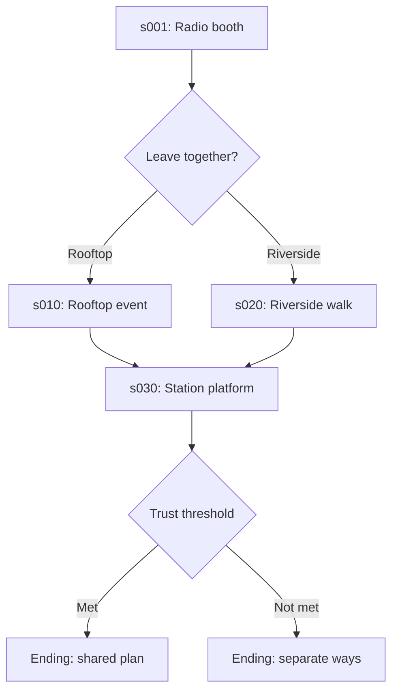

# Crossroads at Sundown fixture

This is synthetic test data for Project Loomlight. It contains no personal data,
downloaded media, or private game material. It is a test instrument for source
preservation, visual authoring, branching and state, screens, SDK validation and
LLM context. It is not a product demo or a writing sample.

Two fictional adult colleagues, Alex Rowan and Morgan Vale, finish a community-radio
shift and choose a rooftop event or a riverside walk. Both routes change trust and
time, then reconverge before one of two endings. The subject matter stays neutral so
fixtures are safe in logs and screenshots. A separate synthetic metadata case checks
that adult-content flags survive without application filtering, and contains no
graphic material.

- `game/` is the integrated representative project source.
- `micro/valid/` isolates syntax and byte-preservation cases.
- `micro/recovery/` contains intentionally incomplete editor buffers and is never
  supplied to Ren'Py as a runnable project.
- `encoded/` stores base64 representations of BOM/CRLF cases so Git normalization
  cannot alter the golden bytes.
- `manifest.json` records SHA-256, encoding, line endings, purpose, and expected SDK
  disposition for each source fixture.

The source spike proves byte preservation and minimal patching. The integrated `game/`
fixture also passes Ren'Py 8.5.3 compile, strict lint, automated test, normal-run,
development-warp, and PC-distribution gates on Linux. Parser-only and intentionally
invalid microfixtures remain outside the runnable project.
