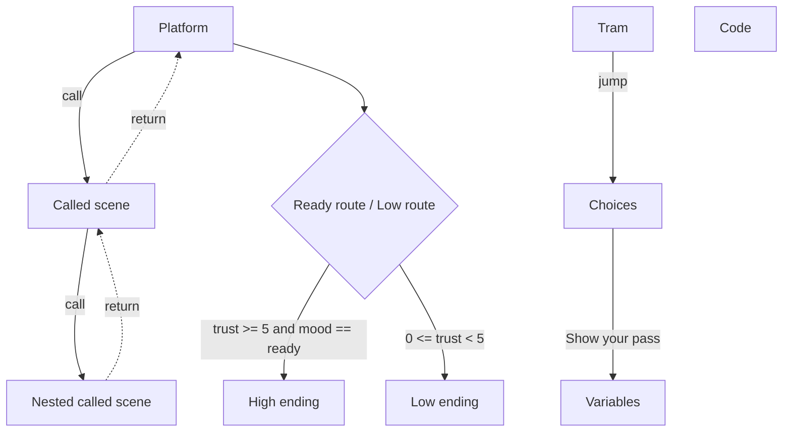

# Story example project

This is a small public Loomlight project for qualifying Story. It contains synthetic
content only. The art is the Design Lab "The Last Tram" art in
`app/design-lab/screens/story-revamp/art/`, and the audio is the two synthetic tones in
`tests/fixtures/phase-1h/assets/`. Neither is copied here.

Mara and Eli wait for the last tram, ride it, and choose where to sit. The Platform
scene holds the Phase 3A routes: two nested conditions, a nested Call and a guarded
Choice that leads to one of two endings.



## How it is built

`LifecycleService::prepare_story_example_probe` in
`app/src-core/src/lifecycle/story_example.rs` builds the project through the same IPC
handlers that the renderer uses. Nothing executes. It is the only builder:

1. It starts from the source-foundation fixture, which has the bool `flag`, the
   character Bec and a scene file with a BOM.
2. It creates the Variables `trust` (whole number), `precision` (whole number, beyond
   2^53), `mood` (text), `fare` (decimal) and `has_pass` (yes/no). It creates the
   characters Mara and Eli, the Panel `ticket_panel` and the Dialog `fare_dialog`.
3. It saves the standard GUI choice screen to `game/screens.rpy` and creates the
   scenes. It saves each scene's file from `scenes/`, where `${Scene name}` stands
   for that scene's label.
4. It makes the Story edits the SDK gate plays. It edits the nested dialogue, gives the
   outer If the test `flag == True` and adds the Calls from Platform to B and from B
   to C. It also adds `mood == "ready"` to the Ready route's test.
5. In Choices it sets "Pay the fare" to Show disabled, ends six options with Repeat
   this Choice, and sets Mark picked on the second Choice and Hide picked on the third.
6. It imports the art and audio, then saves Tram, which names them.

So the files in `scenes/` are the starting source, not the finished project.

## What it covers

| Scene | Content |
| --- | --- |
| Platform | A protected Python block and comments. An If on `flag` holding an If on `trust`, `mood` and `precision`, an Else if `trust == 4` (the boundary below `trust >= 5`) and an Otherwise. A nested Call. A Choice with two guarded options that each jump to an ending, and a line that plays when neither option shows |
| Called scene, Nested called scene | The second and third Calls of the chain, each returning to the next beat |
| Tram | Background, Play music, Show character, Dialogue, Narration, Change appearance, Move character, Sound effect, Show screen, Hide screen, Call screen, Transition, Hide character, Stop music, Set variable and a closing Jump |
| Choices | A Choice with a Character prompt, a nested Choice, an empty option, a hidden guarded option and options that continue, jump or return. A Mark picked Choice with a Show disabled option. A Hide picked Choice with a hidden guarded option. Both repeat through Repeat this Choice |
| Variables | Set variable for yes/no, text, whole number (a formula, `%=` and an exact 64-bit value) and decimal (`+=`, `//=`, `*=`). A two-route condition on a yes/no |
| Code | Custom Code lines and a Python block, a Custom Code option ending, a Choice with an unknown test, and conditions with an unsupported expression, a missing Variable and a mismatched Variable type |

Together the scenes hold every Add a beat kind, Repeat this Choice and Custom Code.

## Tests that use it

- `lifecycle::story_example::tests::story_example_has_every_beat_kind_choice_state_and_variable_type_and_reopens`
  (`npm run test:core`) checks the coverage above, the exact Platform and Called scene
  bytes after the Story edits, the Call continuations, and a lossless reopen.
- `app/tests/story-release.dispatch.mjs` (`npm run test:fixtures`) runs the assembled
  release journey through the production Story, Source and header controls against
  real core. The journey ends with an ordinary interrupted save and its recovery. A
  second case then uses the controls the journey leaves out: the stage picture,
  Audition, Add change here, + Next line, Select Choice, + New variable…, the scene
  tree's chapter and scene create, move and delete, and a Choice option's + New scene….
- `renpy::tests::phase3a::phase3a_conditions_calls_sdk_gate` plays the Platform routes
  in the pinned Ren'Py SDK, and its routine preflight
  `phase3a_sdk_fixture_source_save_preserves_bom` opens the same project.

To open a copy in Loomlight, build the core examples and run the Story driver with an
empty folder directly under the system temp folder, then send end of input:

```bash
cd app
cargo build -p loomlight-core --locked --examples
target/debug/examples/story-controller-driver --root "$TMPDIR/loomlight-phase3a-controller-example" \
  --seed-evidence "$TMPDIR/story-example-seed" --seed example --retain < /dev/null
```

The project is then in `$TMPDIR/loomlight-phase3a-controller-example/synthetic-project`.
